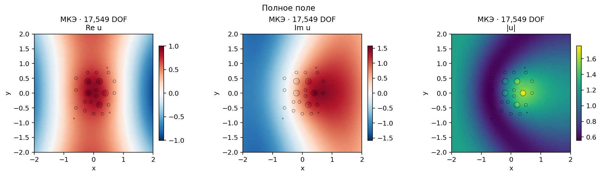

# Multiscale FEM Scattering

**GMsFEM и нейрооператоры для двумерного рассеяния волн в неоднородных средах.**

Исследовательский Python-репозиторий магистерской работы: от комплексного решения уравнения Гельмгольца методом конечных элементов до локальных многомасштабных базисов и обучаемых суррогатных моделей. Основной вопрос — как уменьшить размер и стоимость вычислений, сохранив пространственную структуру рассеянного поля и контролируя ошибку относительно FEM reference.

**English overview.** Research code for **2D heterogeneous Helmholtz wave scattering**, combining the finite element method (**FEM**), the generalized multiscale finite element method (**GMsFEM**), and spectral neural operator surrogates. Implementations include **POD/SVD-based SNO**, **Chebyshev spectral neural operators**, and **Fourier Neural Operators (FNO)**. Python, FEniCSx/DOLFINx, Gmsh, SciPy and PyTorch support complex-valued simulations, dataset generation, reduced-order modeling, training, inference and FEM L2 evaluation.

[Саммари](SUMMARY.md) · [Учебный маршрут GMsFEM](gmsfem/docs/learning_path.md) · [Методы](#что-можно-исследовать) · [Результаты](#сохранённые-результаты) · [Запуск](#быстрый-запуск) · [Документация](#карта-репозитория) · [Цитирование](#источники-и-цитирование)



*Пример полного поля $u^{\mathrm{tot}}=u^i+u^s$: $k=1$, материалы `notebook`, 17 549 FEM-степеней свободы. Источник: [сохранённый GMsFEM-эксперимент](gmsfem/results/notebook/report.md).*

## Что можно исследовать

Репозиторий объединяет два направления: **редукцию физического оператора через GMsFEM** и **обучение отображения параметров задачи в поле через neural operators**. Для парного сравнения в `neural_operator` используются одинаковые FEM-данные и интегральная метрика ошибки.

| Подход | Что реализовано | Откуда начать |
| --- | --- | --- |
| Комплексный FEM / МКЭ | Непрерывные P1-элементы, поэлементные материалы, контрастная слабая правая часть с учётом интерфейсов | [Постановка и дискретизация](gmsfem/docs/method.md) |
| GMsFEM | Эллиптические и Helmholtz snapshot-пространства Type 1/2, локальные спектральные задачи, глобальная Galerkin-проекция | [GMsFEM README](gmsfem/README.md), [notebook](gmsfem/GMsFEM_scattering.ipynb) |
| SVD-SNO | Train-only POD, full/randomized SVD, сеть над коэффициентами и восстановление комплексного поля | [Full SVD](neural_operator/sno/Full-SVD.ipynb), [randomized SVD](neural_operator/sno/Randomized-SVD.ipynb) |
| Chebyshev-SNO | DCT-I, усечение и нелинейное смешивание коэффициентов Чебышёва | [Модель и обучение](neural_operator/chebyshev/Train.ipynb) |
| FNO | Fourier-слои с нелинейностью на регулярной сетке и явным переносом FEM ↔ grid | [Модель и обучение](neural_operator/fno/Train.ipynb) |

Общие эксперименты позволяют изучать влияние числа локальных мод, ранга POD, частоты, размера сетки и алгоритма SVD. Ошибки сжатия, переноса между сетками и предсказания сети учитываются отдельно; построение базисов, обучение и inference имеют отдельные измерения времени.

SNO и FNO выдают **Re(u_scattering), Im(u_scattering), Abs(u_scattering)** через общий `predict_components`; модуль вычисляется из восстановленных Re и Im. [Методичка по SVD, архитектуре SNO и FNO](neural_operator/docs/svd_sno_guide.md) объясняет вычисления и запуск, [статья](paper/svd_sno_revision_2026-11-06/main.pdf) содержит математическое описание SVD-SNO.

## Физическая задача и метрика

Рассматривается квадрат $\Omega=[-2,2]^2$ с **24 проницаемыми круговыми включениями**. Включения заполнены материалом с другими коэффициентами. Используются положительные скалярные $\alpha(x),n(x)$ и изотропный тензор $A=\alpha I$; фон — $\alpha=n=1$.

Падающая плоская волна $u^i(x)=e^{ikd\cdot x}$, $|d|=1$, задаёт полное поле:

$$
\nabla\cdot(\alpha\nabla u^{\mathrm{tot}})+k^2n u^{\mathrm{tot}}=0,
\qquad u^{\mathrm{tot}}=u^i+u^s.
$$

Вычисляется рассеянное поле $u^s$ с поглощающим условием первого порядка $\partial_\nu u^s-iku^s=0$ на внешней границе. Это приближение открытой задачи на ограниченной области. Слабая форма, знаки и материальные интерфейсы разобраны в [методическом описании](gmsfem/docs/method.md).

Основная метрика нейрооператоров — **относительная комплексная P1 FEM L2 ошибка рассеянного поля**, вычисляемая через согласованную матрицу масс $M$:

$$
e_M=\frac{\sqrt{(\widehat u^s-u^s)^*M(\widehat u^s-u^s)}}{\sqrt{(u^s)^*Mu^s}}.
$$

В GMsFEM-отчётах дополнительно разделены ошибки полного и рассеянного полей, компонентов и модуля; знаменатель нормы указан в каждой таблице. [Протокол нейрооператоров](neural_operator/docs/methods.md).

## Сохранённые результаты

### GMsFEM: сокращение числа неизвестных

Для preset `notebook`, $k=1$, тонкая P1 FEM-система содержит **17 549 неизвестных**. Сохранённый эксперимент даёт:

| Редуцированная система | Неизвестных | Комплексная L2 ошибка полного поля относительно fine FEM |
| --- | ---: | ---: |
| GMsFEM 10×10, Type 2, 16 мод на вершину | 1 936 | 0.5092% |
| GMsFEM 20×20, Type 2, 16 мод на вершину | 7 056 | 0.1696% |

Это ошибки редукции на той же тонкой сетке. Отдельное сравнение с независимо построенной более мелкой FEM-сеткой приведено в [полном отчёте](gmsfem/results/notebook/report.md). Для другого набора материалов сохранён [эксперимент `paper_example1`](gmsfem/results/paper_example1/report.md).

### SVD-SNO: предсказание поля по частоте и направлению

В текущем static-эксперименте **геометрия и одна физическая среда фиксированы**, меняются $k$ и направление волны. Каждая полоса содержит 1000 частот × 8 направлений = **8000 FEM-полей**. Split по частотам: 670/170/160 групп, или 5360/1360/1280 полей train/validation/test. POD и нормировки строятся по train; ранг и checkpoint выбираются по validation.

| Randomized SVD-SNO | Mean test FEM L2 | p95 | Test-полей |
| --- | ---: | ---: | ---: |
| $k\in[1,2]$ | **0.96%** | 1.68% | 1 280 |
| $k\in[4,8]$ | **5.54%** | 9.04% | 1 280 |

Источники: [отчёт и ограничения](neural_operator/randomized/RESULTS.md), [машинный отчёт JSON](neural_operator/randomized/static_results.json), [спецификация среды](neural_operator/docs/static_medium.md).

Эти числа оценивают удержанные волновые параметры **той же среды**; перенос на новые материалы ими не проверен. Ошибка измерена относительно дискретных FEM-меток: для high band изменение reference при $h\to h/2$ составляет около **13–14%**. В таблице приведены результаты SVD-SNO; Chebyshev/FNO имеют отдельные реализации и сценарии обучения. Материалы и поля GMsFEM- и neural-экспериментов различаются, поэтому две таблицы выше описывают самостоятельные исследования.

**Статус ревизии 8 ноября 2026.** SNO переработан с явной версией архитектуры и совместимой загрузкой старых bundles. На одном static-low test-наборе из 1280 полей получены SNO v2 **0,9475%** и Chebyshev-SNO **7,9364%** после нового обучения; сохранённый FNO повторно проверен текущим кодом: **1,6599%**. Это одна среда и один seed, с разными размерами моделей и затратами. [Конфигурации, проверки и ограничения](neural_operator/docs/operator_revision.md), [саммари](SUMMARY.md). [Аудит датасетов](neural_operator/docs/dataset_audit.md) отделяет основной low-band от high-band с недостаточно проверенной точностью FEM. Два устаревших variable-medium набора удалены целиком с сохранением конфигураций и хешей.

**Что входит в Git.** GMsFEM-отчёты, численные архивы и рисунки; neural-отчёты Markdown/JSON и сохранённые outputs notebooks. Полноразмерные neural-датасеты и `model.pt` находятся в локальных `data/` и `runs/`, исключённых из Git. После клонирования их нужно сгенерировать и обучить по инструкциям ниже.

## Быстрый запуск

Нужны Git и Docker с Docker Compose. Все команды выполняются из корня репозитория; FEM workflow работает в одном MPI-процессе.

```bash
git clone https://github.com/Egoriy286/multiscale-fem-scattering.git
cd multiscale-fem-scattering
docker compose up -d --build dolfinx-complex
```

Контейнер содержит complex DOLFINx/PETSc, Gmsh и JupyterLab. Для нейрооператоров дополнительно установите зависимости:

```bash
docker compose exec -T dolfinx-complex python3 -m pip install -r neural_operator/requirements.txt
```

### Первый GMsFEM-расчёт

Небольшой профиль строит базисы Type 1/2 и сравнивает редукции с тонким FEM. Отдельное уточнение reference здесь пропущено, результаты пишутся в новый каталог:

```bash
docker compose exec -T dolfinx-complex python3 -m gmsfem.run --profile quick --no-reference --output gmsfem/results/quickstart
```

Результат: `report.md`, CSV с ошибками, JSON с конфигурацией, архивы полей и рисунки. [Полная серия и параметры](gmsfem/README.md#командная-строка).

### Первый neural-эксперимент

Пример **6 частот × 2 направления** проверяет путь «данные → обучение → сравнение». Две эпохи служат проверкой исполнения; для воспроизведения опубликованной точности нужен полноразмерный эксперимент из [neural_operator/README.md](neural_operator/README.md).

```bash
# Посмотреть план стандартного датасета без FEM-расчётов.
docker compose exec -T dolfinx-complex python3 -m neural_operator.run data --dry-run

# Создать отдельный малый набор: 12 полей, split 8/2/2.
docker compose exec -T dolfinx-complex python3 -m neural_operator.run data --n-frequencies 6 --n-directions 2 --h 0.3 --n-coarse 2 --dataset neural_operator/data/quickstart_6x2

# Обучить только SVD-SNO и сохранить bundle в quickstart_6x2/svd/model.pt.
docker compose exec -T dolfinx-complex python3 -m neural_operator.run train --dataset neural_operator/data/quickstart_6x2 --method svd --pod-method full --epochs 2 --output neural_operator/runs/quickstart_6x2

# Сравнить эту модель с FEM/GMsFEM на тех же held-out данных.
docker compose exec -T dolfinx-complex python3 -m neural_operator.run compare --dataset neural_operator/data/quickstart_6x2 --method svd --runs neural_operator/runs/quickstart_6x2 --output neural_operator/runs/quickstart_comparison_6x2
```

`data` генерирует или повторно использует совместимый набор; обучение запускается отдельной командой. `inspect --dataset PATH` показывает состав готового набора. Full и randomized — алгоритмы SVD с отдельными путями результатов. [Устройство данных](neural_operator/docs/datasets.md), [карта neural-кода](neural_operator/docs/structure.md).

### Jupyter и проверки

```bash
docker compose exec -T dolfinx-complex jupyter server list

docker compose exec -T dolfinx-complex python3 -m unittest discover -s gmsfem/tests -v
docker compose exec -T dolfinx-complex python3 -m pytest neural_operator/tests -q
```

Откройте ссылку Jupyter с токеном и выберите ядро **Python (DOLFINx Complex)**. Проверки включают независимую сборку матриц и RHS, нулевое рассеяние в однородной среде, спектральные преобразования, split без утечек и сохранение/загрузку inference bundle. [Подробности GMsFEM](gmsfem/README.md#проверки).

## Карта репозитория

| Путь | Назначение |
| --- | --- |
| [`gmsfem/`](gmsfem/README.md) | FEM, локальные snapshots, спектральные базисы, coarse solve и сохранённые исследования |
| [`neural_operator/`](neural_operator/README.md) | Общие данные, обучение, оценка и самостоятельный inference |
| [`sno/`](neural_operator/sno/), [`chebyshev/`](neural_operator/chebyshev/), [`fno/`](neural_operator/fno/) | Модели и training notebooks каждого neural-метода |
| [`datasets/`](neural_operator/datasets/), [`notebooks/`](neural_operator/notebooks/) | Генерация данных и общие исследования спектров, частот и сеток |
| [`templates/`](templates/README.md) | Шаблоны лабораторных 4 и 6: крупные блоки, подсетки и перекрывающиеся окрестности |
| [`FEniCSx_(dolfinx).ipynb`](FEniCSx_%28dolfinx%29.ipynb), [`FEniCSx_(dolfinx)_DG.ipynb`](FEniCSx_%28dolfinx%29_DG.ipynb) | Исходные CG/DG notebooks для контекста и истории постановки |
| [`references/`](references/) | Локальные материалы по методу |

`templates/laba4/lr4.py` и Legacy-вариант лабораторной 6 используют DOLFIN 2019 и требуют отдельного окружения; современные FEM/neural workflow используют DOLFINx.

## Для ChatGPT и исследовательских агентов

Научное и практическое саммари: **[SUMMARY.md](SUMMARY.md)**. Краткий индекс проекта: **[llms.txt](llms.txt)**. Метаданные программного обеспечения: **[CITATION.cff](CITATION.cff)**.

Для ответа о методе используйте [математическую постановку GMsFEM](gmsfem/docs/method.md) или [формулы нейрооператоров](neural_operator/docs/methods.md). Численные утверждения сверяйте с отчётом конкретного запуска: его материалами, полем, сеткой, split и нормой. Сохранённые результаты одной статичной среды следует описывать с этой областью применимости. Для восстановления эксперимента нужны конфигурация и версия кода; локальное наличие weights/datasets проверяется отдельно.

## Источники и цитирование

GMsFEM адаптирован к геометрии проекта по работе Kalachikova, Vasilyeva, Harris, Chung, *Generalized Multiscale Finite Element Method for scattering problem in heterogeneous media*, JCAM 424 (2023), 114977 — [DOI](https://doi.org/10.1016/j.cam.2022.114977). Методологические связи neural-реализаций: [Spectral Neural Operators](https://arxiv.org/abs/2205.10573) и [Fourier Neural Operator](https://arxiv.org/abs/2010.08895). [Аннотированный список первичных источников](neural_operator/docs/references.md) поясняет, какие части использованы.

Реализации являются локальными адаптациями; репозиторий не заявляет дословное воспроизведение таблиц GMsFEM-статьи или архитектуры PODNO. При использовании кода цитируйте программное обеспечение по [CITATION.cff](CITATION.cff), укажите commit и конфигурацию эксперимента, а методологические источники приведите отдельно.

**Автор:** Egoriy Monastyrev. **Лицензия кода:** [MIT](LICENSE).
