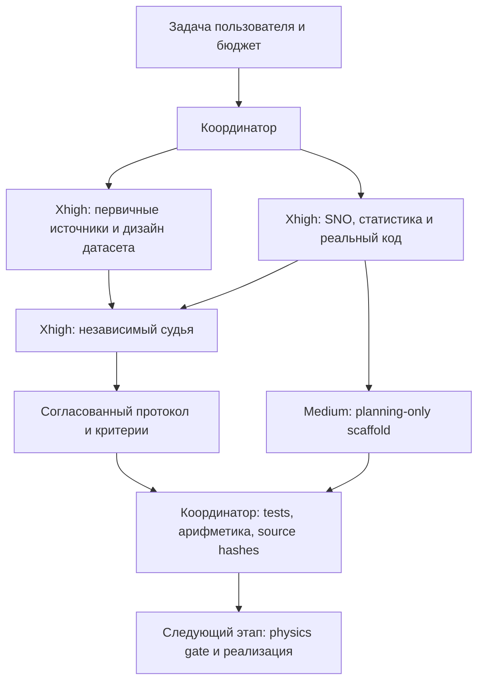

# Deep SNO на нескольких средах: согласованный план эксперимента

**Статус: спланировано; FEM-генерация и обучение нового опыта ещё не выполнены.**
План принят независимым агентом-судьёй после двух раздельных предложений.
Число сред и глубина сети пока не объявляются оптимальными по результатам:
таких результатов ещё нет. Подготовлены [машинный протокол](protocol.json),
[планировщик бюджета](plan.py) и [проверки метаданных](test_plan.py).

## Решение по исходной идее

Идея **25 сред × 100 частот × 4 направления = 10000 полей** полезна как
плотная выборка нескольких сред, но слаба как основной тест переноса на новые
материалы. Текущий split 67/17/16% оставил бы 16/4/5 независимых сред.
Центрированный train-POD материалов тогда имеет ранг не выше 15; множество
материалов на 24 фиксированных кругах допускает до 24 независимых индикаторов.
Повторение частот и направлений не повышает этот material rank.

Проверяемый вывод: сначала распределить бюджет между **разнообразием сред**
и **плотностью волновых запросов**, затем сравнивать глубину сети.
Просто заменить 3 блока на 12 недостаточно.

| Номинальный прямоугольный набор | Всего полей | Независимых test-сред при новом split 68/16/16% |
| --- | ---: | ---: |
| 25 × 100 × 4 | 10000 | 4 |
| 100 × 25 × 4 | 10000 | 16 |
| 125 × 20 × 4 | 10000 | 20 |
| 250 × 10 × 4 | 10000 | 40 |

В этой таблице у всех схем одинаковы 6800/1600/1600 train/val/test полей.
Это **арифметические кандидаты**, а не выполненные эксперименты. У них разные
плотности k и разные test-среды. Полное сравнение нескольких таких наборов
не помещается в общий лимит 10000 уникальных решений даже с переиспользованием.
Поэтому судья выбрал ограниченный общий scout и один последующий датасет.

## Схема агентов и судьи



Судья проверяет независимость test-сред, утечки, цену union нескольких arms,
точность FEM-меток, отделение глубины от числа параметров и возможность
исполнить протокол существующим кодом. [Запись решения](reviews/judge.md).

## 1. Что здесь означает «среда»

Первая фаза сохраняет центры/радиусы 24 допустимых кругов и общую FEM-сетку.
В каждой новой среде независимо задаются:

- число активных включений: 3–10;
- активная маска: случайное подмножество кругов;
- alpha каждого активного круга: log-uniform в [0.6,0.9];
- n: log-uniform в [1.5,3]; фон alpha=n=1.

Обучающую выборку стратифицируем по числу активных кругов и контрасту;
validation/test независимо выбираем из заранее объявленного распределения.
Счётчики материала, split и запросов имеют раздельные seeds. Сначала
фиксируются среды/splits, затем генерируются k и направления.

`medium_id` обозначает физическую пару DG0 alpha,n, а не отдельный запрос.
Все частоты и направления этой среды остаются в одном split. Хеши точных
DG0-полей ловят дубликаты с другими ID. Для утверждения именно о новых
активных масках нужен дополнительный group split по mask_id; простой
medium split этого не гарантирует. Число невстречавшихся масок показывается
отдельно. Подвижные центры/радиусы — следующая самостоятельная фаза с
remeshing, canonical representation и split по geometry lineage.

## 2. Единый бюджет, включая проверки

| Назначение | Полей / решений | Независимые среды |
| --- | ---: | ---: |
| Train, вместе со всем scout | 7200 | 90 в fallback; 280 в diversity-ветке |
| Validation | 800 | 20 |
| Test | 1600 | 40 |
| QA, включая refined/control/repeated solves | до 400 | отдельные calibration-среды |
| **Общий предел** | **до 10000** | |

Один solve здесь — одно комплексное поле на одной сетке для medium,k,theta.
Refined solve считается отдельно и обычно дороже coarse solve. Пять
инициализаций нейросети не требуют пяти FEM-датасетов. Неиспользованный QA
резерв не превращается автоматически в просмотренные test-поля.

**Fallback:** 90 train-сред × 20 k × 4 направления = 7200. Вместе с 20 val
и 40 test это 150 основных физических сред. Это конкретный стартовый план,
а не обещание, что именно 90×20 является универсальным оптимумом.

## 3. Сначала физическая проверка

Начальный кандидат h=0.1 не считается автоматически пригодным для всех новых
материалов. Отдельные calibration-среды покрывают число кругов, мелкие активные
включения, крайние контрасты и k=1/2. На тех же DG0-материалах сравниваются h,
h/2, а в выбранных случаях h/4. Проверяются нулевое рассеяние при alpha=n=1,
конечность, положительность, нормированная линейная невязка, квадратура,
геометрия, порядок узлов, CRC/SHA256.

Предварительная политика: желательно максимум выборочной FEM-разницы ≤0.5%,
жёсткий допуск ≤1%. Это инженерный критерий стабильности меток, не строгая
оценка ошибки непрерывной PDE. 200 QA-слотов отводятся на первый цикл,
200 — резерв. При провале меняется сетка/recipe, считаются все потраченные
решения; трудные test-примеры не отбрасываются. При исчерпании резерва
генерация останавливается для пересмотра бюджета.

Основной результат относится к конечной области с выбранным Robin-условием.
Утверждение о точности внешней задачи требует отдельного domain/absorber
исследования. QA-часть в dry-run ledger — **резерв слотов**, ещё не готовая
таблица физических запросов: исполняемый QA-ключ обязан включать mesh_id.

## 4. Scout: выбрать, чему отдать оставшиеся поля

Общие nested-пулы: train-media 20⊂40⊂80 и частоты F5⊂F10⊂F20.
Частоты лежат в [1,2]; планировщик задаёт детерминированный max-gap порядок
точек, без обещаний QMC-гарантий. Направления train — 0, pi/2, pi, 3pi/2.

| Arm | Среды × частоты × направления | Train-полей |
| --- | --- | ---: |
| A: плотные запросы | 20 × 20 × 4 | 1600 |
| B: компромисс | 40 × 10 × 4 | 1600 |
| C: разнообразие | 80 × 5 × 4 | 1600 |

**Их union = 3200, а не 4800:** первые 20 сред получают F20,
следующие 20 — F10, следующие 40 — F5. Каждое поле генерируется один раз.
Все arms используют одни и те же validation-среды и запросы; test закрыт.
Каждый arm строит свой POD только по собственным 1600 train-полям. Давать
ему POD от всего union означало бы передать внебюджетную информацию меток.

Для scout используются depth=3, width=64, три init seeds, одинаковый cap
выходного ранга 128. Фактический rank/floor каждого arm фиксируется; сравнение
трактуется как сравнение полных train-only pipelines. Вход — известные 24
контраста alpha и 24 контраста n с train-only scaling, чтобы малое число
сред не отрезало информацию входным POD. Learned-input-POD остаётся отдельным
диагностическим контролем, а не скрытой заменой представления.

Оставшиеся **4000 train-полей** имеют две заранее определённые судьбы:

- **Frequency completion:** заполнить все 90 сред до F20. Получится 90×20×4.
- **Diversity completion:** сохранить scout union и добавить 200 новых
  сред×5×4. Получится 280 сред с неравным числом запросов.

Выбор — только по validation. Score = macro-medium mean всех 40 запросов,
то есть 0.5 shared +0.3 frequency +0.2 angle cohort errors. Diversity требует
воспроизводимого улучшения не менее 10%, отсутствия ухудшения p95 более 5%
и paired medium-bootstrap CI, не пересекающего ноль, **относительно обоих
других arms A и B**. Для решения усредняются три init seeds внутри каждой
среды, затем bootstrap выполняется по средам. Эти числа — заранее
заданные practical policy thresholds. Неубедительный scout ведёт к fallback;
он не доказывает оптимальность fallback. Затем датасет замораживается.

## 5. Validation/test состоят из разных проверок

У каждой среды ровно 40 запросов:

| Cohort | Запросов на среду | Смысл |
| --- | ---: | --- |
| 5 общих k × 4 базовых угла | 20 | Новая среда, известные wave queries |
| 3 interlaced k × 4 базовых угла | 12 | Новая среда и интерполяция по k |
| 2 общих k × 4 shifted угла | 8 | Новая среда и новые направления |

Interlaced k validation/test зарезервированы раздельно и не добавляются в
train completion. Угловой сдвиг validation=pi/8, test=pi/4. Это **не** отдельное
доказательство углового переноса на уже обученных средах; такого дополнительного
benchmark в бюджете нет. Помимо общего score обязательно показываются три
cohort-метрики.

## 6. Как проверить именно пользу глубины

После выбора датасета один раз строятся mean/std и выходной POD, выбирается
ранг только по validation consistent-mass oracle floor и сохраняется общий
preprocessing bundle. Рассматриваются r=32/64/128/256; ориентиры floor:
mean≤1%, p95≤2%. Это целевые диагностические пороги, не будущие результаты.
Если floor не проходит, сначала меняется представление, а не глубина.

Основная ablation: **L=3/6/12, H=64**, одна архитектурная версия 2 и пять init
seeds. Дополнительные shallow/wide controls получают примерно столько же
параметров, сколько L12/H64, при том же выходном ранге. Формула:

$$P=8H+2+L(2H^2+H+R^2),\qquad R=\max(r_A,r_n,r_{out}).$$

`plan.py` подбирает целую ширину и явно сообщает, достигнут ли допуск 1%.
Уменьшать rank только глубокой сети для выравнивания параметров нельзя.
Fixed width, matched parameters и matched compute — разные сравнения.
Показываются val error против optimizer updates, фактического времени и
затрат; один и тот же лимит эпох не равен одинаковым FLOPs.

Начальный training budget: AdamW lr=0.002, weight decay=1e-5, clip=1,
batch64, максимум300 эпох, min100, patience60. Гиперпараметры выбираются только
по val. Model-init seed не меняет POD seed. Статистика — по независимым
средам: macro FEM L2, median/p95/max, paired bootstrap whole media и отдельный
seed spread. Основной заранее заданный test-контраст — L12/H64 против
L3 с matched-parameter шириной; прочие сравнения вторичны. Используются
5000 paired medium-bootstrap повторов и 95% CI; practical gain threshold — 5%.
CI выигрыша глубины, пересекающий ноль, даёт inconclusive. Эти пороги —
политика планируемого опыта, а не измеренные результаты.

## 7. Что требуется реализовать перед запуском

1. Hierarchical recipe medium×frequency×direction с query/cohort IDs.
2. Материалы один раз на medium, отдельные поля и batched gather.
3. Native 24-mask input encoder и material-contrast reconstruction check.
4. Exact consistent-mass oracle rank selection, persisted common preprocessing.
5. Val-only training без открытия test labels; отдельный final-test evaluator.
6. Medium-aware metrics/bootstrap и production physics gate.

Текущий variable generator выбирает **одно k на среду**. Простой параметр
`n_media=25` не создаёт 25×100×4. Текущий training path автоматически оценивает
test после каждого fit и связывает randomized-POD seed с model seed; его
нельзя напрямую использовать для этого HPO. Исходники не изменены этим планом.

Planning CLI проверен отдельно и **не** генерирует FEM-поля или weights:

```bash
python3 experiments/deep_sno_multimedia/plan.py --branch frequency
python3 experiments/deep_sno_multimedia/plan.py --branch diversity
python3 -m unittest discover -s experiments/deep_sno_multimedia -p test_plan.py -v
```

Для сохранения metadata задайте `--output PATH`. Это сценарии возможного
распределения, а не выполненные датасеты. SHA256 исходников фиксируется в ledger.
На mesh 3221/6280 coarse u занимает около495 MB; repeated materials добавили бы
около1.46 GB, compact tables — около23/52 MB в двух ветвях. Refined QA и
solver/optimizer/POD workspace учитываются отдельно. Один dense7200×3221
float64 POD-компонент занимает185.5 MB до копий; реальный peak надо измерить.

## Первичные источники и границы переноса

- [NSNO, Chen et al., §6.2](https://arxiv.org/html/2401.13494v1#S6.SS2):
  1000 train/100 test MNIST scatterers и четыре axial training waves.
  Поддерживает идею многих сред и четырёх направлений. PDE, source input,
  NS-UNO/Neumann architecture и solver отличаются от нашего POD-SNO;
  это не источник «оптимального» M/F или ожидаемой ошибки.
- [WaveBench: авторский Helmholtz loader](https://raw.githubusercontent.com/wavebench/wavebench/main/wavebench/dataloaders/helmholtz_loader.py):
  defaults49000/500/500, отдельные частотные наборы. Это пример явного
  разделения реализаций, а не требование такого размера для нашей задачи.
- [Spectral Neural Operators](https://arxiv.org/html/2205.10573v2): coefficient-space
  подход и фиксированные Fourier/Chebyshev ряды. Локальная POD-модель адаптирует
  эту идею; глубина12 и число сред из источника не следуют.
- [Owen: Sobol points](https://arxiv.org/abs/2008.08051): стандартные свойства
  digital nets нельзя безусловно переносить на произвольный усечённый размер.
  Здесь выбраны явная стратификация и nested1D grids, без QMC-обещаний.

Исследовательский и архитектурный разборы: [dataset](reviews/dataset.md),
[architecture](reviews/architecture.md); окончательный [вердикт судьи](reviews/judge.md).

## Проверка подготовленного плана

Пройдены **8 planning tests**: общий бюджет, distinct queries, отсутствие
пересечений medium IDs, reuse scout union, частотная вложенность, угловые
cohorts и согласие JSON-протокола с двумя сценариями. Число параметров
дополнительно проверено созданием реальных PyTorch-моделей без обучения;
[условные примеры размеров](parameter_examples.json) охватывают R64/R128.
Сохранённые [frequency](scenarios/frequency.json) и
[diversity](scenarios/diversity.json) ledgers являются сценариями, не результатами
генерации или новым научным сравнением.
