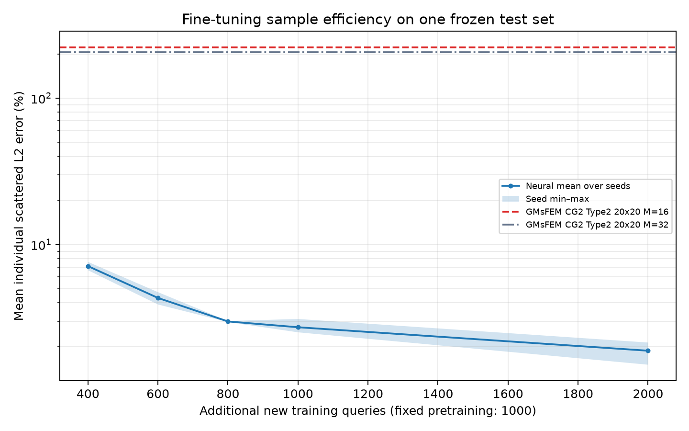

# Multiscale SVD-SNO и GMsFEM Type 2 при больших волновых числах


## Завершённые результаты

Полная серия завершена 16 ноября 2026 года: 15 из 15 нейросетевых запусков, 200 общих тестовых задач для каждого метода, checkpoint replay и независимый FEM-аудит прошли. [Полный отчёт с графиками](results/REPORT.md), [проверки](results/verification.json), [аудит меток](results/fem_label_audit.json).

| Метод | Дополнительный train | Средняя ошибка, % | SD средних по seed, п.п. | P95, % |
|---|---:|---:|---:|---:|
| Multiscale POD SVD-SNO | 400 | 7.124 | 0.467 | 29.257 |
| Multiscale POD SVD-SNO | 600 | 4.318 | 0.417 | 20.508 |
| Multiscale POD SVD-SNO | 800 | 2.983 | 0.025 | 14.045 |
| Multiscale POD SVD-SNO | 1000 | 2.724 | 0.328 | 12.103 |
| Multiscale POD SVD-SNO | 2000 | 1.884 | 0.330 | 6.282 |
| GMsFEM CG2 Type 2, M16 | — | 222.672 | — | 683.212 |
| GMsFEM CG2 Type 2, M32 | — | 205.714 | — | 703.995 |

Нейросетевые метрики агрегированы по 200 задачам и трём seed (600 оценок, а не 600 независимых физических задач). GMsFEM детерминирован и имеет 200 оценок. У всех SNO-вариантов фактический POD-ранг 192, то есть 384 вещественных коэффициента поля и 1 255 744 обучаемых параметра сети.

У модели с 2000 новыми примерами медиана ошибки 0.435%, но максимальная ошибка отдельного случая/seed — 57.44% при k≈6.5782. Поэтому среднее 1.884% не является гарантией малой ошибки на каждой частоте.

GMsFEM M16/M32 в этой конфигурации не показал сеточной устойчивости редуцированного решения: при k=20 изменение после уточнения fine-сетки составляет примерно 97.3% и 610.2% соответственно. Полное CG2-решение при том же уточнении меняется на 0.2755%. Это ограничивает вывод именно этими редуцированными пространствами; результат не является общим ранжированием семейства GMsFEM. Наблюдаемое расхождение полного CG2 с сохранённым CG3-эталоном по всем 200 тестам: среднее 0.225%, максимум 4.605%; проверки на пяти контрольных частотах не сертифицируют весь диапазон равномерно.




Отдельный эксперимент для фиксированной неоднородной среды из notebook-задачи рассеяния. Исследуется отображение `k → u_scat` при неизменных геометрии, материалах и направлении падающей волны `theta=0`. Это параметрическая аппроксимация по частоте, а не обучение оператора на случайных новых материалах.

Сравниваются только два семейства: мультимасштабный SVD/POD-SNO и настоящий GMsFEM Type 2. Старые результаты FNO в это сравнение не входят. Качество нового высокочастотного эксперимента определяется выполненными расчётами; успех SNO на старом диапазоне не считается доказательством его точности до `k=20`.

## Датасет и смысл числа примеров

Новый набор содержит **2400 отдельно решённых физических задач**: 2000 обучающих, 200 validation и 200 test. Один пример — одна частота и соответствующее комплексное рассеянное FEM-поле. Узлы сетки, вещественная и мнимая части и повторы обучения не увеличивают число примеров.

| Дополнительный новый train | Фиксированное предобучение | Всего уникальных обучающих запросов | Общие validation / test |
|---:|---:|---:|---:|
| 400 | 1000 | 1400 | 200 / 200 |
| 600 | 1000 | 1600 | 200 / 200 |
| 800 | 1000 | 1800 | 200 / 200 |
| 1000 | 1000 | 2000 | 200 / 200 |
| 2000 | 1000 | 3000 | 200 / 200 |

Train-наборы вложены: `400 ⊂ 600 ⊂ 800 ⊂ 1000 ⊂ 2000`; каждый префикс распределён по всему диапазону. Validation и test одинаковы для всех размеров и методов. Для каждого размера используются три нейросетевых запуска с seed 11, 29 и 47, всего 15 запусков.

Каждый запуск наследует соответствующий seed-checkpoint старого эксперимента, обученный на 1000 задачах диапазона 0.1–4 и выбранный по старой validation-выборке. Поэтому горизонтальная ось нового исследования означает **число дополнительных примеров для дообучения**. Она не означает обучение с нуля на 400–2000 наблюдениях. Все 2400 новых частот отличаются от всех 1200 исторических частот, включая исторические train, validation и test.

Рабочий диапазон — **0.05 ≤ k ≤ 20**. В точке `k=0` правая часть равна нулю, матрица жёсткости имеет постоянную нулевую моду и статическая задача не определяет единственное рассеянное поле. Для нулевого рассеянного поля относительная ошибка также не определена. Эта точка исключена из обучения и относительных метрик; аудит проверяет нулевую правую часть и постоянное ядро непосредственно. Test включает 0.05 и 20; эти два края немного выходят за диапазон новых обучающих частот. Остальные тестовые точки проверяют интерполяцию.

Точная раскладка и параметры находятся в `data/samples.npz` и `data/config.json`. Seed планирования — 2026111401; решения не используются для выбора частот. Файл `u_scat.npy` хранит complex128-поля через memory mapping, а bitmap фиксирует только полностью записанные строки. Возобновление не выдаёт недописанную строку за готовый пример.

## FEM-эталон, сгущение и геометрия

Внутри включений `alpha=0.2`, `n=10`. Локальное волновое число равно `sqrt(n/alpha) k ≈ 7.071 k`; при внешнем `k=20` локальная длина волны примерно 0.0444. Поэтому старая сетка для диапазона до 4 не переносится на новый диапазон автоматически.

Реально выполнены три сгущения P1-сетки:

| Сетка | Степень поля | Вершины | Треугольники | Комплексные DOF | Вещественные неизвестные |
|---|---:|---:|---:|---:|---:|
| Graded P1, уровень 0 | 1 | 33406 | 66410 | 33406 | 66812 |
| Graded P1, уровень 1 | 1 | 122137 | 243472 | 122137 | 244274 |
| Graded P1, уровень 2 | 1 | 472599 | 943596 | 472599 | 945198 |
| Выбранный native CG3 | 3 | 42082 | 83762 | **377530** | **755060** |

Сгущается вся внутренняя область включений, с плавным переходом к более крупным элементам снаружи. Дополнительно уточнено полигональное представление окружностей. Геометрическое отображение элементов остаётся аффинным; CG3 означает степень поля, а не кубическую криволинейную геометрию.

Сам по себе малый остаток линейной системы не проверяет дискретизационную ошибку. Историческое P1-сгущение **не прошло** критерий 2% на высоких частотах. Поэтому для новых меток выбран независимо проверенный native CG3-эталон.

На контрольных `k=4,8,12,16,20` получены отдельные максимальные различия:

| Проверка | Максимальное различие L2 |
|---|---:|
| CG2 → CG3 на одной уточнённой геометрии | 0.531% |
| Native CG3 → независимо сгущённый CG2 | 0.670% |
| Native CG3 → сохранённое P1-представление | 0.962% |

Каждая проверка имеет заранее заданный порог 2%. Это эмпирические проверки на пяти частотах, **не равномерная математическая оценка ошибки на всех 2400 частотах**. Погрешности разных проверок не складываются в доказанную общую границу.

Метки — значения native CG3-решения на общей наблюдательной P1-сетке с 122137 узлами. Эта сетка нужна для хранения, POD-декодера и общей метрики; она не объявляется тонкосеточным P1-решением PDE.

Каждая новая частота решается со своей матрицей и правой частью. Для соседних частот разрешено использовать предыдущую LU-факторизацию как предобусловливатель GMRES и предыдущее решение как начальное приближение. Это не интерполяция готовых меток. Проверяется остаток **исходного** уравнения `<1e-10`; при неуспехе выполняется новая прямая LU-факторизация. Прямые независимые сравнения на выбранной CG3-сетке дали различия коэффициентов не более `2.75e-12`. Параметр `gmres_info` сохраняется отдельно и не заменяет проверку физического уравнения.

Код, численные результаты и контрольные суммы: [selected_reference.json](results/highorder/selected_reference.json), [график проверок](results/reference_convergence.png), [таблица DOF](results/reference_dofs.csv). В финальном аудите дополнительно воспроизводятся прямой LU-факторизацией 12 заранее выбранных строк нового набора. Проверяются хеши всех меток и остатки всех 2400 исходных уравнений.

Причина отдельной проверки высокочастотной дискретизации обсуждается в работе [Babuška–Sauter, 1997](https://epubs.siam.org/doi/10.1137/S0036142994269186): уравнение Гельмгольца имеет дисперсионную погрешность FEM, которую нельзя оценить только числом точек на длину волны.

## Дообучение multiscale SVD/POD-SNO

Для **каждого N отдельно** только по его обучающим полям строятся среднее, комплексный POD-базис в согласованной FEM mass-норме и нормировки. Ни validation, ни test не участвуют в SVD, выборе ранга или нормировке.

Ранг выбирается по обучающим данным: минимальный из кандидатов `32,64,96,128,192,256,384,512`, достигающий RMS индивидуальных относительных ошибок проекции не более 1%. При недостаточном ранге 512 программа останавливается и не публикует неполный эксперимент как завершённый. Фактический ранг и остатки проекции сохраняются отдельно для каждого N.

Старый 20-модовый декодер переносится на новую сетку и проецируется в новый POD-базис. Его seed-модель действительно дообучается; проверяется ненулевое изменение старых весов. К ней добавляется независимая мультимасштабная residual-сеть полного нового ранга с нулевым начальным выходом.

Старый вклад сохраняется с весом 1 до `k=4`, плавно уменьшается на 4–5 и равен нулю при `k≥5`. Это фиксированное физическое ограничение области старого предобучения, выбранное до нового обучения. Поэтому высокочастотную часть предсказывает новая residual-сеть. Эксперимент называется дообучением с переносом низкочастотного prior и расширением декодера; он не является неограниченным продолжением старой сети на новые частоты.

Обе мультимасштабные компоненты имеют восемь независимых ветвей, четыре блока и ширину 8; начальные масштабы `[1,40,80,100,120,140,180,200]`. Обучаемые масштабы и веса ветвей сохраняются в checkpoint. Ёмкость меняется вместе с train-only POD-рангом; фактическое число параметров записывается в таблицы.

Обучение: максимум 1000 эпох, batch 100, Adam `lr=1e-3`, `weight_decay=1e-4`, cosine schedule по шагам оптимизатора до нуля, validation на эпохе 1, каждой пятой и последней. Остановка — после 40 проверок без улучшения. Выбирается checkpoint с минимальным validation-средним, а test оценивается после выбора. Train-кривые — ошибки полного train-набора текущего checkpoint, а не средние потери разных промежуточных minibatch-моделей.

Вычисления сети идут на native MPS в float32; физическая validation-метрика и итоговая оценка — CPU float64. Подготовка POD ограничена двумя CPU-потоками и выполняется блоками, без материализации всех полей в RAM. Отдельные синтетические измерения и CPU/MPS-проверки градиентов сохранены в `results/`.

Одинаковое число эпох при разных N означает разное число шагов и разный вычислительный бюджет. В отчёте есть графики по эпохам, шагам и реальному времени; увеличение N не описывается как сравнение при равных затратах.

## GMsFEM Type 2 и его степени свободы

Используется полное пространство граничных snapshots, включая вершинные и рёберные CG2-следы. Локальные задачи и функции χ строятся с оператором `K-k²M_n`; спектральная пара — `K` и `S_alpha`. Для каждой тестовой частоты пространство строится заново. Метки и обученные веса SNO не входят в построение GMsFEM.

Мелкая дискретизация GMsFEM тоже уточнена: используются элементы **CG2** на материально согласованных сгущённых сетках. Независимая UFL-сборка глобальных и локальных матриц проверена, в том числе на patch с интерфейсом материалов. Локальные Neumann-матрицы собираются только по элементам patch, не вырезаются как principal submatrix глобальной жёсткости. Исходная реализация P1 сохранена без изменений.

На coarse-сетке 20×20 редуцированная система имеет `(20+1)² M = 441 M` комплексных неизвестных:

| Локальных функций M | Комплексные DOF GMsFEM | Вещественные неизвестные |
|---:|---:|---:|
| 16 | 7056 | 14112 |
| 32 | 14112 | 28224 |
| 64, только остановленный ресурсный пилот | 28224 | 56448 |

Основная серия использует M=16/32 и **167925 комплексных DOF мелкой CG2-сетки** (335850 вещественных неизвестных). Пилот M64 остановлен по измеренным затратам до получения его ошибки и не входит в основную серию.

Основные M и мелкая сетка окончательно фиксируются **до обучения** в `protocol.json:gmsfem`, вместе с хешем сетки. Проверки уточнения находятся в `gms_refinement.json` и `gms_mesh_selection.json`. Приводятся и полные CG2 DOF, и редуцированные DOF. Большая ошибка редуцированного решения не удаляется из отчёта даже при малой линейной невязке.

Для POD-сети число комплексных степеней свободы поля равно фактическому POD-рангу R, то есть 2R вещественных коэффициентов. **Число обучаемых параметров сети — другая величина**, оно приводится отдельно. Число узлов общей наблюдательной сетки также не подменяет DOF редуцированной системы.

## Общая метрика и таблицы

Для каждой задачи используется одна и та же метрика на сохранённом P1-представлении:

`e_i = 100 sqrt(Re[(u_pred-u_ref)^* M (u_pred-u_ref)] / Re[u_ref^* M u_ref])`.

Здесь `M` — согласованная P1 FEM mass-матрица, `u_ref` — сохранённое представление native CG3-эталона. Сначала считается индивидуальная относительная ошибка, затем среднее по задачам. Это не MSE, не mass lumping и не отношение энергий объединённого датасета. Поле комплексное, с комплексным сопряжением. Native CG2- и GMsFEM-поля сначала оцениваются на тех же наблюдательных узлах.

Основная метрика отличается от прямой native CG2/CG3 quadrature-метрики проверок сгущения. Они подписаны отдельно. Различие полного CG2-решения с сохранённым эталоном — диагностическая характеристика fine-дискретизации, не гарантированная нижняя граница ошибки каждого GMsFEM-приближения.

Три seed — повторы инициализации на одной среде и одном split. Диапазон min–max и стандартное отклонение по seed не являются доверительным интервалом по случайным новым материалам. P95 и максимум относятся к реально проверенным частотам; они не сертифицируют узкие резонансы между тестовыми точками.

Итоговые артефакты:

- `results/REPORT.md` — таблицы ошибок, DOF и графики;
- `summary.csv`, `per_seed_summary.csv`, `bands.csv` — среднее, медиана, P95, максимум и частотные интервалы;
- `paired_errors.csv`, `per_k.csv` — исходные попарные ошибки и профиль по k;
- `sample_efficiency.csv` — зависимость от дополнительных 400/600/800/1000/2000 примеров;
- `dofs.csv`, `timings_dofs.csv`, `reference_dofs.csv` — степени свободы и затраты;
- `convergence_raw.csv` — фактически измеренные train/validation-кривые;
- `verification.json`, `fem_label_audit.json`, `report_manifest.json` — replay, физические проверки и контрольные суммы.

Затраты генерации FEM-меток, POD и нейросетевого обучения рассматриваются отдельно от предсказания. У GMsFEM frequency-dependent offline-работа повторяется для каждого нового k и считается один раз на частоту, а не повторно по каждому M и seed. Время CPU и MPS нельзя трактовать как чистое преимущество архитектуры без учёта оборудования.

## Воспроизведение

Используются существующий complex DOLFINx/PETSc Docker-контейнер и native `.venv` с PyTorch/MPS. Из корня репозитория:

```sh
make highk-reference    # реальные проверки сетки, порядка и reference solver
make highk-data         # все 2400 новых FEM-решений; поддерживается resume
make highk-gms-refinement # мелкая CG2-сетка GMsFEM и её уточнение
make highk-train        # 5 размеров × 3 seed; train-only POD для каждого N
make highk-baselines    # GMsFEM на зафиксированной мелкой сетке и общих test
make highk-verify       # checkpoint replay + независимый прямой FEM-аудит
make highk-report       # таблицы и графики только после успешных проверок
make highk-status
```

`make highk-study` последовательно выполняет весь цикл. Для native BLAS и PyTorch используются ограничения `VECLIB_MAXIMUM_THREADS=2 OPENBLAS_NUM_THREADS=2 OMP_NUM_THREADS=2`. Точные настройки, версии библиотек, исходники, предыдущие checkpoints, геометрия и метки связываются хешами. После замораживания изменение научных настроек требует явно нового эксперимента.

Завершённость определяется `results/execution.json` со статусом `passed` и успешными аудитами. Предварительный пилот прежнего линейного решателя остановили после 24 пробных расчётов. Поля пилота удалены, а его конфигурация и статистика решателя доступны в локальном каталоге `data_solver_pilot_v1/`.

Дополнительные импортируемые реализации зафиксированы в `results/additional_source_manifest.json` во время подготовки POD, до первого шага нового нейросетевого обучения. Этот манифест проверяется при автоматическом завершении вместе с неизменяемым `protocol.json`.
