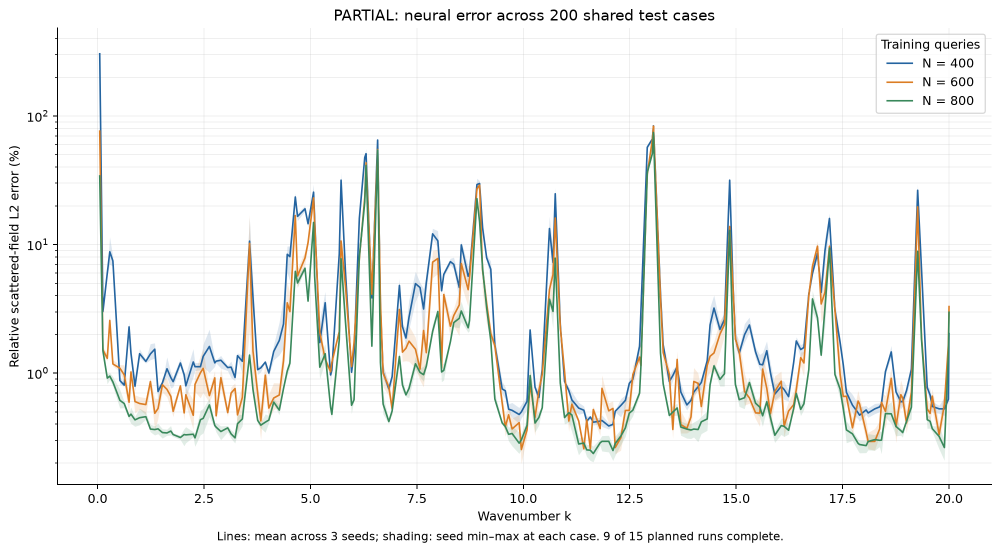
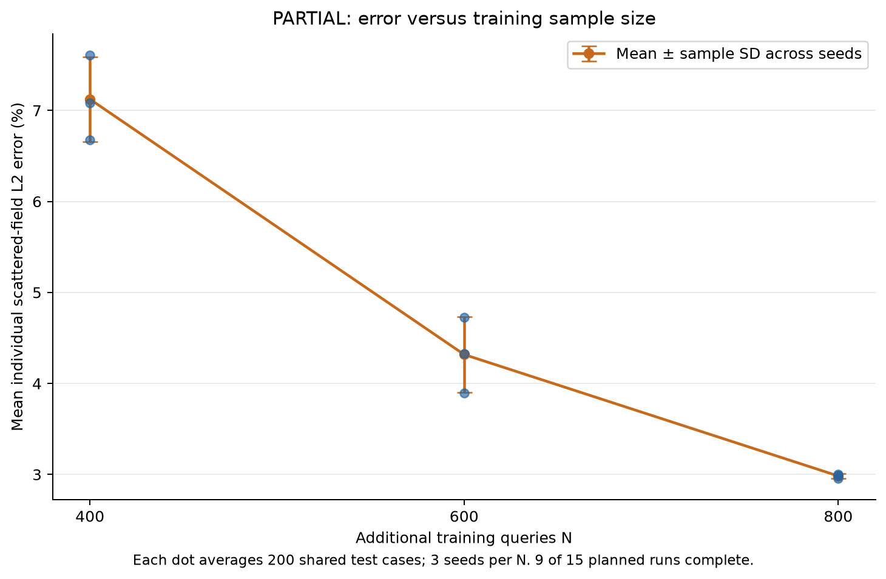

# PARTIAL report: completed neural runs

**Status: 9 of 15 planned neural runs complete.** N = 1000 and 2000 are unfinished. This is not the final study report; no GMsFEM aggregate is compared here.

The nine completed runs cover N = 400, 600, and 800, each with seeds 11, 29, and 47. All are evaluated on the same 200 test cases, with k from 0.05 to 20. Values below are the arithmetic mean of individual relative scattered-field L2 errors, in percent. The across-seed standard deviation uses the sample convention (ddof = 1).

| Training queries | Seed 11 | Seed 29 | Seed 47 | Mean ± sample SD |
|---:|---:|---:|---:|---:|
| 400 | 6.6789% | 7.6108% | 7.0817% | 7.1238% ± 0.4674 percentage points |
| 600 | 3.8961% | 4.3291% | 4.7295% | 4.3182% ± 0.4168 percentage points |
| 800 | 2.9913% | 3.0037% | 2.9553% | 2.9834% ± 0.0251 percentage points |

Lines show the mean over seeds for each case; shaded bands span the minimum to maximum seed error. The vertical axis is logarithmic.

Dots show the 200-case mean for each seed; bars show mean ± sample standard deviation across the three seed means.

Generated from saved `metrics.json` files by `partial_report.py`; test case identifiers, wavenumbers, and angles are checked for equality across all nine runs.
