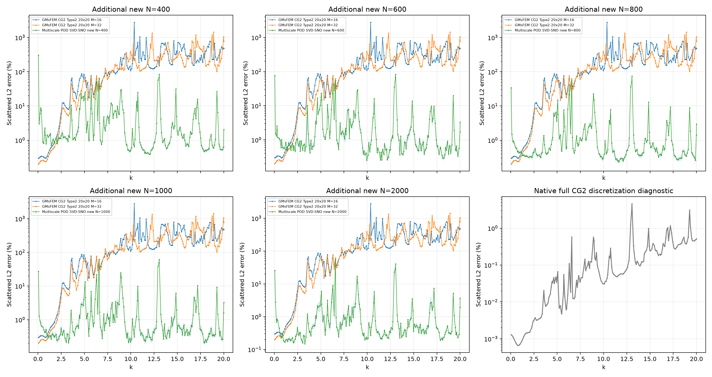
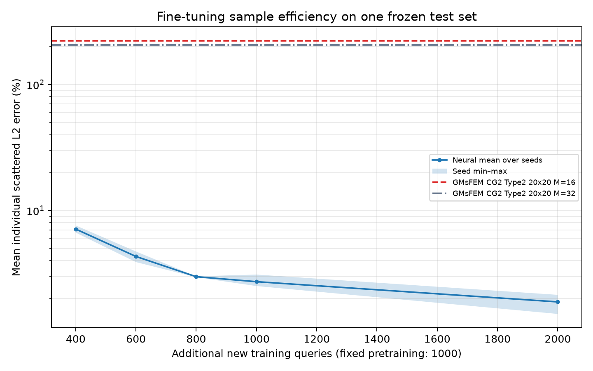
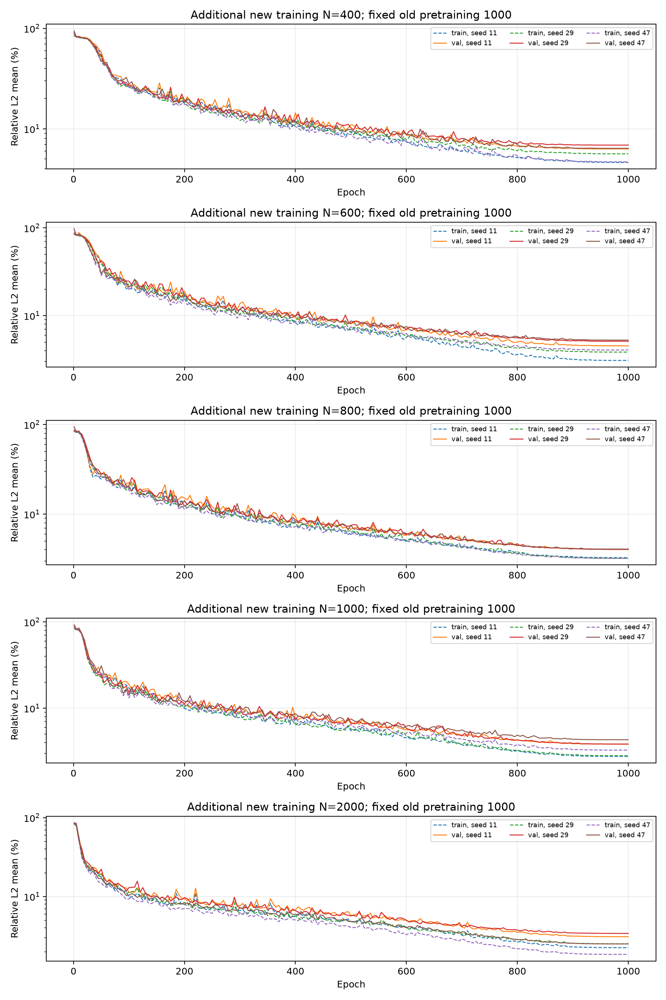
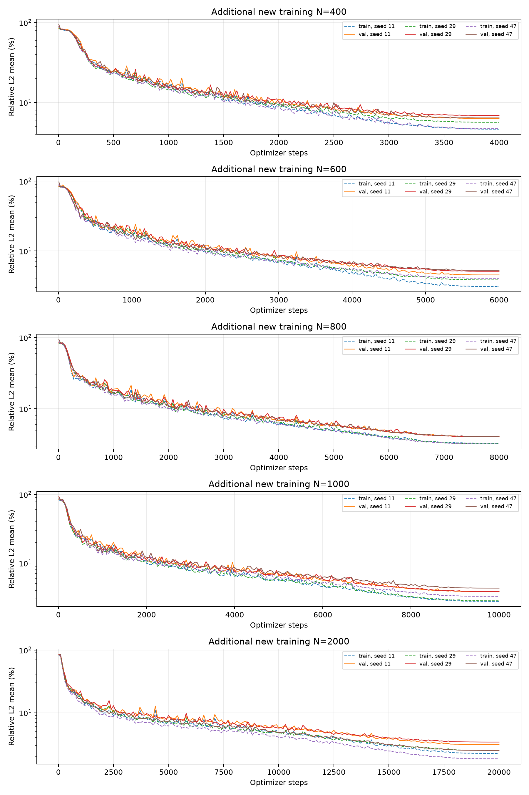
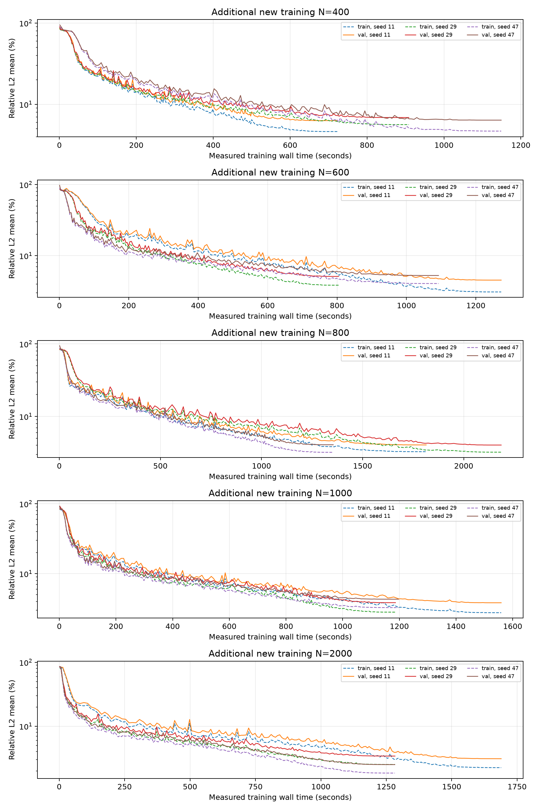
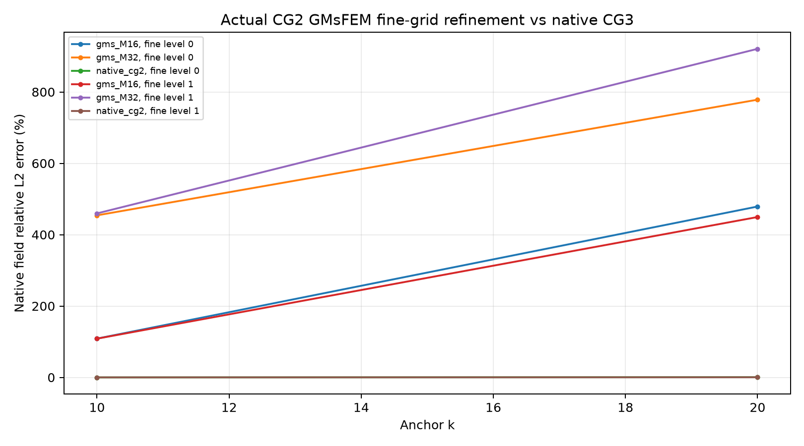
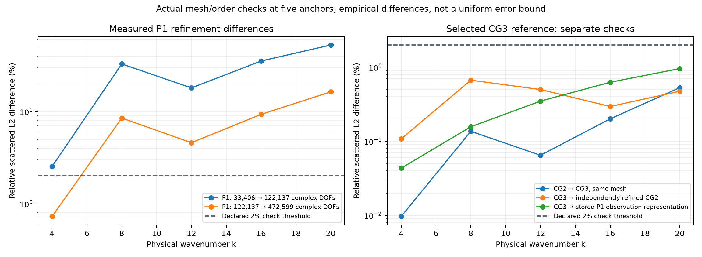

# High-k multiscale POD SVD-SNO / GMsFEM

Fresh split: 2000 train, 200 validation, 200 test; 3 neural seeds.
Errors below are percentages of the scattered complex consistent P1 FEM L2 norm, averaged over individual cases. Neural rows pool equally sized seed runs. The shaded curve spans seed minima and maxima at each exact test frequency.

The inherited model contribution is gated to exactly zero for k≥5; the full-new-rank residual learns that range. Lower-frequency inherited weights are jointly fine-tuned. Test endpoints 0.05 and 20 lie slightly outside the new training range; this includes small endpoint extrapolations.

Every neural model inherits a seed-matched checkpoint pretrained on 1000 old low-k training queries and selected using old validation data. N denotes additional disjoint high-k fine-tuning queries: total unique training queries are 1000+N. This measures fine-tuning sample efficiency. The inherited 20-mode SNO and full-new-rank residual SNO are jointly trained; capacity varies with the new training-only POD rank.

| Method | Mean % | Seed-mean SD % | Median % | P95 % | Max % |
|---|---:|---:|---:|---:|---:|
| GMsFEM CG2 Type2 20x20 M=16 | 222.67 | — | 141.62 | 683.21 | 2781.7 |
| GMsFEM CG2 Type2 20x20 M=32 | 205.71 | — | 133.65 | 703.99 | 1445.4 |
| Multiscale POD SVD-SNO new N=1000 | 2.7242 | 0.3278 | 0.5343 | 12.103 | 71.237 |
| Multiscale POD SVD-SNO new N=2000 | 1.8836 | 0.33015 | 0.43465 | 6.2818 | 57.443 |
| Multiscale POD SVD-SNO new N=400 | 7.1238 | 0.46737 | 1.3127 | 29.257 | 333.88 |
| Multiscale POD SVD-SNO new N=600 | 4.3182 | 0.41683 | 0.91921 | 20.508 | 91.995 |
| Multiscale POD SVD-SNO new N=800 | 2.9834 | 0.025137 | 0.53842 | 14.045 | 76.44 |

Selected reference audit: [reference convergence](reference_convergence.png) and [reference DOF table](reference_dofs.csv). The failed historical P1 study is shown separately from the selected CG3 checks.

Actual native CG2 GMsFEM fine-grid refinement and the native fine-solve discretization adequacy are recorded in `gms_refinement.json` and `gms_mesh_selection.json`. Reduction errors are retained even when large; fine-grid adequacy does not imply coarse-space accuracy.

GMsFEM uses full boundary snapshots and a fresh frequency-dependent Type2 space per test k. The declared M values are nested truncations of one maximum-M construction; timings include shared setup and must not be summed across repeated case rows.

Raw artifacts: `paired_errors.csv`, `per_k.csv`, `bands.csv`, `convergence_raw.csv`, and `timings_dofs.csv`. Mesh accuracy is documented independently by the mesh convergence experiment; report errors compare against the chosen discrete reference.

Native full CG2 diagnostic versus the stored reference: mean 0.22484%, P95 0.71484%, maximum 4.6046%. This quantifies the source fine discretization discrepancy; it is not a lower bound on every reduced-space error.

When high-order reference fields are sampled onto the P1 support mesh, all reported primary errors use those stored P1 fields. The independent native high-order refinement error and high-order-to-P1 representation error must be read separately in `reference_metadata.json` and the physics convergence artifacts. These errors are not interchangeable.

Historical P1 mesh convergence passed: False; maximum latest successive scattered difference 16.386%. Successive refinement is an empirical error indicator, not a rigorous continuum error bound; fixed first-order absorbing boundary remains part of the physical model.

Validation before and after fine-tuning (selection uses validation only):

| New N | Seed | Initial validation % | Best validation % | Selected epoch | Old weight L2 change |
|---:|---:|---:|---:|---:|---:|
| 400 | 11 | 80.519 | 6.3111 | 985 | 13.311784215301214 |
| 400 | 29 | 80.573 | 6.884 | 985 | 13.70451511588452 |
| 400 | 47 | 80.621 | 6.3974 | 985 | 13.311322756138676 |
| 600 | 11 | 80.503 | 4.5358 | 970 | 16.17578697743668 |
| 600 | 29 | 80.559 | 5.1145 | 980 | 16.575758635113772 |
| 600 | 47 | 80.601 | 5.2719 | 980 | 16.53297380373611 |
| 800 | 11 | 80.484 | 4.0533 | 975 | 19.645590795788813 |
| 800 | 29 | 80.527 | 4.0382 | 975 | 19.846560474594202 |
| 800 | 47 | 80.581 | 4.0752 | 1000 | 19.78522605008988 |
| 1000 | 11 | 80.487 | 3.8361 | 995 | 22.32290376828072 |
| 1000 | 29 | 80.52 | 3.848 | 995 | 22.78017931470001 |
| 1000 | 47 | 80.581 | 4.314 | 985 | 22.408282863640725 |
| 2000 | 11 | 80.466 | 3.098 | 985 | 35.14857753961628 |
| 2000 | 29 | 80.484 | 3.4096 | 990 | 34.983770426793455 |
| 2000 | 47 | 80.56 | 2.5056 | 970 | 34.989739330551885 |

Seed-mean SD uses the three seed-level test means with ddof=1. It describes training-seed variability, not a query-resampling confidence interval.

| Method / additional new N | Native truth complex DOFs | Support complex DOFs | GMs full complex DOFs | Reduced complex DOFs / POD rank | POD real unknowns | Network parameters |
|---|---:|---:|---:|---:|---:|---:|
| Neural new N=400 | 377530 | 122137 | — | 192 | 384 | 1255744 |
| Neural new N=600 | 377530 | 122137 | — | 192 | 384 | 1255744 |
| Neural new N=800 | 377530 | 122137 | — | 192 | 384 | 1255744 |
| Neural new N=1000 | 377530 | 122137 | — | 192 | 384 | 1255744 |
| Neural new N=2000 | 377530 | 122137 | — | 192 | 384 | 1255744 |
| GMsFEM CG2 Type2 20x20 M=16 | 377530 | 122137 | 167925 | 7056 | — | — |
| GMsFEM CG2 Type2 20x20 M=32 | 377530 | 122137 | 167925 | 14112 | — | — |

Complex DOF/rank counts and real coefficient unknown counts describe the discretized fields; network parameters are separate trainable quantities.

