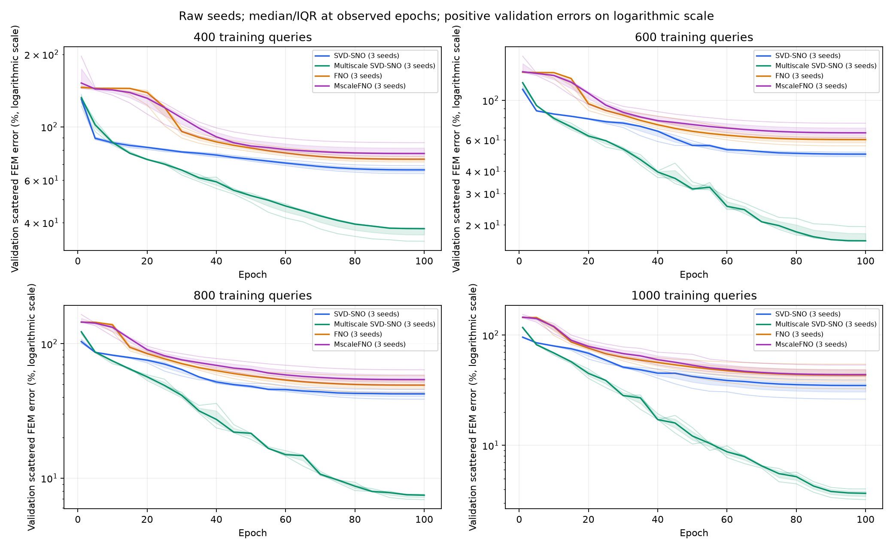
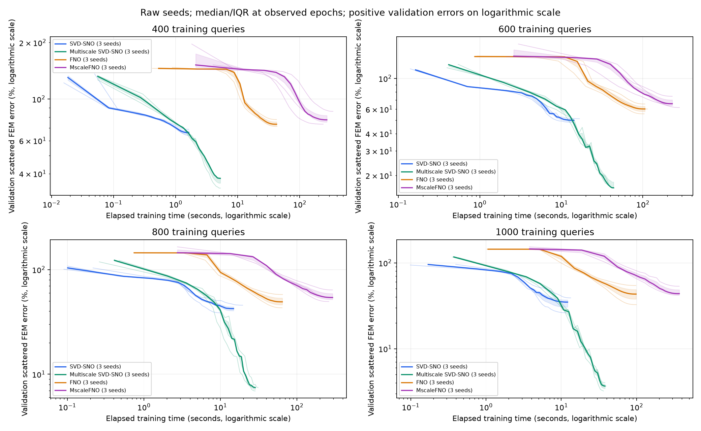
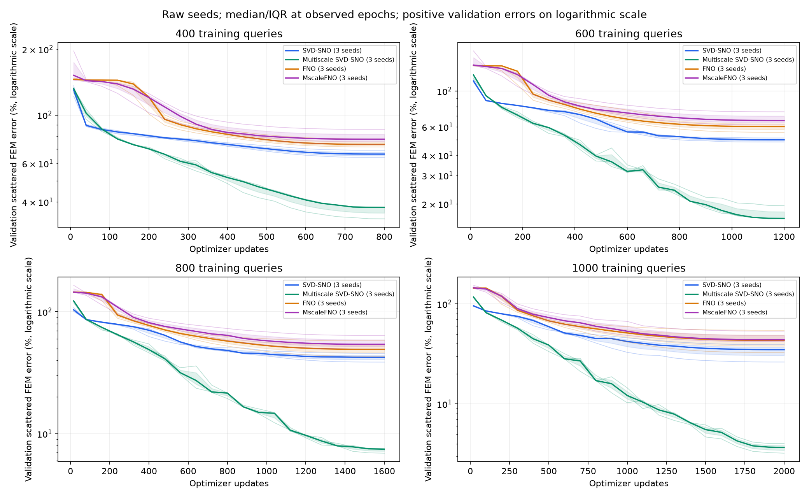
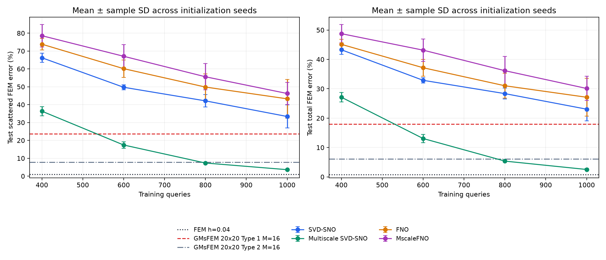
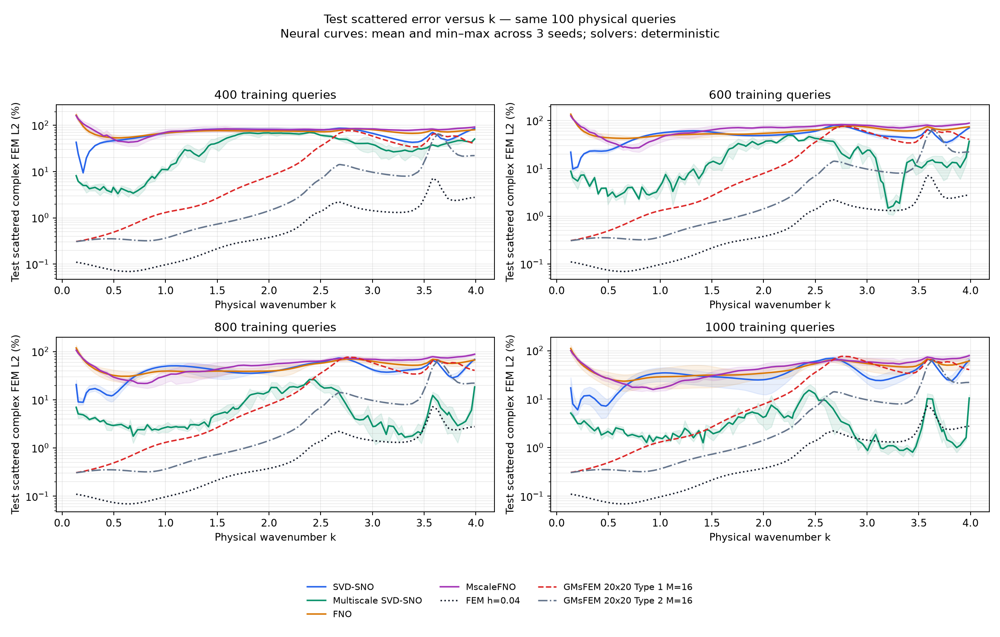
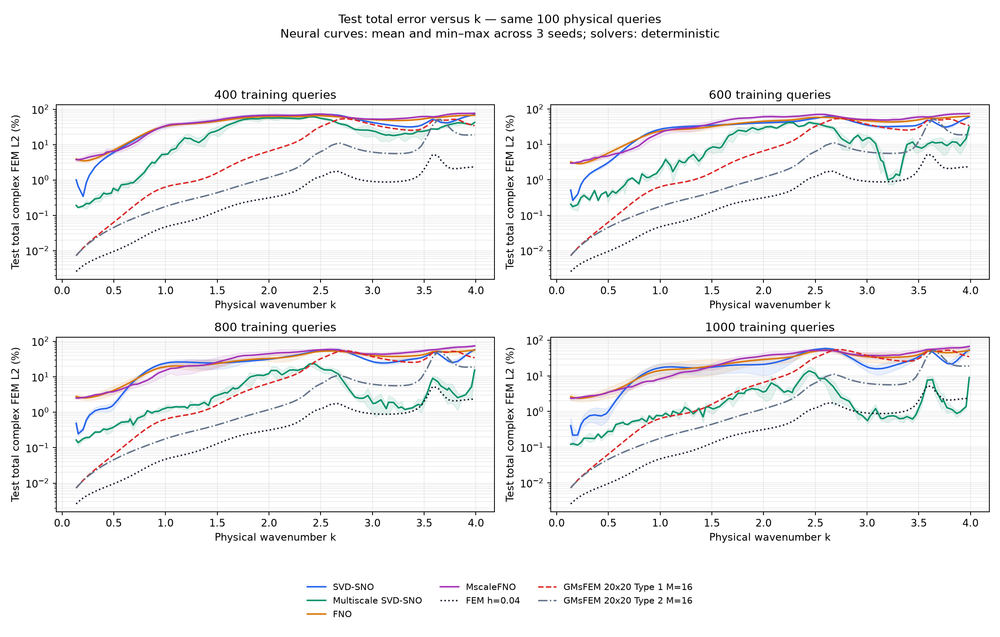
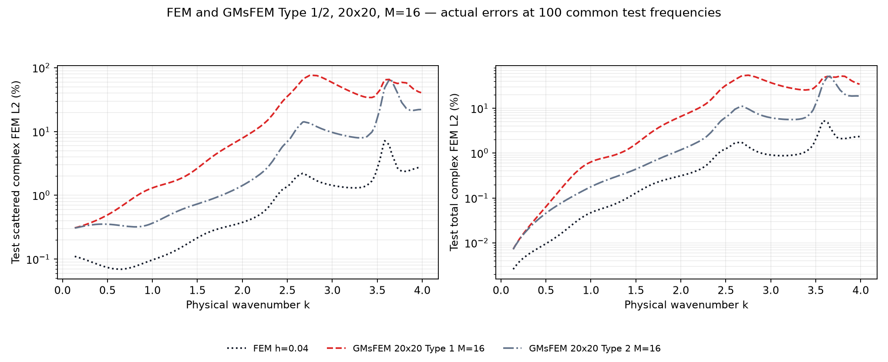

# Completed sample-size study

All 48 runs passed the supplied checkpoint replay verification and artifact hash checks.

Common consistent-mass complex FEM errors; validation-selected checkpoints. Seed SD measures initialization variability on one fixed dataset. Case p95 is averaged across seeds. No test tuning is permitted by the protocol.

| Train | Method             | Scattered mean ± seed SD (%) | Mean case p95 (%) | Total mean ± seed SD (%) | Trainable real weights | Mean training s |
| ----- | ------------------ | ---------------------------- | ----------------- | ------------------------ | ---------------------- | --------------- |
| 400   | SVD-SNO            | 66.223 ± 2.504               | 84.036            | 43.280 ± 1.551           | 22,488–22,488          | 1.6             |
| 400   | Multiscale SVD-SNO | 36.330 ± 2.527               | 70.652            | 27.118 ± 1.645           | 22,432–22,432          | 5.2             |
| 400   | FNO                | 73.820 ± 3.158               | 83.024            | 45.124 ± 1.709           | 37,634–37,634          | 42.4            |
| 400   | MscaleFNO          | 78.568 ± 6.286               | 90.860            | 48.758 ± 3.131           | 33,824–33,824          | 285.2           |
| 600   | SVD-SNO            | 49.717 ± 1.442               | 71.893            | 32.876 ± 0.880           | 22,488–22,488          | 15.0            |
| 600   | Multiscale SVD-SNO | 17.420 ± 1.848               | 42.620            | 13.061 ± 1.431           | 22,432–22,432          | 40.8            |
| 600   | FNO                | 60.130 ± 4.898               | 77.540            | 37.161 ± 2.886           | 37,634–37,634          | 107.9           |
| 600   | MscaleFNO          | 67.059 ± 6.473               | 84.245            | 43.151 ± 3.809           | 33,824–33,824          | 237.4           |
| 800   | SVD-SNO            | 42.117 ± 3.453               | 67.910            | 28.347 ± 1.851           | 22,488–22,488          | 14.9            |
| 800   | Multiscale SVD-SNO | 7.341 ± 0.360                | 20.867            | 5.366 ± 0.257            | 22,432–22,432          | 28.9            |
| 800   | FNO                | 49.844 ± 7.297               | 70.138            | 31.023 ± 4.206           | 37,634–37,634          | 64.7            |
| 800   | MscaleFNO          | 55.595 ± 7.370               | 79.488            | 36.155 ± 4.856           | 33,824–33,824          | 284.2           |
| 1000  | SVD-SNO            | 33.366 ± 6.468               | 64.889            | 23.050 ± 4.009           | 22,488–22,488          | 12.3            |
| 1000  | Multiscale SVD-SNO | 3.617 ± 0.433                | 10.643            | 2.515 ± 0.328            | 22,432–22,432          | 38.0            |
| 1000  | FNO                | 43.259 ± 10.849              | 65.711            | 27.111 ± 6.428           | 37,634–37,634          | 98.7            |
| 1000  | MscaleFNO          | 46.237 ± 6.125               | 72.705            | 30.102 ± 4.134           | 33,824–33,824          | 370.7           |

Resource-limited training used a 100-epoch cap, with validation every 5 epochs (and the recorded boundary evaluations). Reaching the cap does not establish convergence.

SVD-SNO runs use CPU; FFT-FNO runs use MPS. Wall-time comparisons across those families include different hardware/runtime paths and do not isolate architecture efficiency. Ordinary SVD-SNO uses GELU whereas multiscale SVD-SNO uses sine: this is a whole-method comparison, so differences cannot be attributed solely to scaling.

The trainable-weight count excludes the train-fitted POD mean/modes and fixed grid/FEM transfers. Both SNO variants share the same decoder for each training size. Representation fitting/projection timings are recorded in cache/n\*/{sno,fno}/cache.json; FEM generation timings are in data/dataset_info.json. These offline costs are outside the optimizer/validation training timer.

## Fresh deterministic common-test supplement

These fresh FEM/GMsFEM solves use the same 100 physical test queries and reference-normalized complex errors. They have no training-sample count or initialization-seed SD. The deterministic solver fields are evaluated directly at reference quadrature; neural predictions are P1 reconstructions on the reference mesh. This supplement was not used for neural tuning.

| Solver                   | Scattered mean (%) | Scattered p95 (%) | Total mean (%) | Total p95 (%) |
| ------------------------ | ------------------ | ----------------- | -------------- | ------------- |
| FEM h=0.04               | 1.055              | 2.813             | 0.807          | 2.363         |
| GMsFEM 20x20 Type 1 M=16 | 23.684             | 68.241            | 17.953         | 51.462        |
| GMsFEM 20x20 Type 2 M=16 | 7.804              | 36.351            | 6.088          | 29.227        |

[Baseline summary and runtime](gmsfem_summary.csv).

## Error profiles versus physical wavenumber

The k plots use all 100 common test queries, sorted by the actual physical wavenumber. Each neural point is the arithmetic mean of the three validation-selected models; shading is their observed min–max, not a confidence interval. FEM and GMsFEM curves use the same per-query reference-normalized complex errors, with Type 1/2 on the 20x20 grid and M=16. Resonant peaks and nonmonotonicity are preserved: each k defines a different scattering problem.

Horizontal solver lines in the training-size plot are the means over that same test set. They are independent of neural training-set size. Training/validation convergence plots retain their own validation metric; the solver curves and horizontal lines belong to the common-test comparisons.

[All per-frequency values and seed ranges](frequency_error_profiles.csv).

Convergence error axes show percentages on a logarithmic scale when all observed errors are positive; a panel containing zero uses a labeled linear scale. Raw seed curves and median/interquartile summaries use common actually evaluated epochs; shading is not a confidence interval. Time and update coordinates are medians at those same epochs. Threshold crossings are first observed validation evaluations, with no interpolation; blank crossings mean not reached.

See [protocol](../PROTOCOL.md), [article comparison](../ARTICLE_COMPARISON.md), [summary](summary.csv), [paired case differences](paired_errors.csv), and [observed threshold crossings](validation_thresholds.csv).

[Independent physical metric audit](physical_audit.json).

[All 1,200 FEM label residuals](fem_label_audit.json): maximum normalized discrete-system residual 4.275e-13. This checks the saved discrete PDE solutions, not their continuum discretization error.

[Representation diagnostics](representation_diagnostics.json). The optimal consistent-mass G-projection residual is a lower bound for predictions restricted to the fixed bilinear grid-to-FEM decoder: it minimizes the FEM error over that decoder’s entire output space. The separate P1 FEM-to-grid-to-FEM round-trip error measures one particular transfer and is not a strict lower bound. Neither diagnostic guarantees optimizer convergence.

