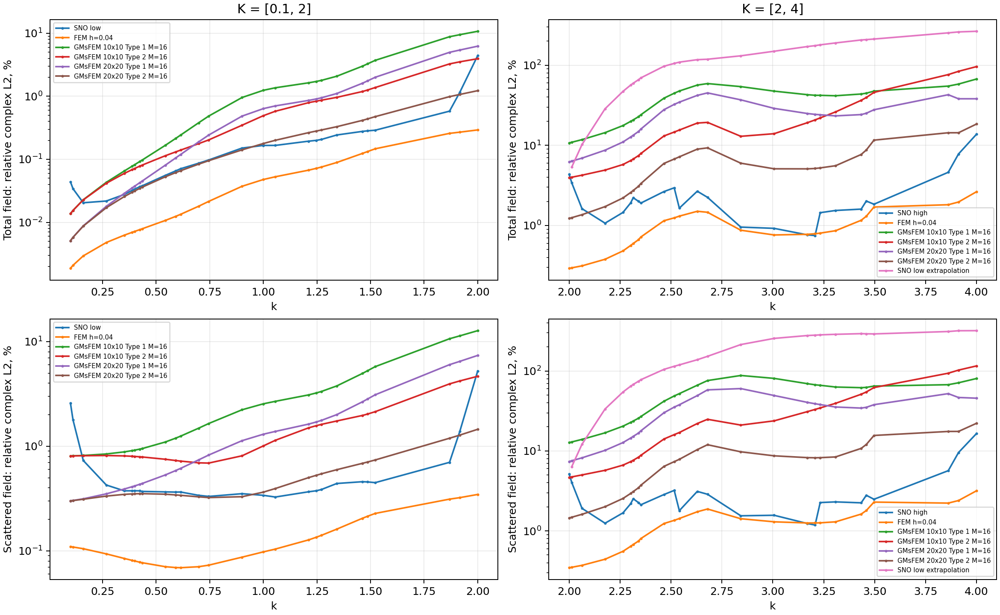
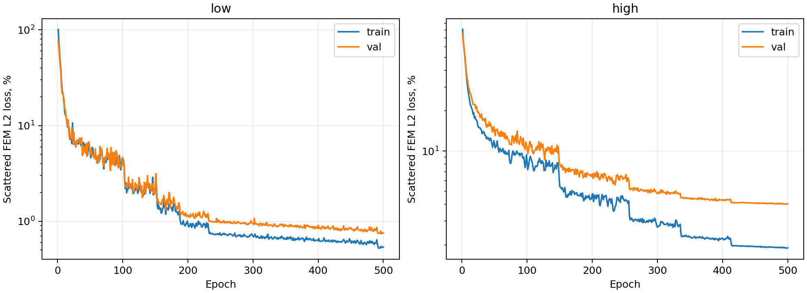

# Результаты SNO и GMsFEM на эталонной среде

Ошибки ниже — проценты, знаменатель — эталонное поле. Оба метода проверены на одинаковых удержанных частотах и направлениях; полное поле интегрируется с аналитической падающей волной.

| Диапазон / метод | Число полей | Полное: mean, % | Полное: p95, % | Рассеянное: mean, % | Рассеянное: p95, % |
|---|---:|---:|---:|---:|---:|
| low / SNO low | 216 | 0.3325 | 1.1946 | 0.7575 | 2.6427 |
| low / FEM h=0.04 | 216 | 0.0662 | 0.2747 | 0.1354 | 0.3301 |
| low / GMsFEM 10x10 Type 1 M=16 | 216 | 1.9166 | 9.7779 | 3.1939 | 11.6721 |
| low / GMsFEM 10x10 Type 2 M=16 | 216 | 0.7638 | 3.6293 | 1.4521 | 4.2627 |
| low / GMsFEM 20x20 Type 1 M=16 | 216 | 1.0583 | 5.5637 | 1.7069 | 6.6413 |
| low / GMsFEM 20x20 Type 2 M=16 | 216 | 0.2534 | 1.1011 | 0.5190 | 1.2992 |
| high / SNO high | 208 | 2.6968 | 7.7265 | 3.3180 | 9.6640 |
| high / FEM h=0.04 | 208 | 1.0162 | 2.3196 | 1.3026 | 2.7288 |
| high / GMsFEM 10x10 Type 1 M=16 | 208 | 37.9583 | 65.9923 | 50.1200 | 83.2340 |
| high / GMsFEM 10x10 Type 2 M=16 | 208 | 24.1016 | 87.5354 | 31.3696 | 105.8060 |
| high / GMsFEM 20x20 Type 1 M=16 | 208 | 24.5209 | 47.9610 | 32.1117 | 61.4139 |
| high / GMsFEM 20x20 Type 2 M=16 | 208 | 6.3494 | 16.2866 | 8.2112 | 20.4590 |
| high / SNO low extrapolation | 200 | 131.8231 | 262.7538 | 177.7174 | 320.9292 |

## Какая модель точнее в этом запуске

low: по средней комплексной ошибке полного поля точнее **GMsFEM 20x20 Type 2 M=16**. SNO: 0.3325%; лучший GMsFEM (GMsFEM 20x20 Type 2 M=16): 0.2534%. Это вывод для удержанных частот, одной среды и указанных настроек; времени обучения он не учитывает.

high: по средней комплексной ошибке полного поля точнее **SNO high**. SNO: 2.6968%; лучший GMsFEM (GMsFEM 20x20 Type 2 M=16): 6.3494%. Это вывод для удержанных частот, одной среды и указанных настроек; времени обучения он не учитывает.

Замороженная low-модель на **k>2**: средняя ошибка полного поля **131.8231%**, рассеянного — 177.7174%. Успех отдельно обученной high-модели нельзя трактовать как успешную экстраполяцию low-модели.

GMsFEM сохраняет исходную fine-сетку h=0.04, а SNO обучена на reference h=0.02. Строка `FEM h=0.04` показывает вклад этого различия. При фиксированных 16 модах в high-диапазоне возможны большие ошибки редукции даже при очень малой невязке Галеркина; малая невязка не доказывает близость к reference FEM.

## Точка исходной таблицы: k = 1, θ = 0

В последнем столбце — сохранённое сравнение GMsFEM с более мелким FEM-эталоном. Основная старая таблица относительно fine h=0.04 использует другой знаменатель-эталон; она отдельно воспроизведена в `table_reproduction/`.

| Метод | Re/ref, % | Im/ref, % | Модуль/ref, % | Complex/ref, % | Сохранённый complex/ref, % |
|---|---:|---:|---:|---:|---:|
| SNO low | 0.231084 | 0.124617 | 0.104992 | 0.154190 | — |
| FEM h=0.04 | 0.069336 | 0.038904 | 0.027217 | 0.047230 | 0.047230 |
| GMsFEM 10x10 Type 1 M=16 | 2.037446 | 0.898323 | 0.795701 | 1.238986 | 1.238986 |
| GMsFEM 10x10 Type 2 M=16 | 0.756322 | 0.413834 | 0.373366 | 0.508442 | 0.508442 |
| GMsFEM 20x20 Type 1 M=16 | 1.030350 | 0.472388 | 0.416174 | 0.636948 | 0.636948 |
| GMsFEM 20x20 Type 2 M=16 | 0.328530 | 0.101741 | 0.127943 | 0.177754 | 0.177754 |

low: SNO — 32072 параметров, POD-ранги {'A': 0, 'n': 0, 'real': 25, 'imag': 25}, эпох 500, лучшая 497, остановка epoch_limit; POD floor (test scattered mean) = 0.1120%. Validation-порог POD достигнут: True. Подготовка 109.4 с, обучение 245.4 с.

high: SNO — 47138 параметров, POD-ранги {'A': 0, 'n': 0, 'real': 56, 'imag': 56}, эпох 500, лучшая 498, остановка epoch_limit; POD floor (test scattered mean) = 0.0912%. Validation-порог POD достигнут: True. Подготовка 124.6 с, обучение 351.5 с.

## Вычислительная стоимость

| Диапазон / метод | POD либо offline, с | Обучение, с | Проекция матриц + LU, с | Online на поле, мс |
|---|---:|---:|---:|---:|
| low / SNO | 109.42 | 245.45 | — | 31.192 |
| low / FEM h=0.04 | 0.00 | — | 5.07 | 18.004 |
| low / GMsFEM 10x10 Type 1 M=16 | 1.82 | — | 27.03 | 27.133 |
| low / GMsFEM 10x10 Type 2 M=16 | 48.37 | — | 27.86 | 26.089 |
| low / GMsFEM 20x20 Type 1 M=16 | 2.17 | — | 209.57 | 52.887 |
| low / GMsFEM 20x20 Type 2 M=16 | 70.13 | — | 205.62 | 49.110 |
| high / SNO | 124.60 | 351.46 | — | 13.723 |
| high / FEM h=0.04 | 0.00 | — | 5.25 | 17.630 |
| high / GMsFEM 10x10 Type 1 M=16 | 2.52 | — | 27.88 | 27.721 |
| high / GMsFEM 10x10 Type 2 M=16 | 50.58 | — | 27.26 | 26.495 |
| high / GMsFEM 20x20 Type 1 M=16 | 2.52 | — | 209.21 | 51.634 |
| high / GMsFEM 20x20 Type 2 M=16 | 67.48 | — | 199.72 | 49.653 |

SNO online измерен по одному полю: кодирование входа, сеть и восстановление на reference-узлах. GMsFEM online включает проекцию RHS, решение, восстановление и межсеточный перенос как в reference-узлы, так и в точки квадратуры для последующей оценки; сборка физической RHS и интегрирование ошибок сюда не включены. Offline/LU учтены один раз при фактическом переиспользовании. Torch использует 2 потока, BLAS в FEM — 1; измерения выполнены при параллельной работе этапов. Времена не являются изолированным аппаратным benchmark и не задают равный бюджет. Стоимость SNO в таблице относится к окончательному запуску; предварительный validation-scout с постоянным шагом (остановлен до test) — дополнительный расход, описанный в `validation_decision.json`. Генерация FEM-меток для обучения учитывается отдельно в `dataset_dataset_info.json`; для GMsFEM обучающие метки не требуются.

`SNO low extrapolation` — замороженная модель из [0.1,2] на тестовых k>2. `SNO high` — отдельная модель, обученная внутри [2,4]. Это разные проверки.

Лимит окончательного обучения — 500 эпох. Этот опыт сравнивает конкретные сохранённые модели; минимально возможная ошибка SNO при другом бюджете или настройках здесь не установлена.

Подробные гиперпараметры: [MODEL.md](../MODEL.md). Проверка исходной таблицы k=1 сохранена в `table_reproduction/` в подпапках диапазонов. 16 мод GMsFEM задаются на каждую крупную вершину и не равны глобальному POD-рангу SNO.
