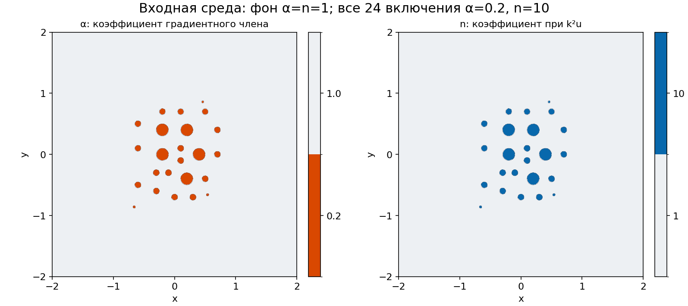
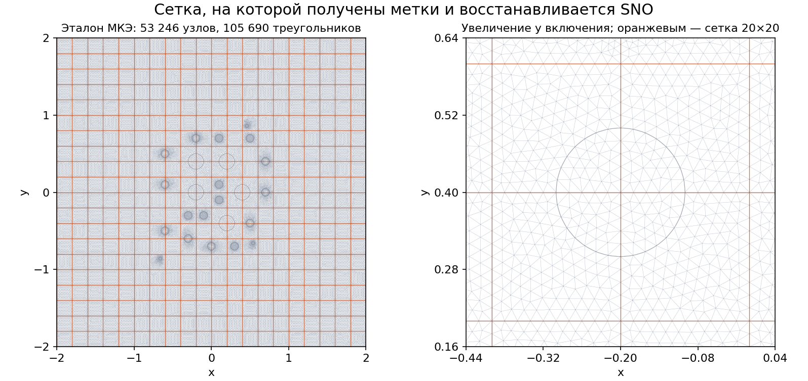
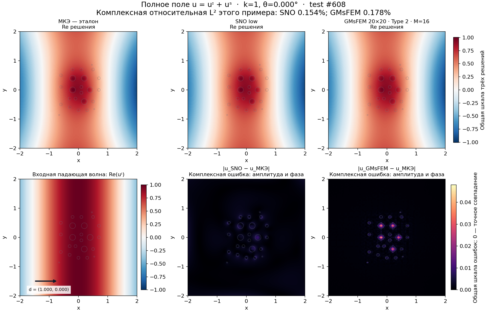
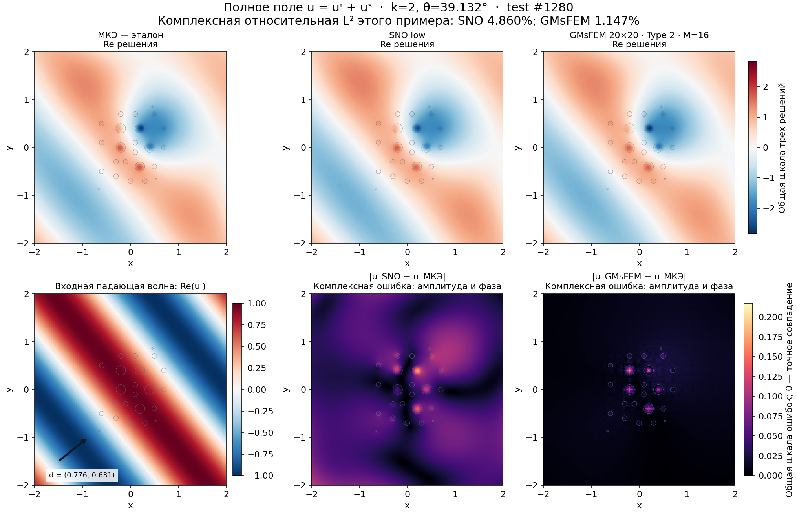
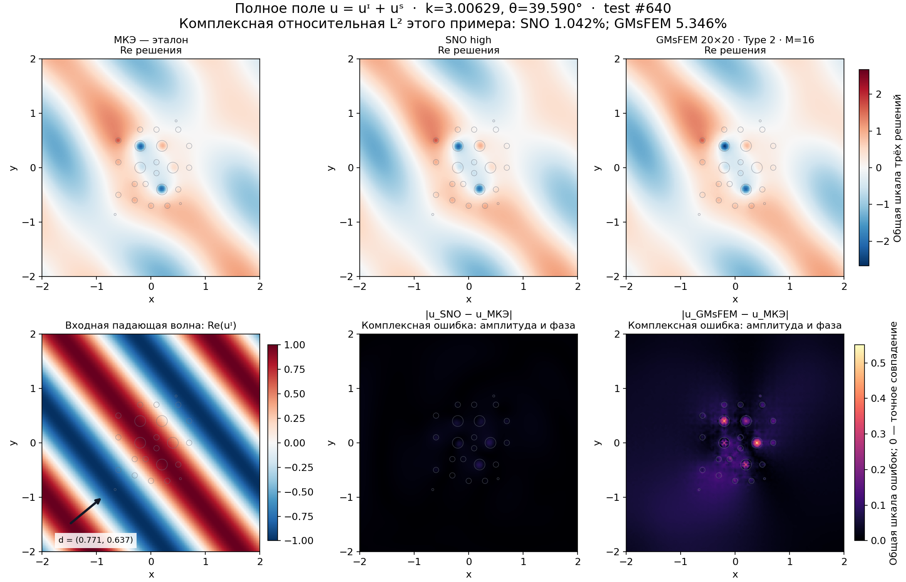
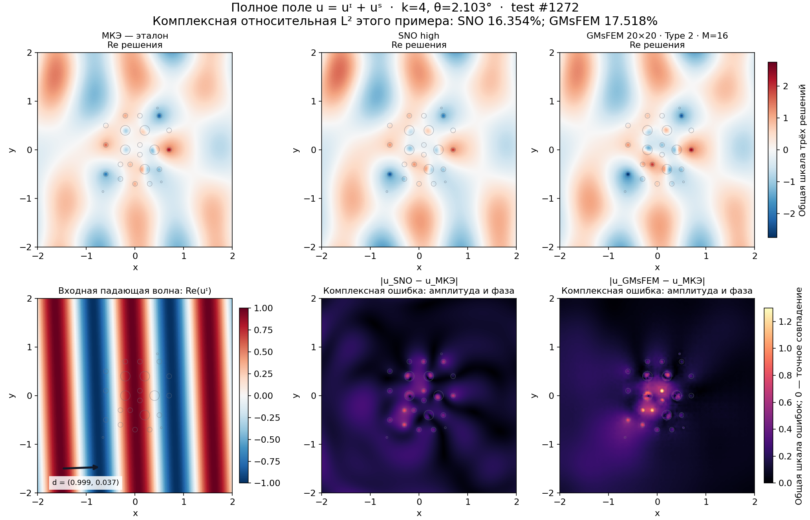

# Решения, разности и входные параметры

Откройте [наглядное сравнение с переключателями](index.html). Каждый рисунок — реальные решения сохранённого эксперимента, без нового обучения.



В фоне α=n=1, во всех 24 включениях α=0.2 и n=10. α — коэффициент градиентного члена, n — коэффициент при k²u. Точные DG0-коэффициенты показаны по ячейкам; узловое усреднение не используется.

Падающая волна uᶦ=exp(ik d·x), направление d=(cosθ,sinθ). Полное поле u=uᶦ+uˢ; рассеянное uˢ показывает отклик включений. Re и Im — две фазовые компоненты, |u| — амплитуда.

| Пример | k | θ, градусы | Индекс test |
|---|---:|---:|---:|
| low_k1 | 1 | 0.000000 | 608 |
| low_k2 | 2 | 39.132382 | 1280 |
| high_k3 | 3.00628931 | 39.589703 | 640 |
| high_k4 | 4 | 2.102990 | 1272 |

У примеров разные направления: это не серия изменения только k. k≈3 на рисунках означает фактическую test-частоту 3.0062893081761004.

На основных рисунках сверху стоят МКЭ, SNO и GMsFEM с общей цветовой шкалой. Снизу слева — входная падающая волна и стрелка её направления; снизу справа — две карты |u_модель−u_МКЭ| с общей шкалой. Чем ближе цвет ошибки к нулю, тем ближе поле к МКЭ. Ошибка включает амплитуду и фазу, поэтому она не равна разности модулей.

Отдельные карты знаковых разностей показывают Re(u_модель)−Re(u_МКЭ), Im(u_модель)−Im(u_МКЭ) и |u_модель|−|u_МКЭ|. Последняя строка характеризует амплитуду и не заменяет комплексную ошибку. Общая падающая волна сокращается в комплексной разности полного и рассеянного полей; их абсолютные комплексные ошибки одинаковы, но относительные L²-ошибки различаются.

Каждое комплексное P1-поле оценивается из своей исходной сетки на общей отображаемой сетке 401×401. Только после этого вычисляются модуль и разности. Проценты L² взяты из исходной FEM-квадратуры и проверены повторным расчётом; они не посчитаны по пикселям рисунка. Цветовые шкалы между разными k могут различаться — смотрите численные пределы colorbar.

GMsFEM: 20×20, Type 2, 16 мод на крупную вершину, исходная fine-сетка 17 549 DOF. SNO: замороженные low/high checkpoint на reference-сетке 53 246 DOF. Фактический вход нейросети в этой фиксированной среде — cosθ, sinθ и нормированное k; входные POD-ранги материалов равны нулю. В viewer показана нормировка отдельно для выбранной модели.



## low_k1: k=1, θ=0.000°



[Знаковые разности](low_k1_total_differences.png) · [Модуль решения](low_k1_total_abs.png) · [Рассеянное поле](low_k1_scattered_real.png)

## low_k2: k=2, θ=39.132°



[Знаковые разности](low_k2_total_differences.png) · [Модуль решения](low_k2_total_abs.png) · [Рассеянное поле](low_k2_scattered_real.png)

## high_k3: k=3.00629, θ=39.590°



[Знаковые разности](high_k3_total_differences.png) · [Модуль решения](high_k3_total_abs.png) · [Рассеянное поле](high_k3_scattered_real.png)

## high_k4: k=4, θ=2.103°



[Знаковые разности](high_k4_total_differences.png) · [Модуль решения](high_k4_total_abs.png) · [Рассеянное поле](high_k4_scattered_real.png)

## Воспроизведение

Из корня проекта, в исправленном complex-контейнере:

```bash
docker compose exec -T dolfinx-complex python3 -m experiments.reference_sno_gmsfem.visual_fields
docker compose exec -T dolfinx-complex python3 -m experiments.reference_sno_gmsfem.visualize_fields
```

`cases.json` содержит фактические параметры, проверку метрик и SHA256 входов. `fields.npz` хранит комплексные поля отображения, `inputs.npz` — исходные коэффициенты и сетку.
