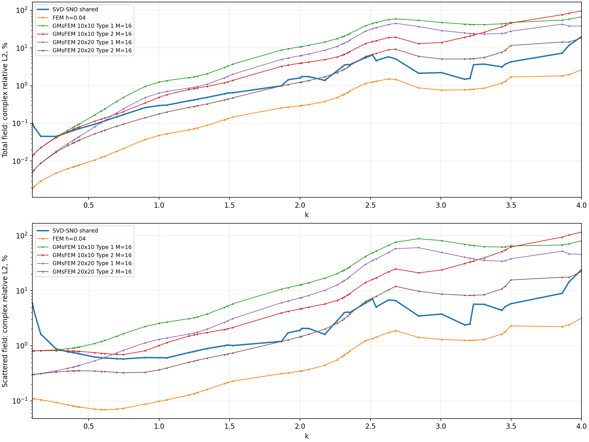
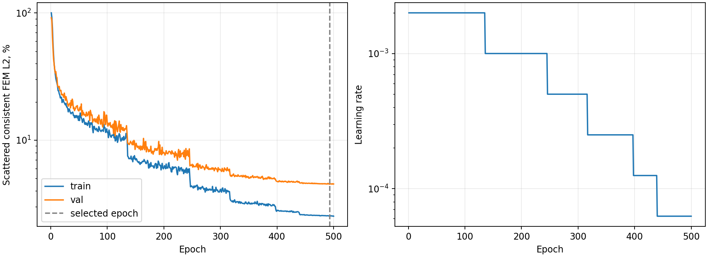
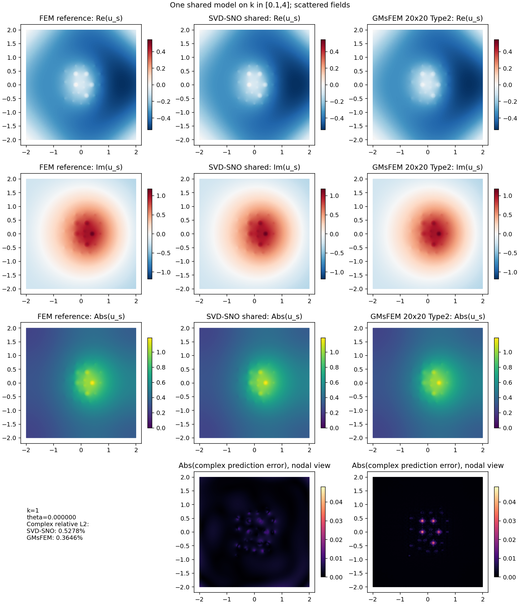
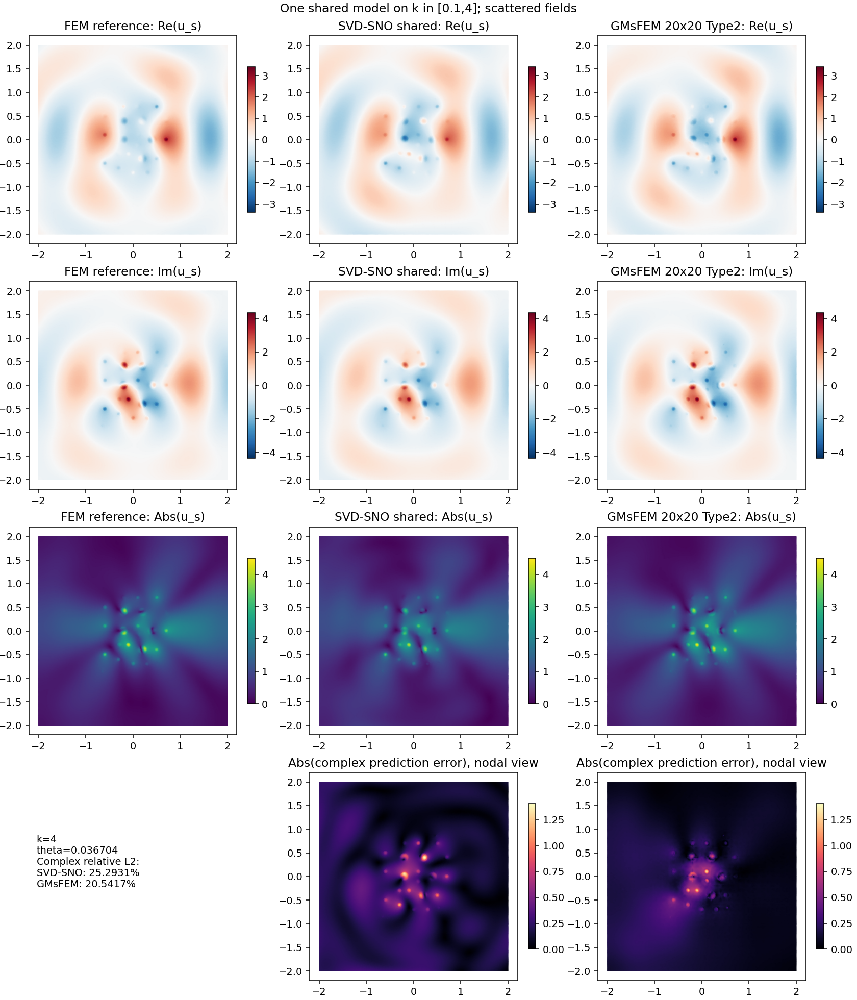

# Одна SVD-SNO на k ∈ [0.1,4.0] и сравнение с GMsFEM

**Обучение и независимая проверка выполнены.** Используется один checkpoint, одна нормировка k и общие train-only POD-базисы Re/Im. Частотного выбора модели или декодера нет.

На общем test из 424 полей средняя complex L2 ошибка полного поля SVD-SNO равна **2.3656%**, лучшего GMsFEM (GMsFEM 20x20 Type 2 M=16) — **3.2439%**. По этой метрике точнее **SVD-SNO shared** в данном запуске.

| Метод | Test-полей | Полное: mean, % | Полное: p95, % | Полное: max, % | Рассеянное: mean, % | Рассеянное: p95, % |
|---|---:|---:|---:|---:|---:|---:|
| SVD-SNO shared | 424 | 2.3656 | 7.3718 | 27.5856 | 3.3271 | 9.3734 |
| FEM h=0.04 | 424 | 0.5322 | 1.7701 | 4.0516 | 0.7080 | 2.2359 |
| GMsFEM 10x10 Type 1 M=16 | 424 | 19.5974 | 59.1481 | 78.8433 | 26.2142 | 80.3694 |
| GMsFEM 10x10 Type 2 M=16 | 424 | 12.2125 | 68.9519 | 118.7495 | 16.1286 | 87.1248 |
| GMsFEM 20x20 Type 1 M=16 | 424 | 12.5683 | 39.4973 | 72.5226 | 16.6225 | 52.1784 |
| GMsFEM 20x20 Type 2 M=16 | 424 | 3.2439 | 12.6624 | 30.8011 | 4.2925 | 15.6482 |

## Данные и физическая задача

Объединены существующие **2568 FEM-полей / 320 уникальных k**: train 1712/214 частот, validation 432/54, test 424/52. Все прежние splits сохранены. Группа k=2 содержит 16 различных направлений и целиком принадлежит test. Частоты образуют union прежних сеток, а не новый равномерный linspace. Никаких новых обучающих FEM-решений не потребовалось.

Среда фиксирована: Ω=[−2,2]², 24 включения, фон α=n=1, во включениях A=0.2I и n=10. Падающая волна exp(ik d·x), d=(cosθ,sinθ). Комплексный P1-оператор Kα−k²Mn−ikB; поглощающее условие первого порядка. Reference: h=0.02, 53 246 узлов, 105 690 треугольников. Проверяется интерполяция по k и θ одной среды, а не перенос на новые материалы.

## Архитектура и фактическое обучение

SVD-SNO v2: tokens [c_A,j,c_n,j,cosθ,sinθ,scaled k], lift 5→48, 6 блоков Z←Z+GELU(ZWlocal+b+BZWchannel), общая голова 48→2, обратная train-нормировка и два POD-декодера. Материал неизменен, поэтому r_A=r_n=0 и независимые входы фактически (k,θ).

Фактические POD-ранги: `{'A': 0, 'n': 0, 'real': 61, 'imag': 61}`; обучаемых параметров **50648**. Rank cap=96; ранг выбирался только на validation с порогом 0.1% среднего projection error; порог достигнут: **True**. Consistent decoder floor на test: mean **0.1435%**.

AdamW, lr=0.002, weight decay=1e-5, batch=32, seed=42, CPU threads=2; gradient clipping=1. ReduceLROnPlateau: factor=0.5, patience=20, min_lr=1e-5. Loss — относительная комплексная consistent FEM L2 рассеянного поля, точно вычисляемая в POD-координатах с учётом decoder floor.

Выполнено **500 эпох**, выбран checkpoint эпохи **493** по validation. Причина остановки: `epoch_limit`. Подготовка: 170.61 с; обучение: 634.51 с. Test не использовался для выбора ранга, эпохи или гиперпараметров. Один seed не определяет разброс между обучениями.

## Согласованность сравнения

GMsFEM: исходная fine-сетка h=0.04, 17 549 узлов; крупные сетки 10×10 и 20×20, Type 1/2, по 16 локальных мод на крупную вершину (1936/7056 coarse DOF). Тип 1 имеет эллиптические snapshots, Type 2 — частотно-зависимые Helmholtz snapshots. Поэтому в ошибку GMsFEM входят и редукция, и отличия его исходной fine-сетки.

Все 2120 baseline-строк перенесены из проверенных исходных запусков по точным (source, index, k, θ), с проверкой SHA256 полей, геометрии и настроек. Метрики не интерполировались. Дополнительно заново решены FEM h=0.04 и GMsFEM 20×20 Type 2 M=16 при k=0.1,1,2,4; совпадение с сохранёнными метриками проверено с допуском 1e-6. Все 424 предсказания SNO повторно получены после загрузки checkpoint и сверены.

Комплексные ошибки вычисляются в одних reference-квадратурных точках; для полного поля падающая волна задаётся аналитически. GMsFEM оценивается прямо из своего P1-пространства в этих точках. Промежуточные nodal fields используются только для рисунков. Ошибки в таблице — проценты относительно соответствующего reference-поля; полное и рассеянное поля имеют разные знаменатели.

Baseline timings относятся к двум историческим запускам; Type1 и setup при k=2 выполнялись в них раздельно. Здесь не заявляется измеренное ускорение единого GMsFEM workflow относительно SNO. FEM-reference имеет собственную ошибку дискретизации и аппроксимации внешней границы.

## Ошибки по подынтервалам одной модели

Эти интервалы используются только для анализа; веса и POD-декодеры общие.

| Интервал k | Метод | Полей | Полное mean, % | Рассеянное mean, % |
|---|---|---:|---:|---:|
| [0.1,1] | SVD-SNO shared | 128 | 0.1125 | 1.2901 |
| [0.1,1] | GMsFEM 20x20 Type 2 M=16 | 128 | 0.0545 | 0.3364 |
| (1,2] | SVD-SNO shared | 96 | 0.7970 | 1.1352 |
| (1,2] | GMsFEM 20x20 Type 2 M=16 | 96 | 0.5998 | 0.8403 |
| (2,3] | SVD-SNO shared | 112 | 3.6470 | 4.2326 |
| (2,3] | GMsFEM 20x20 Type 2 M=16 | 112 | 4.4610 | 5.3276 |
| (3,4] | SVD-SNO shared | 88 | 5.7229 | 7.5287 |
| (3,4] | GMsFEM 20x20 Type 2 M=16 | 88 | 9.2187 | 12.4955 |

[Полные per-query данные](comparison.csv) · [JSON](comparison.json) · [Протокол](protocol.json) · [Проверка](validation.json) · [Независимый reload/FEM-контроль](verification.json)

[Галерея графиков на русском и SVG для экспорта](visuals/README.md)
