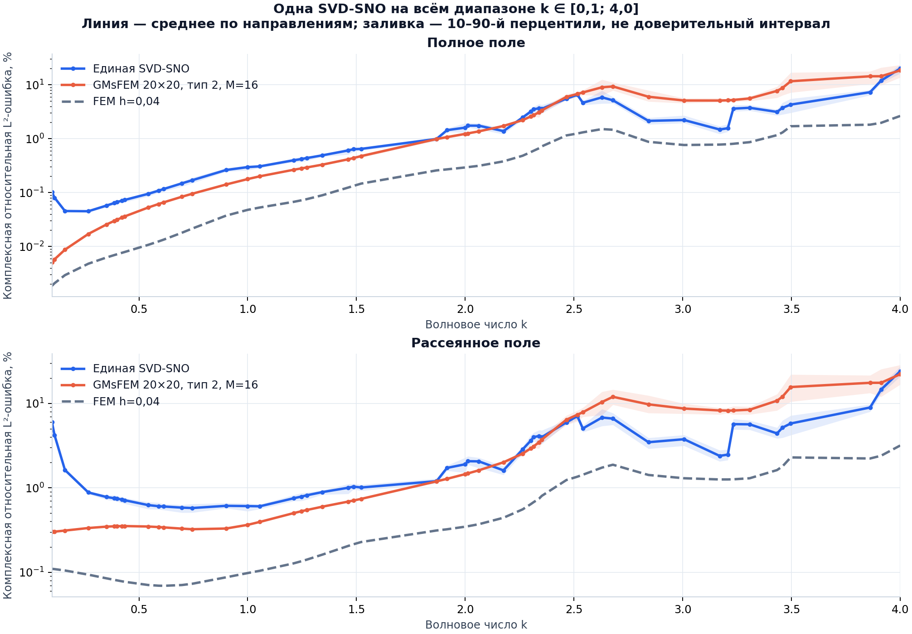
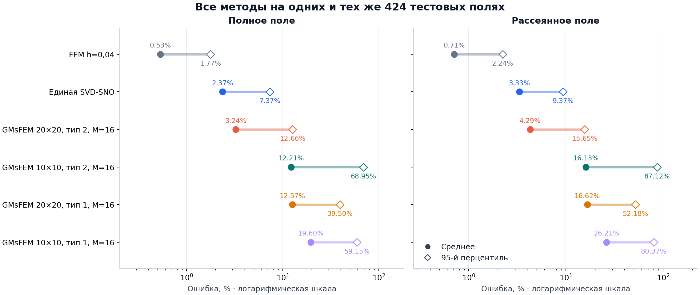
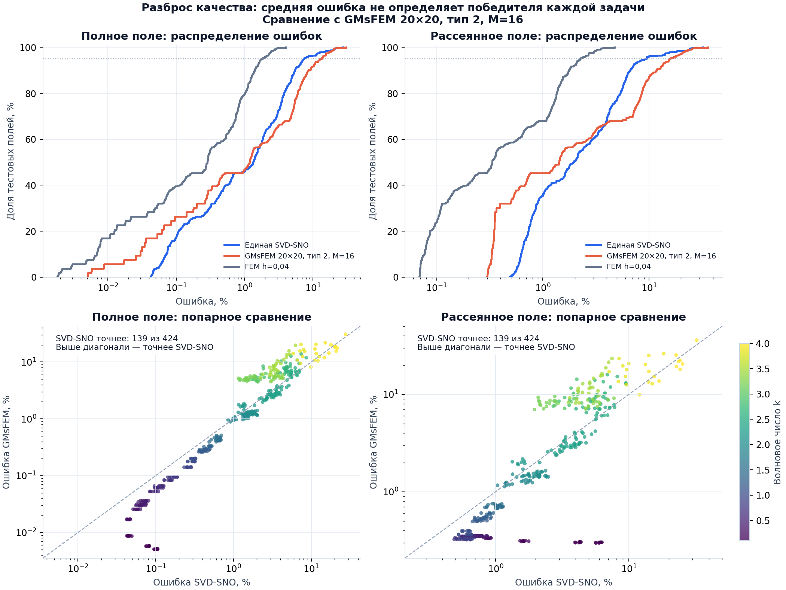
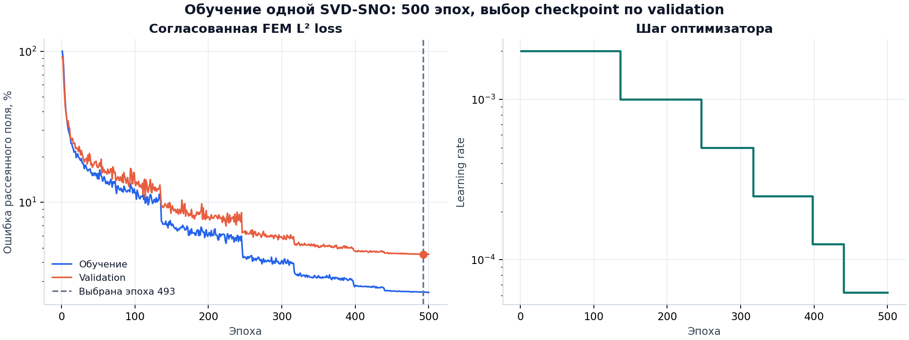
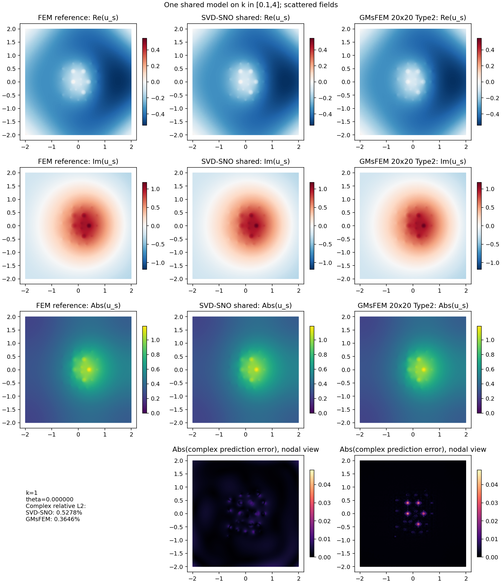
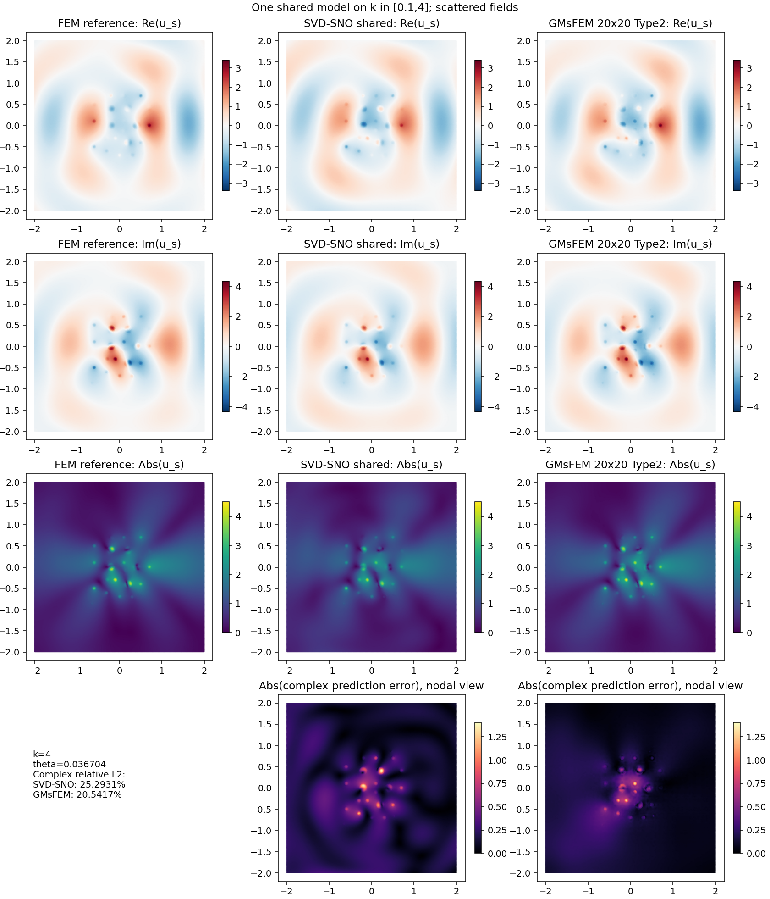

# Графики общей SVD-SNO и GMsFEM

Все графики построены по проверенным результатам 424 общих test-полей одной фиксированной среды. Модель и POD-базисы общие для k∈[0.1,4]. Графики не требуют нового обучения или FEM-решений.

## Ошибки во всём диапазоне k

Линии — среднее по направлениям на каждой удержанной частоте. Заливка — 10–90-й перцентили по этим направлениям; это не доверительный интервал. Сравнение с лучшим GMsFEM по средней ошибке полного поля и с FEM h=0.04. Reference для всех ошибок — FEM h=0.02.

[SVG для экспорта](accuracy_by_k.svg)

## Средняя ошибка и хвост распределения

Круг — среднее, ромб — 95-й перцентиль. Шкала ошибок логарифмическая. В ошибку GMsFEM входят редукция и различие его fine-сетки с reference.

[SVG для экспорта](methods_comparison.svg)

## Распределение и попарное сравнение

Верхние графики показывают долю полей с ошибкой не выше заданной. Нижние сопоставляют ошибки на одних и тех же (k,θ); цвет обозначает k. Выше диагонали SVD-SNO точнее GMsFEM. Обобщённое среднее не означает превосходства на каждом отдельном запросе.

[SVG для экспорта](error_distributions.svg)

## Обучение

[SVG для экспорта](training.svg)

## Физические поля и пространственная ошибка

Re, Im, модуль и абсолютная комплексная разность рассеянного поля. Цветовые шкалы согласованы между методами для каждой компоненты. Визуализация использует nodal fields; табличные GMsFEM-метрики вычислены прямо в reference-квадратуре. Выбраны заранее проверенные k=1 и k=4, а не примеры с минимальной ошибкой.

[Полный численный отчёт](../REPORT.md) · [Данные сравнения](../comparison.csv)
