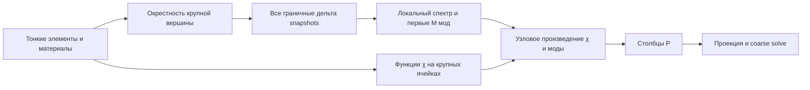

# Понять GMsFEM на проверяемом примере

Цель маршрута — самостоятельно объяснить, откуда берется каждый столбец матрицы перехода `P`, решить малую coarse-систему и отличить ошибку редукции от ошибки исходной физической модели. На первое прохождение отведите 60–90 минут. Достаточно знать линейную алгебру и идею линейного конечного элемента; специальные знания по GMsFEM не нужны.

Здесь **FEM / МКЭ** означает обычный метод конечных элементов, **MsFEM** — один многомасштабный базис на крупную вершину, **GMsFEM** — несколько таких функций на вершину. В этой реализации решается двумерная частотная задача рассеяния; нейросеть и обучающая выборка для построения базиса не используются. Более формальное изложение находится в [method.md](method.md), критическая оценка реализации — в [audit.md](audit.md).

## 1. Сначала получите число, которому можно доверять — 5 минут

Все команды запускаются из корня репозитория. Существующий Docker-сервис содержит нужные пакеты; для новых вычислений нужен комплексный PETSc.

```bash
docker compose up -d dolfinx-complex
docker compose exec -T dolfinx-complex python3 -m gmsfem.learning verify
```

Эта команда **не решает PDE**. Она читает сохраненные `fields.npz`, `spectra.npz`, `summary.json`, `errors.csv` из `gmsfem/results/notebook/`, пересчитывает ошибки и сверяет экспорты. Проверка `verify` требует NumPy/SciPy, но не импортирует DOLFINx или Gmsh. Тот же аудит второго набора:

```bash
docker compose exec -T dolfinx-complex python3 -m gmsfem.learning verify gmsfem/results/paper_example1
```

В сохраненном примере `notebook`: $k=1$, $d=(1,0)$, во включениях $(\alpha,n)=(0.2,10)$, в фоне $(1,1)$. Тонкое пространство имеет **17549 DOF и 34696 треугольников**. Для крупной сетки $20\times20$ и Type 2 проверяются такие значения:

| Мод на вершину $M$ | Coarse DOF | Ошибка комплексного полного поля, % | Ошибка модуля полного поля, % | Ошибка комплексного рассеянного поля, % |
|---:|---:|---:|---:|---:|
| 1 | 441 | 1.458877 | 0.904761 | 2.994455 |
| 4 | 1764 | 0.615897 | 0.410658 | 1.264175 |
| 16 | 7056 | 0.169595 | 0.119251 | 0.348106 |

Все три ошибки нормированы на **соответствующее тонкое поле**. Они взяты из сохраненных массивов, а не из таблиц статьи. При проверке 2026-11-08 совпали все 28 строк каждого набора; максимальное расхождение отдельно вычисленной точной P1 нормы комплексной разности с сохраненной ошибкой было меньше $3\cdot10^{-16}$. Это проверка согласованности файлов и норм. Для подтверждения решения уравнений нужны тесты и новый solve ниже.

`changed_source_files` сообщает, какие существовавшие при расчете исходники изменились с момента сохранения серии. После исправления генератора отчетов сюда попадают `run.py` и `experiment.py`. Это полезная информация о происхождении результата; она сама по себе не делает сохраненные поля неверными. Полные поля, времена и версии пакетов находятся в [summary.json](../results/notebook/summary.json), читаемый результат — в [report.md](../results/notebook/report.md).

**Проверка понимания.** Почему при одинаковом числителе комплексная ошибка полного поля меньше ошибки рассеянного? Ответьте до чтения раздела 8.

## 2. Что остается от обычного FEM — 10 минут

В FEM искомое рассеянное поле записывается по тонким узловым функциям:

$$u_h^s(x)=\sum_{j=1}^{N_h}U_{h,j}\varphi_j(x).$$

Каждый коэффициент — независимое узловое значение. Треугольники достаточно малы, чтобы разрешать окружности и скачки материалов. Полное поле получается добавлением известной падающей волны:

$$u^{\mathrm{tot}}=u^i+u^s,\qquad u^i=e^{ikd\cdot x}.$$

Материальные включения заполнены, а не вырезаны. Коэффициент $\alpha$ умножает градиенты, $n$ — массовый член. Внешняя граница имеет приближенное поглощающее условие. После сборки:

$$A_hU_h=F_h,\qquad A_h=K-k^2M_n-ikC.$$

В коде `C` называется **`problem.B`** и не содержит $k$. Этот множитель добавляется ровно один раз в `problem.operator`. Правильная контрастная нагрузка:

$$F(v)=\int(1-\alpha)\nabla u^i\cdot\nabla\bar v
       +k^2\int(n-1)u^i\bar v.$$

При $\alpha=n=1$ она нулевая: нет контраста — нет рассеяния. При скачках $\alpha$ перенос производной на тест сохраняет интерфейсный вклад. Поэлементная `div` от DG0-коэффициента такой вклад теряет. Это объясняет, почему исходные CG/DG notebooks не являются численным эталоном этой реализации; детали знака приведены в [method.md, раздел 1](method.md#1-поля-коэффициенты-и-граничное-условие).

**Один элемент вручную.** Для треугольника $(0,0),(1,0),(0,1)$ и постоянных коэффициентов

$$
K_T=\frac{\alpha}{2}
\begin{pmatrix}2&-1&-1\\-1&1&0\\-1&0&1\end{pmatrix},
\qquad
M_{w,T}=\frac{w}{24}
\begin{pmatrix}2&1&1\\1&2&1\\1&1&2\end{pmatrix}.
$$

Проверьте $K_T(1,1,1)^T=0$ и $\mathbf1^TM_{1,T}\mathbf1=1/2$. Первый результат означает отсутствие энергии градиента у константы, второй — правильную площадь. Масса с $w=n$ нужна в Helmholtz-операторе, с $w=\alpha$ — в спектральной задаче, с $w=1$ — для обычной $L^2$ нормы. Эти три массы отвечают на разные вопросы.

## 3. Как заменить тысячи неизвестных небольшим пространством — 15 минут

GMsFEM сохраняет исходный тонкий оператор, но допускает только поля вида

$$U_{\mathrm{ms}}=P U_H,\qquad P\in\mathbb R^{N_h\times N_H}.$$

Каждый столбец `P` — пространственная функция, уже содержащая реакцию на мелкие включения. Уменьшается число неизвестных амплитуд $U_H$, а тонкая сетка остается носителем сложной геометрии. Это отличается от простого запуска обычного P1 FEM на крупных квадратах и от усреднения коэффициентов.

Последовательность построения:



Крупная сетка состоит из $n_c\times n_c$ квадратов на $[-2,2]^2$, $H=4/n_c$. Каждой крупной вершине $p$ соответствует **patch** $\omega_p$: объединение соседних квадратов. Во внутренней вершине их четыре, на стороне два, в углу один. Тонкая сетка согласована с крупными ребрами: треугольники их не пересекают.

### Snapshots: сначала все возможные граничные следы

На границе patch есть $J_p$ тонких узлов. Для каждого задаем след, равный 1 в одном узле и 0 в остальных, и продолжаем его внутрь локальным уравнением. Все эти решения — столбцы $\Psi_p$:

$$
\begin{array}{c|c|c}
&\text{Type 1}&\text{Type 2}\\\hline
L_p&K_p&K_p-k^2M_{n,p}\\
\text{локальное PDE}&-\nabla\cdot(\alpha\nabla\psi)=0&-\nabla\cdot(\alpha\nabla\psi)-k^2n\psi=0
\end{array}
$$

Если $I$ и $B$ — внутренние и граничные номера DOF, то

$$\Psi_B=I_{J_p},\qquad (L_p)_{II}\Psi_I=-(L_p)_{IB}.$$

Здесь справа матрица, поэтому одна LU-факторизация обслуживает все $J_p$ правых частей. Любой разрешенный дискретный граничный след $g$ дает продолжение $\Psi_p g$. Важно: snapshots описывают **локальные однородные** задачи. Они не являются фрагментами уже найденного глобального решения и не используют его в качестве обучающих данных.

Локальные $K_p,M_{n,p}$ собираются только из треугольников patch. Подматрица глобального stiffness по тем же узлам сохраняла бы лишние вклады снаружи patch на его границе. Внешний поглощающий член $C$ в snapshot-задачу не входит.

### Собственная задача: выбрать небольшое подпространство

Все $J_p$ snapshots хранить в coarse-пространстве дорого. В их линейной оболочке решаем

$$\Psi_p^TK_p\Psi_p z_j
 =\lambda_j\Psi_p^TS_{\alpha,p}\Psi_p z_j,
\qquad (S_{\alpha,p})_{ab}=\int_{\omega_p}\alpha\varphi_b\varphi_a.$$

Сначала берем **наименьшие** $\lambda_j$, затем поднимаем их в тонкие локальные значения: $v_{pj}=\Psi_p z_j$. Отношение Релея

$$\lambda(v)=\frac{\int_{\omega_p}\alpha|\nabla v|^2}{\int_{\omega_p}\alpha|v|^2}$$

измеряет градиентную энергию на единицу взвешенной массы. Моды с малым отношением содержат пространственные вариации, которые энергетически недорого поддерживать в данном материале. Это локальный критерий отбора, а не гарантия заданного процента глобальной Helmholtz-ошибки.

В **обоих** типах спектральный stiffness — $K_p$, даже если snapshots построены полным Helmholtz-оператором. Спектральная масса имеет вес $\alpha$, а не $n$. При невырожденном Dirichlet-продолжении столбцы $\Psi_p$ независимы благодаря единичной граничной части; поэтому масса в snapshot-координатах положительно определена при $\alpha>0$.

Для Type 1 сумма snapshots дает константу 1; первая мода имеет $\lambda\approx0$. Ее нужно сохранить. Для Type 2 константа не решает локальное уравнение при $k>0$; нулевая первая мода не требуется.

### Зачем еще нужны функции $\chi_p$

Локальная мода $v_{pj}$ имеет произвольный след на границе patch. Если продолжить ее нулем без обработки, появится разрыв. Для каждой крупной вершины строится $\chi_p$: на каждом соседнем крупном квадрате решается локальная задача того же типа, а на его ребрах задается след обычной крупной Q1 функции вершины.

На внутренней внешней границе patch этот след нулевой, а на общих ребрах квадратов совпадает. Произведение локализует и сшивает моды:

$$\phi_{pj}=I_h(\chi_pv_{pj}),$$

где $I_h$ означает P1 интерполяцию произведения по тонким узлам. Буквальное произведение двух P1 функций квадратично внутри треугольника; код хранит его линейный узловой интерполянт. На физической границе области нулевой след не навязывается.

У Type 1 сумма $\sum_p\chi_p=1$ с точностью решения систем: это partition of unity. У Type 2 сумма внутри ячейки обычно отличается от 1. Она решает Helmholtz-задачу со следом 1. Деление на сумму изменило бы заданное локальное PDE, поэтому код этого не делает. Термин partition of unity в статье для Type 2 надо читать с этой оговоркой.

## 4. Раскройте один patch в работающем коде — 10 минут

```bash
docker compose exec -T dolfinx-complex python3 -m gmsfem.learning trace --output /tmp/gmsfem-lesson
```

Команда использует те же `run_study`, `build_offline_space` и `solve_reduced`, что основной CLI. Она создает полноценные `report.md`, `summary.json`, `fields.npz`, `spectra.npz`, `errors.csv`, а в `trace.json` раскрывает центральный patch. Каталог `/tmp` находится **в контейнере**. Для сохранения на хосте задайте, например, `--output gmsfem/results/my_lesson`.

Сохраненный результат этого опыта — [learning_trace.json](learning_trace.json). Расчет выполнен 2026-11-08, DOLFINx 0.11.0.post0, Gmsh 4.15.2, PETSc complex128; полные версии и хэши исходников записаны в JSON. Параметры: `notebook`, $k=1$, $h=0.1$, крупная сетка $4\times4$, $M=1,2,4$. При иной версии Gmsh могут меняться сетка и последние цифры. Сравнивайте одновременно конфигурацию, размерности, residual и ошибки.

| Объект в этом опыте | Размер / значение | Что он означает |
|---|---:|---|
| Все тонкое пространство | 14353 DOF | Кривизна маленьких кругов требует локального уточнения даже при $h=0.1$ |
| Крупные вершины | $5^2=25$ | По одному patch на вершину |
| Центральный patch, vertex 12 | 12846 DOF | Большинство включений лежит в центральной части области |
| Внутренние / граничные DOF patch | 12766 / 80 | Размер Dirichlet-блока и число snapshots |
| Матрица $\Psi_p$ | $12846\times80$ | Все граничные дельта-продолжения |
| Собственная задача | $80\times80$ | Собственные векторы заданы в snapshot-координатах |
| Число оставленных мод | 4 | Первые четыре локальные моды на каждой вершине |
| Матрица `P` для $M=4$ | $14353\times100$ | $N_H=25\cdot4=100$ |

Первые четыре собственных значения центрального patch:

| Тип | $\lambda_1$ | $\lambda_2$ | $\lambda_3$ | $\lambda_4$ |
|---|---:|---:|---:|---:|
| Type 1 | $2.27\cdot10^{-14}$ | 2.477458 | 2.537227 | 5.381154 |
| Type 2 | 1.222523 | 2.249049 | 2.303143 | 5.038164 |

Малое первое значение Type 1 — константа с round-off. У Type 2 первая мода существенно меняется внутри patch. Отклонение суммы $\chi$ от 1: около $1.07\cdot10^{-14}$ у Type 1 и **0.321285** у Type 2; второе число ожидаемо и не является дефектом непрерывности. Его отдельная проверка `chi_interface_defect` около $3.11\cdot10^{-15}$ для обоих типов.

Проверьте созданные поля тем же независимым по отношению к solve читателем:

```bash
docker compose exec -T dolfinx-complex python3 -m gmsfem.learning verify /tmp/gmsfem-lesson
```

## 5. Что именно решает online-этап — 10 минут

После сборки `P` коэффициенты $U_H$ находятся из условия, что невязка исходной системы ортогональна всем coarse-тестам:

$$P^H(A_hPU_H-F_h)=0.$$

Отсюда

$$A_H=P^HA_hP,\qquad F_H=P^HF_h,\qquad A_HU_H=F_H.$$

Здесь $H$ в верхнем индексе — **сопряженное транспонирование**, а $H$ как шаг сетки — другая величина. Локальные базисы текущего кода вещественные, глобальные коэффициенты и поля комплексные. При $M=4$ в учебном опыте нужно решить систему $100\times100$, а затем перемножить `P @ U_H` для восстановления 14353 тонких значений.

В `P` столбцы сгруппированы по вершинам. `space.prolongation(2)` выбирает первые две моды **каждого** patch. Простое `space.P[:, :50]` взяло бы все четыре моды первых вершин и пропустило остальные — это другое пространство.

Глобальный оператор остается неопределенным и комплексным. Галеркинское условие не минимизирует обычную $L^2$ ошибку. Вложенность пространств по $M$ не доказывает монотонное уменьшение каждой наблюдаемой ошибки.

Числа нового quick-опыта:

| Тип | $M$ | Coarse DOF | Комплексная ошибка полного поля / fine, % | Галеркинская невязка |
|---|---:|---:|---:|---:|
| 1 | 1 | 25 | 12.476545 | $1.40\cdot10^{-14}$ |
| 1 | 2 | 50 | 10.892615 | $1.31\cdot10^{-14}$ |
| 1 | 4 | 100 | 5.157337 | $2.17\cdot10^{-14}$ |
| 2 | 1 | 25 | 12.493186 | $8.51\cdot10^{-15}$ |
| 2 | 2 | 50 | 10.605461 | $1.07\cdot10^{-14}$ |
| 2 | 4 | 100 | 4.670786 | $1.51\cdot10^{-14}$ |

Невязка порядка $10^{-14}$ сосуществует с ошибкой порядка 5–12%: линейная система coarse решена точно, но разрешенное пространство еще бедное. Type 2 при $M=1$ здесь слегка хуже Type 1. Поэтому утверждение «Type 2 всегда точнее» неверно даже для этого набора. В этой конкретной серии обогащение уменьшило комплексную ошибку; это численное наблюдение.

Offline-построение не использует направление или амплитуду падающей волны. Его можно повторно использовать для новых правых частей при тех же сетке и коэффициентах; Type 2 требует также того же $k$. Type 1 не зависит от $k$, но качество при новом $k$ нужно проверять. В текущем `run_study` базис строится заново при каждом вызове: возможность повторного использования математического пространства не означает наличие дискового кэша базисов.

## 6. Как читать метрики — 10 минут

Основной ориентир для поля, чувствительного к фазе:

$$e_{\mathrm{complex,ref}}=100\frac{\|u_{\mathrm{ms}}-u_h\|_{L^2}}{\|u_h\|_{L^2}}.$$

Для модуля отдельно используется

$$e_{\mathrm{abs,ref}}=100\frac{\||u_{\mathrm{ms}}|-|u_h|\|_{L^2}}{\||u_h|\|_{L^2}}.$$

Если $u_{\mathrm{ms}}=iu_h$, модули полностью совпадут, но комплексная относительная ошибка равна $100\sqrt2\approx141.421356\%$. Поэтому одинаковая картинка $|u|$ не подтверждает правильную фазу. У комплексного поля $\|u\|^2=\int|u|^2$, а не $\int u^2$.

В CSV суффикс `_paper` означает знаменатель **multiscale**, `_ref` — знаменатель **fine/reference**. Префикс `scattered_` означает сравнение рассеянного поля; без него сравнивается полное. Все относительные ошибки записаны в процентах. Нулевой знаменатель дает неопределенную относительную ошибку: в строгом JSON это `null`, а не ноль.

В `verify` числитель комплексной ошибки проверяется и прямой точной формулой P1 массы:

$$\int_T|e_h|^2=\frac{|T|}{12}\left(\sum_{a=1}^3|e_a|^2+
\left|\sum_{a=1}^3e_a\right|^2\right).$$

Для модуля поля и суммы с аналитической падающей волной используется квадратура Dunavant степени 5. Модуль берется после комплексной интерполяции; среднее по узлам и интерполяция узловых модулей отвечают на другие вопросы. При более высоком $k$ достаточность фиксированной квадратуры следует проверять отдельно.

Наконец, три разные проверки не заменяют друг друга:

| Проверка | Что позволяет заключить | Чего не устанавливает |
|---|---|---|
| Алгебраический residual | Данная система решена с малой невязкой | Хорошую обусловленность и малую ошибку поля |
| GMsFEM против FEM на одной тонкой сетке | Качество редукции пространства | Точность самой тонкой сетки и внешнего ABC |
| Против независимо построенного FEM $h/2$ | Чувствительность к тонкой дискретизации | Точное физическое решение и независимость от внешней границы |

## 7. Практические опыты после первого прохождения

Каждый запуск пишите в новый каталог: так старые картинки и reference-файлы не смешаются с новой конфигурацией.

**Контраст выключен.** Выполните

```bash
docker compose exec -T dolfinx-complex python3 -m gmsfem.run --profile quick --case homogeneous --types 1 --no-reference --no-plots --output /tmp/gmsfem-homogeneous
```

Предскажите нулевой RHS и нулевое рассеянное поле. Полное поле останется падающей волной. Относительные ошибки рассеянного поля с нулевым знаменателем будут неопределенными.

**Обогащение при фиксированной сетке.** Основной `trace` уже сравнивает $M=1,2,4$ на одной fine-сетке. Для следующего опыта:

```bash
docker compose exec -T dolfinx-complex python3 -m gmsfem.run --profile demo --case notebook --coarse 10 20 --modes 1 2 4 8 16 --types 1 2 --output /tmp/gmsfem-enrichment
```

Сначала прочитайте `summary.json`: обе редукции используют один fine-оператор. Сопоставляйте ошибку со стоимостью offline + projection + solve. В этой команде отдельный FEM $h/2$ включен. Он запускается последним и может стоить дороже короткого quick-опыта.

**Высокая частота.** Изменение $k$ одновременно меняет RHS, глобальный оператор, Type 2 snapshots и $\chi$. При большем $k$ особенно важны разрешение локальной длины волны и близость локальных Dirichlet-резонансов. Одного увеличения $M$ недостаточно, если fine-сетка или локальные продолжения ненадежны. Эта документация не утверждает, что произвольный $k$ проверен.

**Численные инварианты.** Полный набор научных тестов:

```bash
docker compose exec -T dolfinx-complex python3 -m unittest discover -s gmsfem/tests -v
```

Тесты проверяют геометрию, материальные площади, независимую сборку локальных матриц, знак RHS через тождество полного поля, нулевое рассеяние, snapshots и spectra, следы и support, фазовые нормы, перенос на независимую сетку и сохраненные артефакты. Карта кода и точный список проверок находятся в [README](../README.md#проверки).

## 8. Самопроверка с ответами

Сначала ответьте самостоятельно. Хороший признак понимания — вы можете назвать не только формулу, но и массив в коде, который ей соответствует.

1. **Почему не взять обычные крупные P1 функции?** Их форма заранее фиксирована и не содержит мелких материалов. Столбцы `P` строятся локальными задачами на разрешающей включения fine-сетке; несколько мод на вершину дают дополнительную свободу.
2. **Чему равно число snapshots?** Числу fine-узлов на всей границе patch, а не числу крупных вершин или выбранному $M$. В сохраненном центральном patch $J_p=80$; оставлено четыре моды.
3. **Что означает вектор $z_j\in\mathbb R^{80}$?** Коэффициенты линейной комбинации snapshots. Физические значения моды на 12846 узлах получаются как `snapshots @ z_j`.
4. **Какой массой пользоваться?** В global Helmholtz — $M_n$, в eigenproblem — $S_\alpha$, в невзвешенной P1 $L^2$ норме — $M_0$. Подмена одной другой меняет задачу.
5. **Нужно ли удалять почти нулевую Type 1 моду?** Нет. Она представляет константу и является первой сохраняемой модой. Нулевой локальный Neumann-stiffness не делает внутреннюю Dirichlet-систему вырожденной.
6. **Почему не нормировать сумму Type 2 $\chi$ до 1?** Это меняет решения локальных Helmholtz-задач. Непрерывность проверяется через совпадение следов; она не требует единичной суммы.
7. **Какой размер coarse-системы при $n_c=10,M=8$?** $(10+1)^2\cdot8=968$. `P` имеет $N_h$ строк и 968 столбцов; $P^HA_hP$ — $968\times968$.
8. **Почему `P[:, :968]` обычно не выбирает восемь мод каждого patch?** Исходный `P` хранит по `max_modes` столбцов на вершину; нужен выбор первых восьми из каждой группы через `prolongation(8)`.
9. **Почему комплексные абсолютные ошибки total и scattered одинаковы?** Одна и та же $u^i$ вычитается из разности. Относительные знаменатели различны. Ошибки модулей после прибавления $u^i$ вообще не обязаны совпадать.
10. **Можно ли считать residual $10^{-14}$ доказательством точности 0.001%?** Нет. Он проверяет решение coarse-системы, а не выразительность `range(P)`. В quick-примере residual около $10^{-14}$ при ошибке поля около 5%.
11. **Малый backward error исключает Type 2 резонанс?** Нет. Почти вырожденная система может иметь малую невязку и большую чувствительность решения к данным. Нужен отдельный анализ обусловленности/локального спектра; текущий код его не выполняет.
12. **Почему нельзя сравнить `paper_example1` с таблицей статьи как точную репликацию?** Здесь другая, notebook-геометрия из 24 включений и другие сетки; название preset задает только материалы. Также нужно согласовать поле, знаменатель нормы и внешнее граничное условие.

## 9. Куда читать дальше

После этого маршрута читайте [method.md](method.md) рядом с `fem.py` и `offline.py`, затем [исходную статью о рассеянии](../../references/10%20GMsFEM%20for%20scattering%20problem.pdf), [издательскую страницу](https://www.sciencedirect.com/science/article/abs/pii/S0377042722005751). В ней два вида локальных пространств связаны с эллиптическим и полным операторами; этот выбор определяет сравниваемые Type 1/2.

Для общей идеи offline/online и работы с пространствами без разделения масштабов полезна первичная работа Efendiev, Galvis, Hou, *Generalized multiscale finite element methods (GMsFEM)*, JCP 251 (2013): [авторский PDF](https://users.cms.caltech.edu/~hou/papers/GMsFEM-2013.pdf), [DOI](https://doi.org/10.1016/j.jcp.2013.04.045). Порядок отбора собственных значений зависит от того, какая из двух форм стоит слева: формулы разных GMsFEM-вариантов нельзя переносить по фразе «самые важные моды». В задаче этого репозитория оставляются наименьшие значения именно пары $(K^{\rm snap},S_\alpha^{\rm snap})$.
