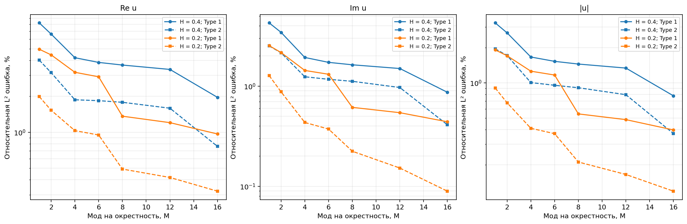
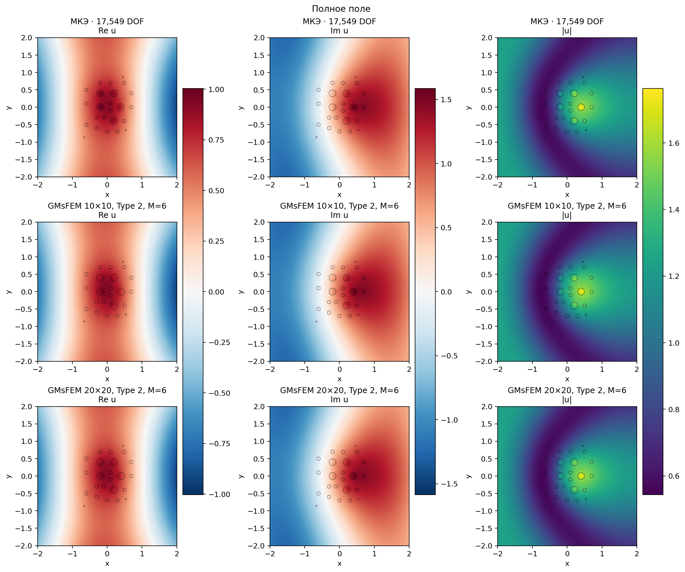
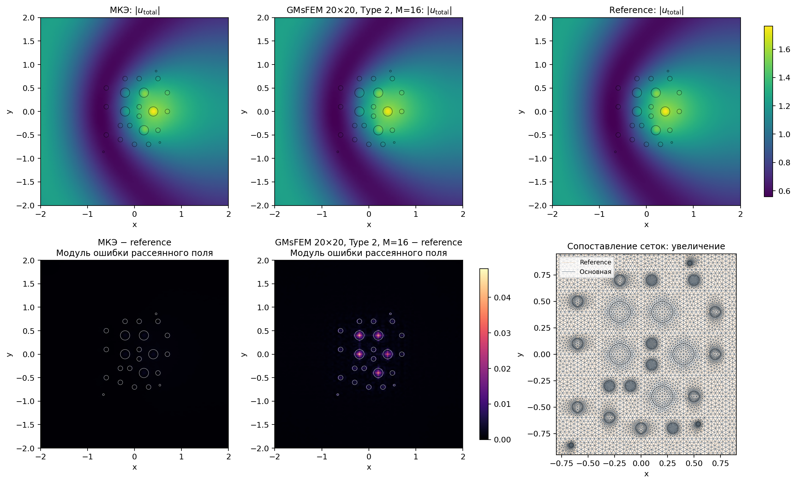

# Численный эксперимент GMsFEM

Preset `notebook`, k=1, d=(1.0, 0.0), A=αI. Геометрия: 24 включения исходных notebooks.

Тонкая CG1-сетка: **17549 DOF**, 34696 треугольников; целевой h=0.04.
Обе крупные сетки и оба типа базиса используют один fine-оператор и одинаковую контрастную RHS.

Сравнивается **полное поле** u=u_i+u_s. Таблица: интегральные L²-ошибки в процентах, знаменатель — multiscale, как на стр. 9 статьи.
В errors.csv дополнительно сохранены reference-нормированные ошибки, комплексная ошибка и ошибки рассеянного поля.

| Крупная сетка | Type | M | DOF | Re, % | Im, % | Модуль, % | Complex/ref, % |
|---|---:|---:|---:|---:|---:|---:|---:|
| 10×10 | 1 | 1 | 121 | 8.2274 | 4.2710 | 3.2533 | 5.4602 |
| 10×10 | 1 | 2 | 242 | 6.6319 | 3.4369 | 2.6740 | 4.3908 |
| 10×10 | 1 | 4 | 484 | 4.2054 | 1.9301 | 1.6639 | 2.6269 |
| 10×10 | 1 | 6 | 726 | 3.8411 | 1.7248 | 1.5279 | 2.3767 |
| 10×10 | 1 | 8 | 968 | 3.6511 | 1.6305 | 1.4490 | 2.2530 |
| 10×10 | 1 | 12 | 1452 | 3.3555 | 1.4971 | 1.3389 | 2.0683 |
| 10×10 | 1 | 16 | 1936 | 1.9595 | 0.8676 | 0.7764 | 1.1996 |
| 10×10 | 2 | 1 | 121 | 4.0139 | 2.5160 | 1.9538 | 2.9242 |
| 10×10 | 2 | 2 | 242 | 3.1540 | 2.1491 | 1.7143 | 2.4177 |
| 10×10 | 2 | 4 | 484 | 1.8697 | 1.2387 | 1.0067 | 1.4057 |
| 10×10 | 2 | 6 | 726 | 1.8386 | 1.1687 | 0.9547 | 1.3483 |
| 10×10 | 2 | 8 | 968 | 1.7811 | 1.1160 | 0.9098 | 1.2948 |
| 10×10 | 2 | 12 | 1452 | 1.5895 | 0.9676 | 0.7936 | 1.1358 |
| 10×10 | 2 | 16 | 1936 | 0.7617 | 0.4112 | 0.3699 | 0.5092 |
| 20×20 | 1 | 1 | 441 | 4.9530 | 2.5332 | 1.9125 | 3.2426 |
| 20×20 | 1 | 2 | 882 | 4.4431 | 2.1611 | 1.7061 | 2.8431 |
| 20×20 | 1 | 4 | 1764 | 3.1757 | 1.4323 | 1.2593 | 1.9649 |
| 20×20 | 1 | 6 | 2646 | 2.9107 | 1.3122 | 1.1676 | 1.7999 |
| 20×20 | 1 | 8 | 3528 | 1.3629 | 0.6133 | 0.5441 | 0.8387 |
| 20×20 | 1 | 12 | 5292 | 1.2033 | 0.5427 | 0.4861 | 0.7409 |
| 20×20 | 1 | 16 | 7056 | 0.9677 | 0.4406 | 0.3971 | 0.5979 |
| 20×20 | 2 | 1 | 441 | 1.9886 | 1.2720 | 0.9056 | 1.4589 |
| 20×20 | 2 | 2 | 882 | 1.5290 | 0.8768 | 0.6764 | 1.0548 |
| 20×20 | 2 | 4 | 1764 | 1.0316 | 0.4336 | 0.4102 | 0.6159 |
| 20×20 | 2 | 6 | 2646 | 0.9487 | 0.3727 | 0.3690 | 0.5522 |
| 20×20 | 2 | 8 | 3528 | 0.4920 | 0.2238 | 0.2114 | 0.3033 |
| 20×20 | 2 | 12 | 5292 | 0.4186 | 0.1522 | 0.1655 | 0.2373 |
| 20×20 | 2 | 16 | 7056 | 0.3214 | 0.0895 | 0.1192 | 0.1696 |

## Время и проверки

Сборка fine-форм: 0.354 s; решение fine-системы: 0.069 s.
Относительная невязка МКЭ: 2.37e-13; независимая ошибка P1/UFL stiffness: 6.17e-15.
Время offline включает χ, snapshots и спектры; projection и online solve измеряются отдельно в CSV. Ускорение полного расчёта не выводится из одного времени online solve.

| Крупная сетка | Type | Offline, s | Snapshot residual | Eigen residual | Отклонение суммы χ от 1 |
|---|---:|---:|---:|---:|---:|
| 10×10 | 1 | 0.643 | 1.56e-17 | 1.16e-15 | 3.55e-15 |
| 10×10 | 2 | 0.652 | 1.40e-17 | 1.14e-15 | 7.94e-02 |
| 20×20 | 1 | 0.818 | 2.42e-17 | 7.76e-16 | 2.89e-15 |
| 20×20 | 2 | 0.840 | 2.26e-17 | 8.82e-16 | 4.31e-02 |

Type 2 использует Helmholtz-продолжения: сумма χ внутри крупной ячейки не обязана равняться единице и не нормируется.

## Последний этап: отдельная эталонная сетка МКЭ

На той же CAD-геометрии заново построена сетка с целевым h/2=0.02: **53246 DOF**, 105690 треугольников.
Обычный CG1 МКЭ решён независимо. Оба поля оцениваются в точках квадратуры reference-сетки с кусочно-линейной интерполяцией исходного поля.
Эта проверка содержит ошибку редукции, fine-дискретизации и полигонализации окружностей. Более мелкий МКЭ — численный эталон, а не точное решение.

| Метод | DOF | Re/ref, % | Im/ref, % | Модуль/ref, % | Complex/ref, % |
|---|---:|---:|---:|---:|---:|
| МКЭ h | 17549 | 0.0693 | 0.0389 | 0.0272 | 0.0472 |
| GMsFEM 10×10, Type 1, M=16 | 1936 | 2.0374 | 0.8983 | 0.7957 | 1.2390 |
| GMsFEM 10×10, Type 2, M=16 | 1936 | 0.7563 | 0.4138 | 0.3734 | 0.5084 |
| GMsFEM 20×20, Type 1, M=16 | 7056 | 1.0304 | 0.4724 | 0.4162 | 0.6369 |
| GMsFEM 20×20, Type 2, M=16 | 7056 | 0.3285 | 0.1017 | 0.1279 | 0.1778 |

## Сопоставление со статьёй

Реализованы уравнения (9)–(17): два типа snapshots/χ, спектральная масса Sα, наименьшие собственные значения и глобальная CG-проекция.
Это адаптация к 24 включениям проекта. Статья не публикует координаты исходной геометрии; её fine-сетки имеют около 100 тысяч DOF. Числа таблиц напрямую не воспроизводятся.
Коэффициенты notebooks и статьи различаются; preset необходимо учитывать. Исходные notebooks содержат интерфейсный дефект RHS; здесь используется согласованная слабая форма.
Ссылка: [Kalachikova et al., JCAM 424 (2023), 114977](https://doi.org/10.1016/j.cam.2022.114977). Выводы и ограничения метода: [методическая документация](../../docs/method.md).
