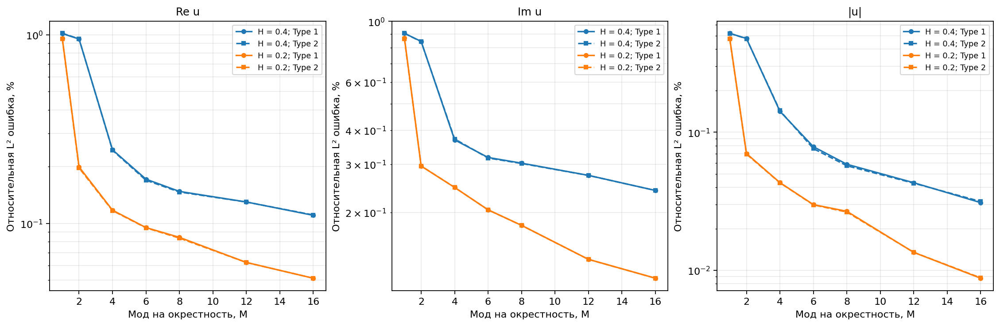
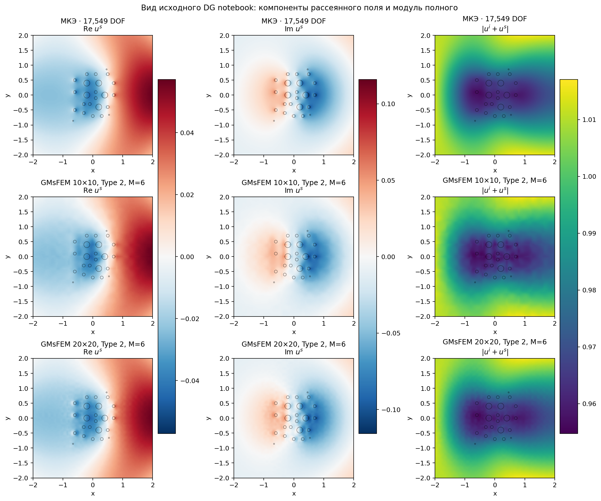
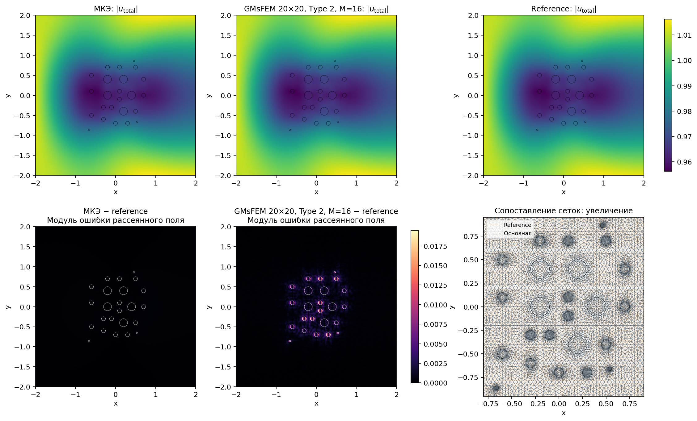

# Численный эксперимент GMsFEM

Preset `paper_example1`, k=1, d=(1.0, 0.0), A=αI. Геометрия: 24 включения исходных notebooks.

Тонкая CG1-сетка: **17549 DOF**, 34696 треугольников; целевой h=0.04.
Обе крупные сетки и оба типа базиса используют один fine-оператор и одинаковую контрастную RHS.

Сравнивается **полное поле** u=u_i+u_s. Таблица: интегральные L²-ошибки в процентах, знаменатель — multiscale, как на стр. 9 статьи.
В errors.csv дополнительно сохранены reference-нормированные ошибки, комплексная ошибка и ошибки рассеянного поля.

| Крупная сетка | Type | M | DOF | Re, % | Im, % | Модуль, % | Complex/ref, % |
|---|---:|---:|---:|---:|---:|---:|---:|
| 10×10 | 1 | 1 | 121 | 1.0158 | 0.9048 | 0.5215 | 0.9493 |
| 10×10 | 1 | 2 | 242 | 0.9502 | 0.8451 | 0.4783 | 0.8877 |
| 10×10 | 1 | 4 | 484 | 0.2456 | 0.3689 | 0.1419 | 0.3239 |
| 10×10 | 1 | 6 | 726 | 0.1717 | 0.3181 | 0.0786 | 0.2678 |
| 10×10 | 1 | 8 | 968 | 0.1478 | 0.3032 | 0.0587 | 0.2512 |
| 10×10 | 1 | 12 | 1452 | 0.1300 | 0.2736 | 0.0431 | 0.2259 |
| 10×10 | 1 | 16 | 1936 | 0.1104 | 0.2410 | 0.0309 | 0.1980 |
| 10×10 | 2 | 1 | 121 | 1.0191 | 0.9046 | 0.5211 | 0.9507 |
| 10×10 | 2 | 2 | 242 | 0.9530 | 0.8433 | 0.4766 | 0.8880 |
| 10×10 | 2 | 4 | 484 | 0.2442 | 0.3718 | 0.1435 | 0.3254 |
| 10×10 | 2 | 6 | 726 | 0.1695 | 0.3166 | 0.0762 | 0.2661 |
| 10×10 | 2 | 8 | 968 | 0.1468 | 0.3024 | 0.0572 | 0.2504 |
| 10×10 | 2 | 12 | 1452 | 0.1298 | 0.2734 | 0.0428 | 0.2257 |
| 10×10 | 2 | 16 | 1936 | 0.1109 | 0.2410 | 0.0315 | 0.1981 |
| 20×20 | 1 | 1 | 441 | 0.9583 | 0.8698 | 0.4791 | 0.9049 |
| 20×20 | 1 | 2 | 882 | 0.1993 | 0.2958 | 0.0702 | 0.2605 |
| 20×20 | 1 | 4 | 1764 | 0.1176 | 0.2472 | 0.0432 | 0.2041 |
| 20×20 | 1 | 6 | 2646 | 0.0951 | 0.2047 | 0.0299 | 0.1685 |
| 20×20 | 1 | 8 | 3528 | 0.0844 | 0.1797 | 0.0268 | 0.1481 |
| 20×20 | 1 | 12 | 5292 | 0.0621 | 0.1349 | 0.0135 | 0.1109 |
| 20×20 | 1 | 16 | 7056 | 0.0512 | 0.1151 | 0.0088 | 0.0942 |
| 20×20 | 2 | 1 | 441 | 0.9508 | 0.8643 | 0.4747 | 0.8986 |
| 20×20 | 2 | 2 | 882 | 0.1970 | 0.2963 | 0.0695 | 0.2600 |
| 20×20 | 2 | 4 | 1764 | 0.1169 | 0.2472 | 0.0431 | 0.2040 |
| 20×20 | 2 | 6 | 2646 | 0.0948 | 0.2047 | 0.0298 | 0.1684 |
| 20×20 | 2 | 8 | 3528 | 0.0836 | 0.1795 | 0.0264 | 0.1478 |
| 20×20 | 2 | 12 | 5292 | 0.0621 | 0.1349 | 0.0135 | 0.1109 |
| 20×20 | 2 | 16 | 7056 | 0.0512 | 0.1151 | 0.0088 | 0.0942 |

## Время и проверки

Сборка fine-форм: 0.342 s; решение fine-системы: 0.071 s.
Относительная невязка МКЭ: 1.26e-14; независимая ошибка P1/UFL stiffness: 1.99e-14.
Время offline включает χ, snapshots и спектры; projection и online solve измеряются отдельно в CSV. Ускорение полного расчёта не выводится из одного времени online solve.

| Крупная сетка | Type | Offline, s | Snapshot residual | Eigen residual | Отклонение суммы χ от 1 |
|---|---:|---:|---:|---:|---:|
| 10×10 | 1 | 0.662 | 1.56e-17 | 7.82e-16 | 1.87e-14 |
| 10×10 | 2 | 0.667 | 1.40e-17 | 8.07e-16 | 1.19e-02 |
| 20×20 | 1 | 0.827 | 2.42e-17 | 6.32e-16 | 2.62e-14 |
| 20×20 | 2 | 0.850 | 2.26e-17 | 6.89e-16 | 2.98e-03 |

Type 2 использует Helmholtz-продолжения: сумма χ внутри крупной ячейки не обязана равняться единице и не нормируется.

## Последний этап: отдельная эталонная сетка МКЭ

На той же CAD-геометрии заново построена сетка с целевым h/2=0.02: **53246 DOF**, 105690 треугольников.
Обычный CG1 МКЭ решён независимо. Оба поля оцениваются в точках квадратуры reference-сетки с кусочно-линейной интерполяцией исходного поля.
Эта проверка содержит ошибку редукции, fine-дискретизации и полигонализации окружностей. Более мелкий МКЭ — численный эталон, а не точное решение.

| Метод | DOF | Re/ref, % | Im/ref, % | Модуль/ref, % | Complex/ref, % |
|---|---:|---:|---:|---:|---:|
| МКЭ h | 17549 | 0.0139 | 0.0125 | 0.0071 | 0.0131 |
| GMsFEM 10×10, Type 1, M=16 | 1936 | 0.1123 | 0.2425 | 0.0324 | 0.1995 |
| GMsFEM 10×10, Type 2, M=16 | 1936 | 0.1127 | 0.2423 | 0.0336 | 0.1995 |
| GMsFEM 20×20, Type 1, M=16 | 7056 | 0.0535 | 0.1163 | 0.0116 | 0.0956 |
| GMsFEM 20×20, Type 2, M=16 | 7056 | 0.0534 | 0.1162 | 0.0117 | 0.0955 |

## Сопоставление со статьёй

Реализованы уравнения (9)–(17): два типа snapshots/χ, спектральная масса Sα, наименьшие собственные значения и глобальная CG-проекция.
Это адаптация к 24 включениям проекта. Статья не публикует координаты исходной геометрии; её fine-сетки имеют около 100 тысяч DOF. Числа таблиц напрямую не воспроизводятся.
Коэффициенты notebooks и статьи различаются; preset необходимо учитывать. Исходные notebooks содержат интерфейсный дефект RHS; здесь используется согласованная слабая форма.
Ссылка: [Kalachikova et al., JCAM 424 (2023), 114977](https://doi.org/10.1016/j.cam.2022.114977). Выводы и ограничения метода: [методическая документация](../../docs/method.md).
