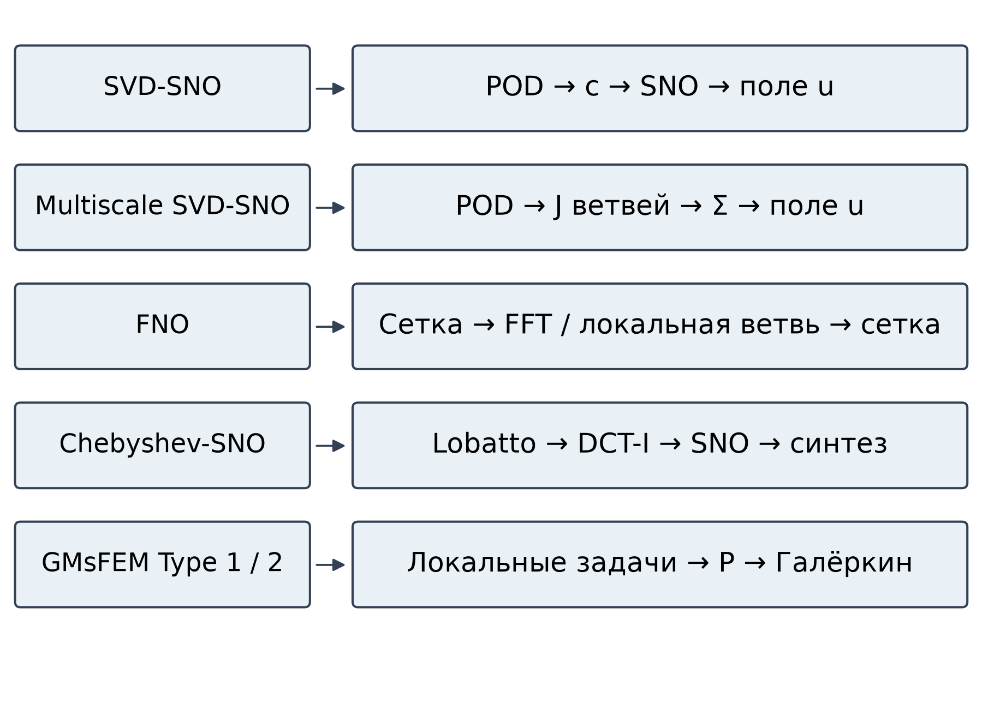
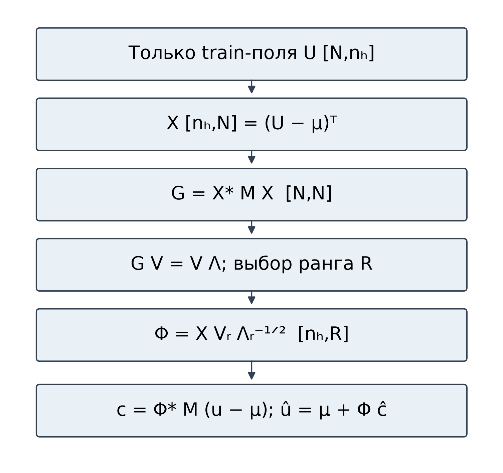
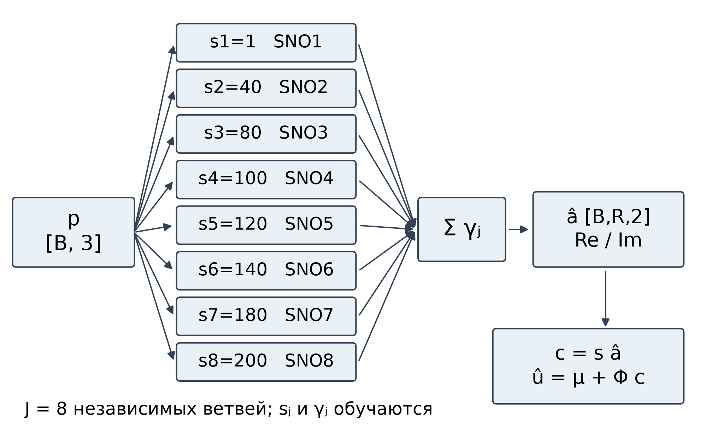
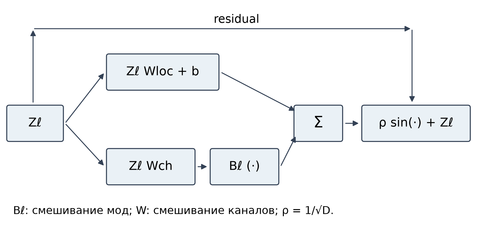
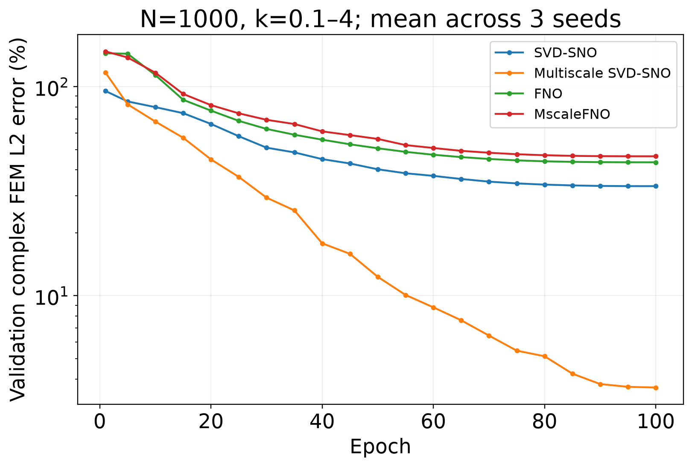
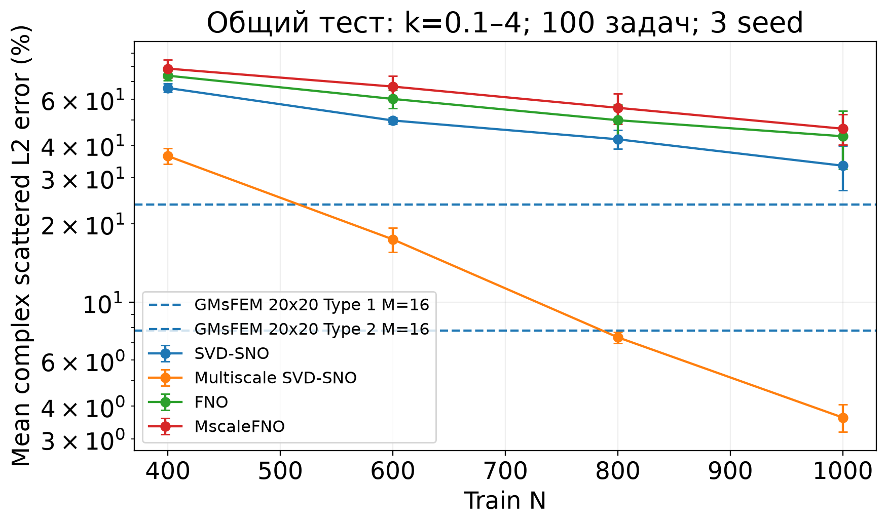
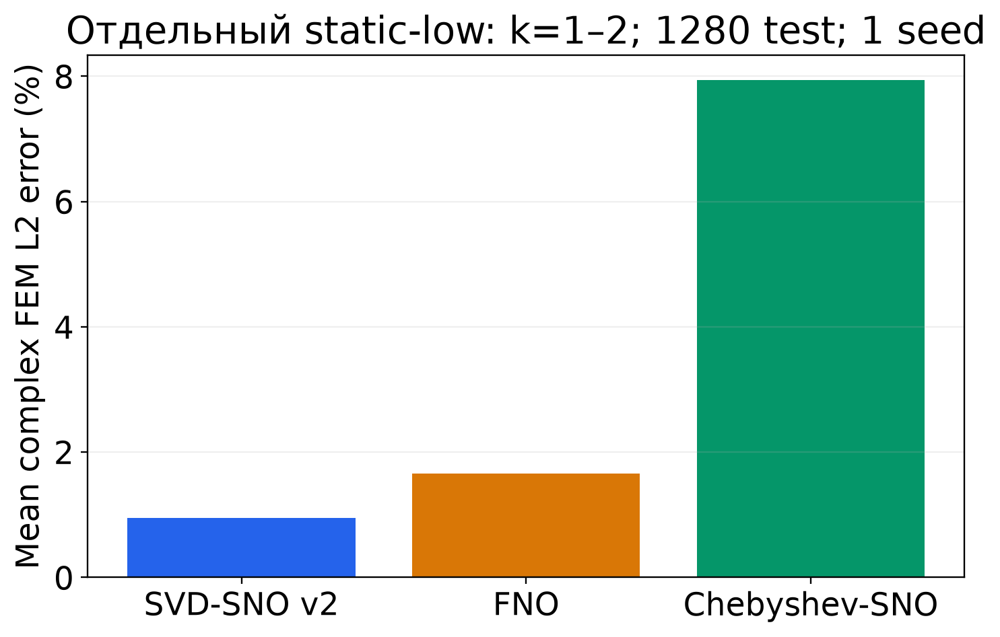
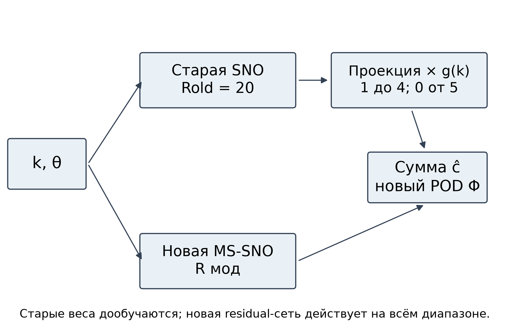
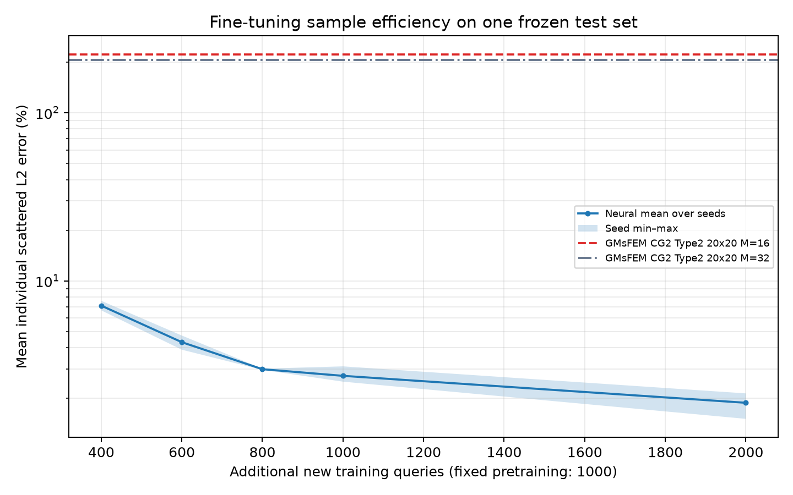
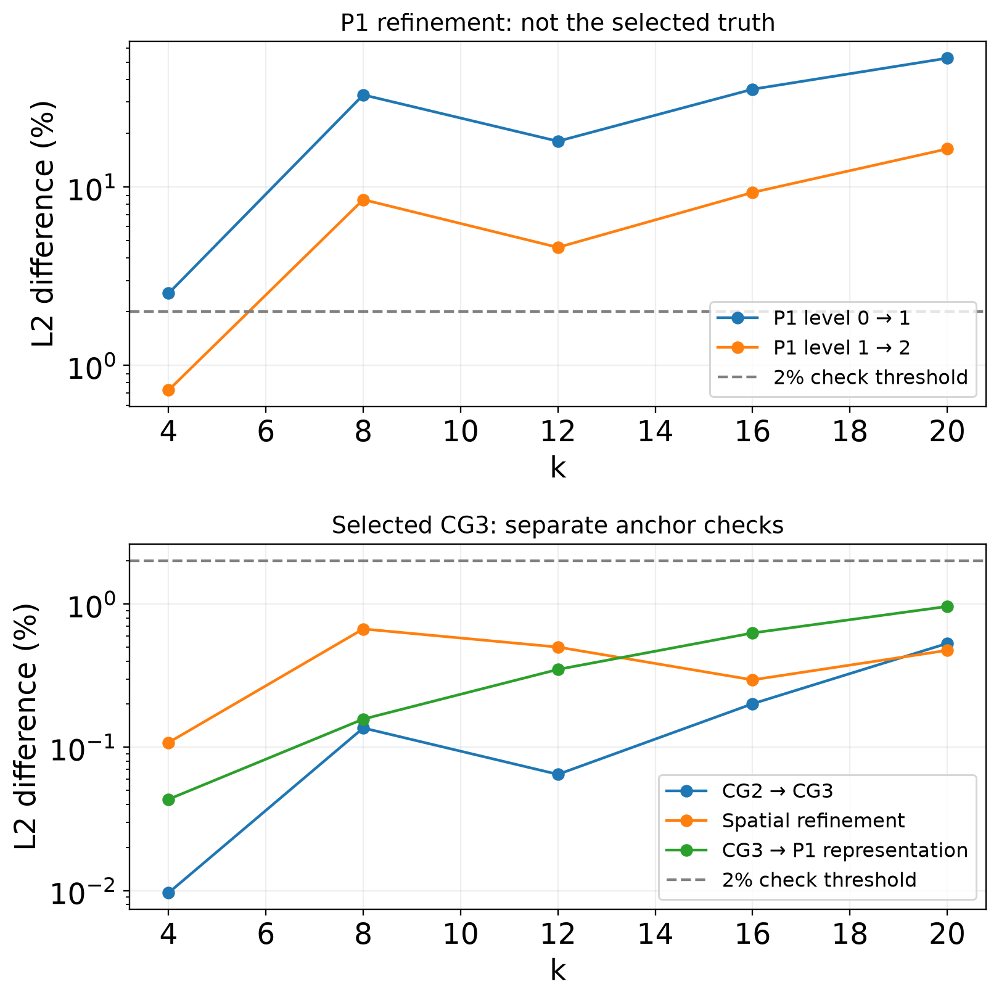

# Многомасштабный SVD-SNO для задачи рассеяния

Методическое пособие по построению, обучению и проверке сокращённой модели комплексного волнового поля. Рассмотрен конкретный программный эксперимент репозитория: частота меняется, а среда и геометрия закреплены. Цель — понять, как дискретное решение FEM превращается в малый набор коэффициентов и как сеть восстанавливает поле при новой частоте.

Пособие сопоставляет метод с обычным SVD-SNO, FNO, Chebyshev-SNO и двумя вариантами GMsFEM. Показатели взяты из сохранённых результатов проекта; разные наборы тестов рассматриваются отдельно. При чтении различайте точность относительно FEM-метки и точность самой FEM-метки относительно непрерывной задачи.


Карта методов: входные данные, представление решения и выход.

Далее последовательно рассматриваются постановка, построение базиса, устройство сети, сопоставление методов и практическая проверка результатов. Формулы даны для понимания вычислений; источником точных настроек каждого запуска остаётся его сохранённая конфигурация.

Навигация: постановка и FEM — разделы 1–3; POD и сеть — 4–8; метрики и методы — 9–13; результаты — 14–18; воспроизведение, диагностика и источники — 19–21. На последней странице приведено сравнение с обычным SVD-SNO.

# 1. Постановка задачи и смысл эксперимента

Пусть известны геометрия области, коэффициенты среды и падающая волна. Для волнового числа k и направления падения θ численный решатель строит комплексное рассеянное поле u. Его действительная и мнимая части вместе задают амплитуду и фазу; модуль |u| вычисляется из них и не является третьим независимым выходом.

$$
u=u_{\rm Re}+i u_{\rm Im},\qquad |u|=\sqrt{u_{\rm Re}^{2}+u_{\rm Im}^{2}}
$$


В рассматриваемой серии сеть приближает отображение параметров волны в решение одной фиксированной среды. Входы ветвей — нормированная частота и пара cos θ, sin θ. Периодическое представление направления устраняет скачок при переходе через 2π. В серии зависимости от числа примеров θ=0, поэтому фактически исследуется интерполяция по k.

Это ограниченная параметрическая модель, а не свидетельство обобщения на произвольные материалы. Чтобы проверить последнее, понадобились бы разные поля коэффициентов на обучении и независимые среды на тесте, а также архитектура, которая действительно принимает информацию об этих полях.

Фиксированная среда упрощает задачу: вариация решения вызвана выбранными параметрами волны. Если распределение частот меняется или появляется новая геометрия, качество необходимо оценивать заново на соответствующих независимых данных.

# 2. FEM как источник эталонных полей

В слабой постановке поле раскладывают по базисным функциям конечных элементов. После сборки получается комплексная линейная система A(k)u=b(k). Для волновой задачи матрица включает жёсткостную часть и частотно-зависимую массовую часть, а также соответствующие граничные члены. Конкретные коэффициенты и условия следует брать из конфигурации решателя, а не восстанавливать по одной схематической формуле.

$$
A(k)\,u(k)=b(k),\qquad M_{ij}=\int_\Omega\phi_i\phi_j\,dx
$$


Согласованная матрица масс M задаёт дискретную физическую L2-норму. Узел сетки, степень свободы и параметр сети — разные величины: число комплексных неизвестных связано с FEM-пространством и ограничениями, а число обучаемых весов относится к суррогату. Комплексная степень свободы обычно хранится двумя вещественными числами.

Нужно проверять невязку системы и сходимость при сгущении сетки. Малая алгебраическая невязка подтверждает решение дискретной системы, но не устраняет дисперсионную ошибку волнового FEM: при росте k сетка, достаточная на низкой частоте, может давать заметный pollution error.

Проверяйте также одинаковый порядок неизвестных во всех массивах и матрице масс. Даже корректная по размерам матрица с другим порядком узлов даст физически неверную норму без обязательной ошибки выполнения программы.

$$
(K-k^2 M_n-ikB)u=b,\qquad u^{\rm inc}=e^{ikd\cdot x}
$$


$$
b(v)=\int_\Omega(1-\alpha)\nabla u^{\rm inc}\cdot\nabla\bar v+k^2(n-1)u^{\rm inc}\bar v\,dx
$$


Здесь M_n — массовая матрица с весом n в операторе Гельмгольца, B соответствует граничному члену; M без индекса — согласованная матрица масс для измерения ошибки. d задаёт направление падения, черта обозначает комплексное сопряжение тестовой функции.

# 3. Разделение данных без утечки

Сначала фиксируют множество частот и разделяют его на train, validation и test. Один sample — одно полностью вычисленное комплексное поле на одной частоте. Validation выбирает checkpoint и настройки, а test служит заключительной оценкой. Повторный подбор по опубликованному test превращает его в часть процесса выбора; для новой независимой оценки нужны новые частоты и новый manifest.

Среднее поле, POD-моды и параметры нормировки строят исключительно по текущему train-подмножеству. При изменении его размера эти объекты пересчитываются. Test-поле можно проецировать на уже фиксированный базис для диагностики, но нельзя включать его в построение базиса. Сохранение ID, частот, seed, конфигурации, контрольных сумм и версии окружения позволяет проверить происхождение результата.

В завершённой серии используются вложенные train-наборы 400, 600, 800 и 1000, общие validation и test по 100 частот. Всего рассчитано 1200 FEM-полей; для каждого размера и метода выполнены три запуска с разными начальными весами. Это измеряет разброс обучения при данном разделении, а не неопределённость по всем возможным средам.

Вложенные обучающие выборки удобны для изучения влияния размера данных, но порождают зависимость между опытами. Поэтому различия между соседними точками графика не являются результатами независимых выборок.

| Серия | Диапазон k | Train / val / test | Повторы |
| --- | --- | --- | --- |
| Static-low | 1–2 | 5360 / 1360 / 1280 полей | 1 seed |
| Sample-study | 0.1–4 | 400–1000 / 100 / 100 | 3 seed |
| High-k | 0.05–20 | 400–2000 / 200 / 200 | 3 seed |

В static-low одна частота объединяет восемь направлений падающей волны; все направления одной частоты остаются в одной части split. В sample-study и high-k направление фиксировано θ=0, и один пример соответствует одной частоте. Поэтому число полей нельзя автоматически считать числом независимых частот или сред.

High-k содержит 2400 новых решений: максимальный train 2000 и общие val/test по 200. Train-префиксы 400, 600, 800, 1000 и 2000 вложены. Каждый запуск дополнительно наследует seed-модель, ранее обученную на 1000 низкочастотных задачах. Следовательно, N — дополнительные примеры, а суммарное число обучающих физических запросов равно 1000+N. Все новые частоты отличаются от исторических.

# 4. Комплексный POD в массовой норме

Сжатие выделяет наиболее энергичные направления вариации обучающих полей. Пусть столбцы матрицы X — центрированные комплексные train-снимки. Сначала вычисляют их среднее μ, затем собственные пары небольшой матрицы снимков X*MX. Корень собственного значения играет роль сингулярного числа во взвешенной геометрии.

$$
X=[u_1-\mu,\ldots,u_N-\mu],\quad X^*MXv_j=\lambda_jv_j,\quad \phi_j=Xv_j/\sqrt{\lambda_j}
$$


$$
\Phi^*M\Phi=I,\quad c=\Phi^*M(u-\mu),\quad u_R=\mu+\Phi c
$$


Звёздочка означает сопряжённое транспонирование: потеря сопряжения искажает комплексную проекцию. Нулевые и численно неразличимые собственные значения исключаются. Центрирование ограничивает ранг числом N−1. В реализации после построения выполняется коррекция ортогональности по M.


Путь от FEM-снимков к train-only комплексному базису и восстановлению поля.

Собственные значения отсортированы по убыванию. Сумма отброшенных собственных значений характеризует потерю центрированной энергии обучающих снимков; она не гарантирует такую же относительную ошибку для каждой новой частоты.

# 5. Ранг и нижняя граница представления

Ранг R определяет размер выходного пространства модели. При малом R восстановление не может выразить отброшенные пространственные особенности, даже если коэффициенты предсказаны идеально. При большом R уменьшается проекционная ошибка, но растут стоимость и сложность обучения; слабые моды чувствительны к точности вычислений.

$$
e_{\rm proj}(u)=\frac{\|u-\mu-\Phi\Phi^*M(u-\mu)\|_M}{\|u\|_M},\quad \|v\|_M^2=v^*Mv
$$


Проекционный floor вычисляют на удержанных полях относительно конкретного декодера. Он измеряет ограничение представления, а не ошибку сети и не нижнюю границу относительно истинного непрерывного решения. Если указан RMS floor, его нельзя подменять средним относительных ошибок: операции усреднения и извлечения корня различаются.

Для выбора ранга используют train-спектр и validation-качество с учётом стоимости; test для этого не используют. В массово-ортонормированном POD сумма квадратов ошибки коэффициентов и квадрата ортогонального остатка даёт квадрат ошибки поля. Поэтому остаток должен участвовать в физическом loss, даже если он не зависит от весов сети.

На практике одновременно стоит построить кривую зависимости ошибки проекции и итоговой ошибки сети от ранга. Разрыв между ними показывает оставшуюся ошибку обучения и предсказания при данном пространстве, хотя агрегаты нужно сравнивать с одинаковым способом усреднения.

# 6. Архитектура multiscale SVD-SNO

Модель состоит из восьми независимых ветвей. Каждая получает один и тот же трёхкомпонентный вектор физических признаков, умноженный на собственный обучаемый скаляр. Отдельный линейный подъём каждой ветви отображает три числа в R×W признаков; reshape создаёт отдельный токен для каждой выходной POD-моды. Затем идут блоки смешивания и линейная голова W→2 для действительной и мнимой частей коэффициента.

В формулах a обозначает нормированные коэффициенты: a=c/s, где s — один общий масштаб выхода, рассчитанный по train. Физическое поле восстанавливается как μ+sΦa. Масштабы ветвей s_j отличаются от скалярной нормировки выхода s.

$$
\widehat a=\sum_{j=1}^{8}\gamma_j F_j(s_j z),\qquad z=(\widetilde k,\cos\theta,\sin\theta)
$$


Масштабы s_j и веса γ_j обучаемы; γ_j первоначально равны 1/8. Ветви обладают собственными параметрами, включая голову, и смешиваются только на выходе. Итоговый тензор имеет форму [batch, R, 2], после денормировки он декодируется общим фиксированным комплексным POD-базисом.


Восемь независимых масштабируемых ветвей и общий POD-декодер.

Начальные значения масштабов задают разные входные масштабы, но во время обучения они могут меняться. Нельзя заранее считать, что каждая ветвь строго отвечает отдельной физической полосе частот: это требует отдельного измерения.

$$
N_{\rm par}=J[4RW+D(2W^2+W+R^2)+2W+2]+2J
$$


Здесь J — число ветвей, R — число выходных мод, W — ширина, D — глубина; последнее слагаемое учитывает обучаемые масштабы и веса ветвей. Размерности при batch B: [B,3] → [B,RW] → [B,R,W] → [B,R,2] → [B,n_h], где n_h — число FEM-узлов; последнее поле комплексное.

# 7. Один блок смешивания коэффициентов

Токены Z имеют форму R×W: строки соответствуют позициям POD-мод, а столбцы — каналам признаков. Локальная линейная ветвь действует на каналы каждой строки. Другая ветвь сначала преобразует каналы, затем плотной матрицей B смешивает позиции мод. После суммы применяется синус и residual-связь.

$$
Z_{\ell+1}=Z_\ell+D^{-1/2}\sin\!\left(Z_\ell W_{\rm loc}+b+B_\ell Z_\ell W_{\rm ch}\right)
$$


D — число блоков. Множитель D⁻¹/² ограничивает масштаб добавки при увеличении глубины. B обучается вместе с сетью и не является POD-базисом Φ. Слово «локальная» относится здесь к одной модальной строке, а не к пространственной окрестности узла. Смешивание в коэффициентном пространстве не является FFT.

Выделение независимых токенов уже на подъёме устраняет симметрию, которая возникла бы при копировании одного и того же вектора во все строки. Выход одной ветви можно сохранить отдельно и проверить, не доминирует ли одна из них после обучения.


Residual-блок: локальная канальная и модальная ветви.

Матрица смешивания действует вдоль индекса мод, а канальные матрицы имеют общий набор весов для разных строк. Эта структура отличается от обычной полностью связанной сети, хотя сам модальный оператор B плотный.

Масштабируется вектор признаков целиком, а не только частота. Это не пересэмплирование частоты и не сгущение FEM-сетки; ветви не образуют байесовский базис.

# 8. Обучение и физический loss

Сеть предсказывает нормированные комплексные коэффициенты. Нормировки определяют по train и применяют неизменными к validation и test; при восстановлении выполняют обратное преобразование. Оптимизатор меняет веса сети, масштабы ветвей и γ, но не FEM-матрицу масс и не уже построенный POD-декодер.

$$
\ell_i=\frac{\|\widehat u_i-u_i\|_M}{\|u_i\|_M},\qquad L=\frac1N\sum_{i=1}^{N}\ell_i
$$


$$
\ell_i^2=\frac{s^2\|\widehat a_i-c_i/s\|_2^2+\|r_i\|_M^2}{\|u_i\|_M^2},\quad r_i=u_i-\mu-\Phi c_i
$$


При вычислении через коэффициенты учитывается также проекционный остаток. Для нулевого или почти нулевого знаменателя нужен явно определённый устойчивый режим; произвольная добавка в числитель может дать ненулевую ошибку даже при точном нулевом ответе. Метрика обучения и финальная оценка должны иметь одинаковый физический смысл.

В низкочастотной серии используется Adam/cosine, batch 50 и бюджет 100 эпох. Checkpoint выбирается по validation; проверка проводится на первой, каждой пятой и последней эпохе. Отсутствие дальнейшего улучшения в пределах заданного бюджета не доказывает полной сходимости.

История обучения должна содержать не только последний результат, но и номер выбранной validation-эпохи. При возобновлении запуска необходимы состояние оптимизатора и генератора случайных чисел, иначе продолжение не будет точным повторением.


Низкочастотная серия N=1000. Средняя validation-ошибка по трём seed на общих фактически измеренных эпохах; это эмпирическая кривая обучения, а не теоретическая скорость сходимости.

# 9. Как читать общую метрику

$$
E_{\rm mean}=\frac{100}{N}\sum_{i=1}^{N}\sqrt{\frac{(\widehat u_i-u_i)^*M(\widehat u_i-u_i)}{u_i^*Mu_i}}\ \%
$$


Сначала находят относительную комплексную FEM L2-ошибку отдельно для каждого случая, затем усредняют проценты. Все сравниваемые методы должны использовать одинаковые test-частоты, поле, массовую матрицу и процедуру переноса на FEM-сетку. Ошибка рассеянного поля и ошибка полного поля имеют разные знаменатели и не взаимозаменяемы.

Среднее скрывает сложные частоты: дополнительно полезны медиана, p95, максимум и график ошибки от k. Для нейросетей отдельно приводят среднее и стандартное отклонение по трём seeds. Три seed показывают разброс инициализации, но сами по себе не задают надёжный доверительный интервал и не заменяют повторение разделений данных.

При сопоставлении стоимости фиксируют setup, генерацию меток, построение базиса, обучение и online-решение. Графики по эпохам, шагам оптимизации и времени отвечают на разные вопросы. Сравнение времени CPU и MPS без указания backend не позволяет выделить преимущество архитектуры.

При выводе общего среднего полезно сохранять и массив ошибок по отдельным частотам. Он позволяет воспроизвести p95, изучить выбросы и убедиться, что разные методы оцениваются на одних и тех же случаях.

# 10. Обычный SVD-SNO

Обычный вариант использует ту же идею: train-only POD сжимает выходные поля, а сеть предсказывает коэффициенты, которые декодируются в FEM-поле. В конкретной паре из серии sample-study он имеет одну ветвь и GELU-активацию; многомасштабный вариант использует восемь синусных ветвей с обучаемыми масштабами. Сравнение сделано при близком числе параметров, но размеры и внутренняя структура отличаются.

Важно различать разные версии SVD-SNO в репозитории. Static-low v2 принимает coefficient tokens, построенные из входных POD-коэффициентов материалов и параметров волны. Для фиксированной среды ранги входных материальных POD равны нулю, и фактическая задача снова сводится к отображению параметров в выходные коэффициенты. Эти версии нельзя считать одной и той же сохранённой сетью.

В обоих случаях POD и сеть решают разные задачи: первый выбирает линейное пространство представления, вторая приближает зависимость коэффициентов от входов. Хорошая аппроксимация коэффициентов не исправляет слишком грубый POD-базис.

Одинаковый ранг не гарантирует одинаковое качество базиса, если он построен на разных снимках или с разной нормой. Для честного сравнения необходимо также фиксировать обучение декодера и правило выбора checkpoint.

# 11. FNO и многомасштабный FNO

Fourier Neural Operator работает с представлением на регулярной пространственной сетке. Типичный блок складывает локальное преобразование каналов с преобразованием Фурье: FFT, обучаемое преобразование выбранных частот, обратное FFT и нелинейность. Его локальная операция действует в пространственных точках, в отличие от локальной модальной строки SVD-SNO.

$$
v_{\ell+1}=\sigma\!\left(W_\ell v_\ell+\mathcal{F}^{-1}(R_\ell\mathcal{F}v_\ell)\right)
$$


Для расчёта FEM-метрики результат FNO переносят на FEM-сетку. Ошибка переноса входит в практическую оценку. Дополнение сетки padding уменьшает некоторые эффекты периодического края, но само по себе не накладывает поглощающее граничное условие PDE. В этом эксперименте граничное поведение учится по FEM-меткам.

MscaleFNO использует параллельные ветви с масштабированными входами, однако текущая коэффициентная модель заимствует этот принцип, а не воспроизводит FFT-оператор статьи. При сравнении следует учитывать ширину, число блоков, сетку, эпохи и устройство, а не только название модели.

При ограниченном числе Fourier-мод нелинейность в пространстве способна создавать дополнительные частотные компоненты. Поэтому число сохранённых мод свёртки не задаёт ту же жёсткую выходную границу, что линейный усечённый полиномиальный декодер.

# 12. Chebyshev-SNO

В реализации Chebyshev-SNO входные значения заданы на тензорной сетке узлов Лобатто. Преобразование DCT-I переводит значения в коэффициенты полиномов Чебышёва, после чего сеть смешивает сохранённые коэффициенты. Обратное преобразование восстанавливает значения на сетке; затем их переносят на FEM-узлы. Это фиксированный полиномиальный базис, а не POD, построенный из снимков.

$$
T_m(x)=\cos(m\arccos x),\qquad u(x,y)\approx\sum_{m,n}a_{mn}T_m(x)T_n(y)
$$


Число мод на ось ограничивает пространство выходного декодера. Его честный projection floor находят массовой проекцией на фактические функции после переноса в FEM: для матрицы декодера Ψ решают систему с Gram-матрицей ΨᵀMΨ. Простое усечение DCT-коэффициентов не обязательно является оптимальной проекцией в FEM-норме.

Для static-low validation при 8, 12 и 16 модах на ось средние floor составили соответственно 7,6143%, 5,8905% и 4,7016%. Это значения validation для конкретного декодера и не обещание test-точности после увеличения числа мод.

Вблизи интерфейсов коэффициентов глобальному гладкому базису может потребоваться много мод. Это объясняет, почему перед увеличением времени обучения полезно сначала измерить достижимую точность выбранного пространства.

# 13. GMsFEM: локальные пространства

Generalized Multiscale FEM сокращает не набор обучающих полей сети, а пространство конечных элементов. На перекрывающихся грубых областях строят локальные snapshot-функции, решают локальную спектральную задачу и оставляют несколько собственных функций. После умножения на локальные функции χ получают глобальный базис и решают редуцированную систему для каждой частоты.

$$
(\Psi^T K\Psi)v_j=\lambda_j(\Psi^T S_\alpha\Psi)v_j,\quad P^*A(k)P c=P^*b(k)
$$


В рассматриваемых Type 1 и Type 2 различаются способы получения локальных снимков: первый связан с оператором K, второй учитывает волновой оператор K−k²M при построении снимков. Затем применяется локальный спектральный отбор типа K/Sα. Это схематическое обозначение: граничные условия, веса и точный алгоритм задаются реализацией конкретного опыта.

M=16 — число выбранных локальных функций по принятому протоколу, а не 16 глобальных параметров сети. Setup локальных задач и online-решение редуцированной системы следует учитывать отдельно. Type 2 может лучше учитывать частоту, но его локальные задачи и стоимость зависят от k.

Спектральный отбор упорядочивает кандидатов по локальной обобщённой задаче, а собранный глобальный базис зависит также от перекрытия и разбиения единицы. Стоимость и точность определяются всей процедурой, а не одним числом M.

Столбцы Ψ — все локальные граничные snapshots, а v_j — коэффициенты их комбинаций. Для Type 1 функции χ образуют разбиение единицы. В Type 2 они решают локальную задачу Гельмгольца и их сумма не обязана равняться единице; это свойство самой реализации, а не автоматический признак ошибки.

# 14. Сравнение на общем низкочастотном тесте

Ниже приведена завершённая серия с 1000 train-полями и общими 100 test-частотами из диапазона k∈[0,1; 4]. Для нейросетей указано среднее по трём seeds от средней ошибки на 100 случаях; для GMsFEM приведена средняя ошибка тех же случаев. Все величины — проценты комплексной FEM L2-ошибки рассеянного поля.

| Метод | Средняя ошибка, % | Условие |
| --- | --- | --- |
| SVD-SNO | 33,366 | 3 seed |
| Multiscale SVD-SNO | 3,617 | 3 seed |
| FNO | 43,259 | 3 seed |
| MscaleFNO | 46,237 | 3 seed |
| GMsFEM Type 1 | 23,684 | M=16 |
| GMsFEM Type 2 | 7,804 | M=16 |


Один тестовый набор; для нейросетей — среднее трёх запусков.

Результат относится к фиксированной среде, архитектурам и бюджету серии. Он показывает наблюдаемое различие этих конфигураций, но не доказывает универсальное превосходство семейства или единственную причину выигрыша.

Данные этой таблицы относятся к рассеянному полю. Результаты для полного поля, где присутствует падающая волна, могут иметь другую относительную величину и должны подписываться отдельно.

# 15. Отдельный эксперимент static-low

Другой набор содержит фиксированную среду, k∈[1; 2], восемь направлений и 1280 тестовых полей. Его нельзя объединять в один рейтинг с предыдущими 100 частотами: распределение, размер теста, архитектуры и настройки различаются. Метрика здесь тоже средняя комплексная consistent FEM L2 в процентах.

| Метод | Среднее, % | Параметры |
| --- | --- | --- |
| SVD-SNO v2 | 0,9475 | 4 022 |
| FNO | 1,6599 | 445 010 |
| Chebyshev-SNO | 7,9364 | 2 426 |


Результаты только для static-low; один seed, разные бюджеты.

SVD-SNO v2 имеет здесь train-only POD-ранги Re=Im=10, а средний projection floor составляет 0,9188%. Близость к итоговой ошибке указывает на существенную роль выходного представления. Один seed и неравные вычислительные бюджеты не позволяют приписать различие только архитектуре.

В этом static-low v2 построены отдельные вещественные POD-базисы для Re и Im, каждый ранга 10. В низкочастотной multiscale-серии используется один совместный комплексный POD ранга 20. Эти политики сжатия различаются и не означают одинаковое выходное пространство.

Сравнение демонстрирует роль выбора представления для конкретного набора. Различия числа параметров и устройств следует учитывать до любых выводов о скорости, ресурсоёмкости или способности к обобщению.

# 16. Перенос на высокие частоты

Высокочастотный эксперимент охватывает k∈[0,05; 20]. Модель объединяет прежнюю сеть ранга 20 с новым остатком. Веса старой сети дообучаются совместно с новой, в том числе при малых k; фиксированы сохранённые POD-декодеры и перенос между ними. Старый вклад плавно выключается при переходе к высоким частотам.

На интервале 4–5 gate плавно меняется. Новый базис и нормировки строят только по соответствующему high-k train-набору. Остаток не ограничен лишь дополнением к старым 20 модам: он использует весь новый базис. Это следует учитывать при интерпретации числа параметров и вклада переноса.

Gate является детерминированной функцией частоты. Плавный переход помогает согласовать вклады в заданной полосе, но его наличие само по себе не гарантирует точность в переходной области: её следует оценивать на удержанных частотах.

$$
\widehat a_{\rm new}=g(k)(T\widehat a_{\rm old}+b)+\widehat a_{\rm res},\quad \widehat u=\mu_{\rm new}+s_{\rm new}\Phi_{\rm new}\widehat a_{\rm new}
$$


$$
T=\frac{s_{\rm old}}{s_{\rm new}}\Phi_{\rm new}^{*}M T_{\rm mesh}\Phi_{\rm old},\quad b=\frac{\Phi_{\rm new}^{*}M(T_{\rm mesh}\mu_{\rm old}-\mu_{\rm new})}{s_{\rm new}}
$$


T_mesh переносит старое поле на новую сетку, s задаёт масштаб нормировки. Gate равен единице при k≤4, плавно меняется на 4-5 и равен нулю при k≥5. Во всех пяти проверенных группах ранг нового POD равен 192.


Старый и новый прогнозы совместно обучаются; перенос POD-декодеров фиксирован.

# 17. Результаты высокочастотной серии

Завершены 15 запусков SVD-SNO, по три seed для каждого размера выборки дообучения. Для SVD-SNO и GMsFEM использованы одни и те же 200 тестовых частот. Ошибка измерена в комплексной FEM L2-норме рассеянного поля относительно выбранного эталона.


Средняя ошибка рассеянного поля. Полоса показывает диапазон средних по трём seed.

При N=400, 600, 800, 1000 и 2000 средняя ошибка SVD-SNO составила 7,124%, 4,318%, 2,983%, 2,724% и 1,884% соответственно. Для GMsFEM Type 2 на грубой сетке 20×20 получены 222,672% при M=16 и 205,714% при M=32.

При росте k необходимо отдельно контролировать качество FEM-метки и чувствительность к сетке. Улучшение суррогата относительно несовершенной метки не доказывает соответствия непрерывному волновому решению.

Полная модель содержит 1 255 744 вещественных параметра, включая 22 432 параметра старой части. Каждая группа использует исходное обучение на 1000 низкочастотных задачах и N новых задач для дообучения.

Ровно k=0 исключено: A(0)=K имеет постоянное ядро, b(0)=0, и статическое уравнение не задаёт единственный рассеянный ответ. Для нулевого рассеянного поля относительный знаменатель также обращается в нуль. Диапазон начинается с 0.05. В двух крайних test-точках 0.05 и 20 имеется небольшая экстраполяция относительно новых train-частот.

# 18. Проверка эталона и стоимость

Для нескольких частот сравните FEM-решения на последовательности сгущённых сеток, перенеся их в общее пространство и используя согласованную норму. Проследите, меняется ли ошибка при дальнейшем сгущении. В волновой задаче фиксированное число узлов на длину волны может оказаться недостаточным из-за накопления фазовой ошибки.


Имеющиеся в проекте данные проверки сходимости опорного решения.

Количество узлов описывает сетку; число степеней свободы зависит от элемента, комплексности и ограничений; обучаемые параметры сети описывают её веса. Эти счётчики нельзя напрямую подменять друг другом. Для GMsFEM дополнительно учитывают число локальных мод и размер глобальной редуцированной системы.

Сравнение эффективности должно включать offline: генерацию данных, локальные спектральные задачи или POD, обучение и сохранение модели; online: подготовку входа, forward/редуцированное решение и декодирование поля. Число запросов, при котором окупается подготовка, зависит от измеренных времён и оборудования.

Сопоставление сеток требует аккуратного переноса между пространствами; разница без контроля интерполяции смешивает ошибку дискретизации и ошибку переноса. Особенно важно проверять наиболее высокие частоты и области возле интерфейсов.

| High-k объект | Комплексные DOF | Вещественные величины |
| --- | --- | --- |
| Native CG3-эталон | 377530 | 755060 неизвестных |
| P1-представление | 122137 | 244274 коэффициентов |
| Fine CG2 для GMsFEM | 167925 | 335850 неизвестных |
| GMsFEM M16 / M32 | 7056 / 14112 | 14112 / 28224 неизвестных |
| POD, все размеры N | 192 | 384 коэффициента |

В GMsFEM на сетке 20×20 число комплексных коэффициентов равно 441M. В итоговое сравнение входят M=16 и M=32. Пилот M=64 остановили до измерения ошибки из-за вычислительных затрат.

В high-k проверки на пяти контрольных частотах дали отдельные максимальные различия 0.531% при повышении CG2→CG3, 0.670% при пространственном уточнении и 0.962% при записи CG3 в P1-представление. Они прошли отдельный порог 2%, но не задают единой равномерной оценки для всех частот.

# 19. Практическое воспроизведение

Из корня проекта подготовьте окружение, проверьте конфигурацию и сохранённый manifest. Для завершённой низкочастотной серии доступны следующие команды; генерация использует Docker, обучение — настроенное локальное окружение. Существующие результаты и checkpoints следует сохранять неизменными; новые настройки направляют в отдельный каталог.

```
make sample-data
make sample-study
make sample-status
```

Порядок независимой проверки: 1) проверить непересечение ID и частот train/validation/test; 2) заново построить POD и нормировки только по train; 3) проверить Φ* M Φ≈I и восстановление коэффициентов; 4) обучить каждый seed и выбрать checkpoint по validation; 5) воспроизвести все test-предсказания и пересчитать физическую норму по FEM-матрице M.

Для static-low команды аудита, конфигурации и checkpoint hashes приведены в neural_operator/docs/operator_revision.md. Исходные частоты и данные проверяются по сохранённому samples.npz: пересоздание планировщика на другой версии NumPy может изменить последние биты. Обновление протокола требует нового run, а не перезаписи завершённого.

До дорогостоящего запуска полезно выполнить небольшую проверку форм, конечности значений и одного прямого расчёта нормы. Полное обучение и окончательный аудит затем выполняются по зафиксированному протоколу и сохранённым конфигурациям.

# 20. Диагностика ошибок

| Симптом | Что проверить | Следующее действие |
| --- | --- | --- |
| Ошибка близка к floor | Ранг и массовую проекцию | Проверить больший ранг по validation |
| Большая ошибка у отдельных k | Норму поля и FEM-сходимость | Посмотреть поле, фазу и остаток |
| Train хорош, validation плох | Разделение и сложность модели | Проверить утечку и регуляризацию |
| Ошибка растёт с k | Сетку и полосу обучения | Уточнить FEM и распределение train |
| Разброс seed велик | Истории и checkpoints | Повторить с новыми seed |

Начинайте с проверки размерностей [batch, R, 2], порядка Re/Im, денормировки и комплексного сопряжения. Затем сравните прямую FEM-норму с вычислением через POD-коэффициенты и остаток. Убедитесь, что декодер, матрица масс и порядок FEM-узлов относятся к одному набору данных.

График loss по эпохам не заменяет физический аудит; плоская кривая может отражать малый ранг, недостаточную оптимизацию или ограничение меток. Проверяйте эти причины раздельно. Для почти нулевого поля сообщайте абсолютную норму ошибки вместе с определением относительной метрики.

Если результаты отличаются от отчёта, проверьте fingerprint данных, версию кода и устройство, прежде чем менять гиперпараметры. Отдельно сравните одинаковые checkpoints и одинаковые тестовые поля, чтобы локализовать источник расхождения.

# 21. Источники и материалы проекта

Протокол и результаты низкочастотной серии описаны в README.md, PROTOCOL.md и results/REPORT.md каталога experiments/multiscale_sample_study. Высокочастотная модель, протокол и проверенные метрики находятся в training.py, protocol.json и results/summary.csv каталога experiments/highk_svd_gmsfem.

Реализация и аудит Chebyshev-SNO, FNO и static-low SVD-SNO: neural_operator/chebyshev/model.py и neural_operator/docs/operator_revision.md. Результаты проверок и графики приведены в соответствующих каталогах results. Все приведённые здесь численные значения относятся к сохранённому состоянию этих файлов.

Литература: Li et al., Fourier Neural Operator for Parametric Partial Differential Equations, arXiv:2010.08895; Fanaskov and Oseledets, Spectral Neural Operators, arXiv:2205.10573; Efendiev, Galvis and Hou, Generalized Multiscale Finite Element Methods, arXiv:1301.2866. Эти публикации объясняют семейства методов; конкретные архитектуры и настройки данного проекта следует брать из исходного кода и протоколов.

При новом эксперименте сохраняйте дату, версии кода и библиотек, fingerprint данных, конфигурацию, checkpoint и результаты повторного вычисления. Это позволяет отличить измерение от предположения и проверить сравнение независимо.

Публикации описывают общие идеи и не служат источником численных результатов репозитория. Для воспроизведения здесь существенны именно локальные конфигурации, версии моделей и сохранённые файлы с результатами.

# Примечание. Отличия от обычного SVD-SNO

В завершённой низкочастотной серии обычный SVD-SNO и multiscale SVD-SNO используют один и тот же принцип комплексного POD-декодирования и запрошенный ранг 20. Обычный вариант имеет одну ветвь ширины 46 и GELU; multiscale — восемь независимых ветвей ширины 8, синусную активацию, обучаемые масштабы входа и обучаемые веса их суммы.

| Свойство | Обычный | Multiscale |
| --- | --- | --- |
| Ветви | 1 | 8 |
| Ширина | 46 | 8 на ветвь |
| Активация | GELU | sin |
| Параметры | 22 488 | 22 432 |
| POD-ранг | 20 | 20 |

При 1000 train-полях средние test-ошибки равны 33,366% и 3,617% соответственно на общих 100 частотах, усреднённые по трём seed. Близкое число параметров делает сравнение полезным, но одновременно изменены число ветвей, ширина и функция активации. По этой паре нельзя выделить эффект одной особенности или утверждать универсальное преимущество для других задач и бюджетов.

Для причинного вывода нужен отдельный абляционный эксперимент: изменять по одному фактору, фиксировать данные и бюджет, повторять seed и оценивать на независимом тесте.

Особенно полезны контрольные варианты с одной синусной ветвью и восемью GELU-ветвями при согласованном бюджете. Они помогут отделить влияние активации от влияния параллельной структуры, хотя и для них потребуются повторения.
