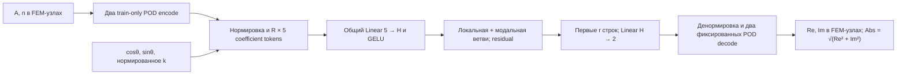

# Ревизия операторов, 8 ноября 2026

SVD-SNO v2 обучена заново и проверена по всем 1280 static-low test-полям. Её средняя complex consistent FEM L2 ошибка — **0.9475%**, у сохранённой v1 — **0.9614%**. Изменение невелико; один seed не доказывает превосходство архитектуры. FNO и Chebyshev-SNO сохранены как самостоятельные методы. Их представления, обучение и ограничения описаны раздельно.

## Что исправлено

| Область | Изменение и проверяемый смысл |
| --- | --- |
| SNO | V2 получает явные coefficient tokens и имеет независимую локальную ветвь. Входные моды сохраняются, даже когда их больше выходных. |
| Checkpoint | `architecture_version` записывается в `model_kwargs`. Все старые unversioned SNO bundles загружаются как v1; полный test-inference даёт те же сохранённые predictions. |
| Физический loss | Нулевая ошибка даёт 0 с конечным градиентом, включая нулевое рассеяние. Прежний floor числителя возвращал 1 для двух нулевых полей. Direct FEM и compressed POD loss остаются согласованы. |
| FNO | При clipping FFT-мод на меньшей сетке сохраняется соответствие отрицательного веса физической частоте. Веса массива `[-m,…,-1]` выбираются с конца; новый regression test проверяет одну и ту же волну на трёх разрешениях. Сохранённый static-low FNO на своей сетке не меняется. |
| Chebyshev | DCT-I и endpoint normalization сохранены; размеры меньше двух и некорректные modes отвергаются до появления NaN. Добавлен consistent FEM projection floor именно для используемого выходного декодера. |
| POD | Real-valued POD явно отвергает комплексные снимки вместо неявного удаления мнимой части. Re и Im строятся отдельно. Проверены weighted orthogonality, нулевой ранг и randomized energy denominator. |
| CLI/notebooks | Добавлены `--sno-architecture-version`, `--resolution`, `--modes`. SVD notebooks выбирают отдельные v2 run-каталоги; прежние outputs удалены из изменённых training notebooks, чтобы не приписывать их новой сети. |

## SVD-SNO v2: формула и смысл индексов

Пусть независимые train-only POD-ранги материалов равны r_A,r_n, а общий выходной размер Re/Im — r. Нормированные входные коэффициенты дополняются нулями до **R=max(r_A,r_n,r)**. Строка входа:

\[
C_j=[\operatorname{pad}(\widetilde c_A)_j,
\operatorname{pad}(\widetilde c_n)_j,\cos\theta,\sin\theta,\widetilde k].
\]

Параметры волны повторяются во всех строках. Общий подъём и блоки:

\[
Z_0=\operatorname{GELU}(CW_{lift}+\mathbf1b_{lift}^T),\qquad
Z_{\ell+1}=Z_\ell+
\operatorname{GELU}(Z_\ell W_{loc,\ell}+\mathbf1b_{loc,\ell}^T+B_\ell Z_\ell W_{ch,\ell}).
\]

Readout `Linear(width,2)` использует первые r строк; затем возвращаются физические масштабы и применяются два фиксированных POD-декодера. Re и Im — два обучаемых выхода; Abs вычисляется из восстановленного поля.



«Локальная» ветвь обрабатывает одну **модальную строку**, а не окрестность физической точки. B — обучаемая матрица смешивания строк, а не пространственный POD-базис Φ. Входные и выходные POD-моды независимы: одинаковый номер строки не означает одинаковую физическую форму. Их связь учит сеть. Для static-набора r_A=r_n=0: модель фактически отображает (cosθ,sinθ,k) в POD-коэффициенты и не может распознавать новые материалы.

Это локальная POD-адаптация coefficient-space SNO. [Fanaskov–Oseledets](https://arxiv.org/abs/2205.10573) используют фиксированные ряды Чебышёва/Фурье; наши POD-базисы и данный эксперимент не объявляются репликацией их результатов. [Методичка](svd_sno_guide.md) подробно разбирает SVD, Z/W/B, Re/Im/Abs и legacy-архитектуру.

V1 сохраняет dense lift d→r×width без GELU и блок `Z + GELU(B(ZW+b))`. V2 обучается с нуля; смена версии не является преобразованием старых весов. В конкретном static-low run v2 имеет 4022 вещественных параметра, v1 — 3110.

## Измеренные результаты static-low

У всех строк одна физическая среда, k∈[1,2], восемь направлений, split по частотам: 5360 train / 1360 validation / 1280 test. Dataset fingerprint совпадает: `786ee3849e909083d98213653affa47907312d0f626e8a60da76e88c70de0ca5`. Ошибки ниже указаны в процентах **complex consistent FEM L2**.

| Модель | Mean | Median | p95 | Max | Completed / best epoch | Параметры |
| --- | ---: | ---: | ---: | ---: | ---: | ---: |
| SVD-SNO v2, новый CPU run | 0.9475 | 0.8671 | 1.6534 | 2.8962 | 165 / 115 | 4022 |
| SVD-SNO v1, прежний CPU run | 0.9614 | 0.8824 | 1.6792 | 2.9480 | 200 / 170 | 3110 |
| FNO, прежний MPS run, новая CPU проверка | 1.6599 | 1.6329 | 1.9505 | 2.2305 | 142 / 92 | 445010 |
| Chebyshev-SNO, новый CPU run, modes8 | 7.9364 | 7.6838 | 9.8811 | 11.1065 | 200 / 199 | 2426 |

Все SNO и Chebyshev test-предсказания повторно вычислены по checkpoint; максимальное отличие от архивов равно нулю. [Компактный JSON](operator_revision.json) содержит полные конфигурации, исходные и повторные метрики, версии библиотек и SHA-256 checkpoint/config/history/predictions; Chebyshev находится в `additional_runs`. [FNO provenance](fno_static_low_verification_2026-11-08.json) содержит исходный MPS run и проверку всех 1280 полей на текущем CPU-коде; максимальная разница test-ошибок — около 4.3×10⁻⁹. Это проверка сохранённой модели, без повторного обучения.

Оба SNO используют randomized train-only POD с выходными рангами Re=Im=10; consistent projection floor mean=0.9188%. Обучение v2 остановлено по validation plateau при patience=50; общий лимит был 200 эпох. Основные настройки всех методов: width=24, depth=3, batch=32, AdamW lr=0.002, weight_decay=10⁻⁵, gradient clipping=1, seed=42. FNO имеет grid32, modes8, padding8. Числа параметров, устройства, завершённые эпохи и режимы представления различаются; это не сравнение при равном вычислительном бюджете. Времена из отдельных runs не используются как доказательство ускорения.

Разница v1/v2 составляет около 0.014 процентного пункта, а стоимость POD-усечения уже близка к итоговой ошибке. Для вывода об архитектурном выигрыше нужны несколько seed и заранее заданный протокол, без выбора лучшего test-результата.

## Chebyshev: измерить представление до обучения

На оси из N возрастающих узлов ξ_j=−cos(πj/(N−1)) матрица C_{jk}=T_k(ξ_j). Пусть D имеет 1/2 в двух крайних позициях и 1 внутри. Используются synthesis=C и analysis=(2/(N−1))DCᵀD. Тогда `analysis @ synthesis = I`; коэффициенты означают f(ξ)=Σa_kT_k(ξ), без скрытых половинных множителей. В двумерном случае преобразование выполняется по обеим осям, затем сохраняется прямоугольный блок мод. Полиномиальные unit tests отдельно проверяют нормировку константы и коэффициенты кубического полинома.

GELU действует над коэффициентами, как у SNO. Поле A/n сначала интерполируется из FEM на Lobatto-сетку, а результат после обратного преобразования — с сетки в FEM. DCT-I не применяется к индексу неструктурированного FEM-узла. Отсутствие промежуточной пространственной нелинейности не устраняет ошибки этих переносов, усечение ряда или низкую регулярность у интерфейсов.

Выход Chebyshev-SNO лежит в фиксированном аффинном пространстве: train mean плюс тензорные полиномы, вычисленные в Lobatto-узлах и затем билинейно перенесённые в FEM-узлы. Его возможности ограничены даже при идеальном предсказании коэффициентов. Для матрицы этого фактического декодера Ψ вычисляются G=ΨᵀMΨ и оптимальные коэффициенты G⁻¹ΨᵀM(u−μ). Здесь M — consistent mass; DCT-truncation error сама по себе такой нижней границей не является.

| Моды на ось | Коэффициенты на компоненту | Validation floor mean | Validation floor p95 |
| --- | ---: | ---: | ---: |
| 8 | 64 | 7.6143% | 9.5266% |
| 12 | 144 | 5.8905% | 6.9562% |
| 16 | 256 | 4.7016% | 5.4575% |

Это **только validation**, 1360 полей; test не участвовал в выборе разрешений. [Машиночитаемый отчёт](chebyshev_decoder_validation_2026-11-08.json) содержит fingerprint, condition numbers и hash воспроизводящей функции. Глобальному полиномиальному представлению трудно описывать поля около многочисленных интерфейсов материалов. С modes8 обучение не может дать среднюю validation ошибку 1% независимо от количества эпох. Увеличение modes/resolution требует нового val-only выбора и нового обучения; число мод не является обещанием точности.

Baseline modes8 обучен все 200 эпох; лучшая validation-эпоха — 199, ошибка 7.9265%. Затем однократно оценены 1280 test-полей: mean 7.9364%. Это близко к представительной нижней границе, но существенно хуже SNO/FNO на данном наборе. Лимит эпох не доказывает сходимость; сохранены все конфигурации и история. Для `chebyshev` параметр `pod_method="randomized"` лишь выбирает профиль каталогов: POD/SVD внутри этой модели не выполняется, а `sno_architecture_version` к ней не применяется.

## FNO: что остаётся пространственным

FNO интерполирует семь входных каналов `[A,n,cosθ,sinθ,k,x,y]` на uniform-grid, поднимает число каналов и повторяет `v + GELU(iFFT(R·FFT(v)) + Conv1x1(v))`. Здесь нелинейность и локальная ветвь действуют в физических узлах. [Исходная FNO-статья](https://arxiv.org/abs/2010.08895) задаёт Fourier kernel, а [документация PyTorch rfft2](https://docs.pytorch.org/docs/stable/generated/torch.fft.rfft2.html) поясняет, почему отрицательные частоты последней оси не хранятся. В первой оси нужны и положительные, и отрицательные окна без перекрытия. Padding=8 расширяет grid32 до40×40; обрезка выполняется перед выходной проекцией.

Padding уменьшает взаимодействие через периодический край расширенного массива, но не навязывает absorbing boundary condition PDE. Граничное поведение здесь выучивается по FEM-меткам; PDE-residual и граничный residual не входят в training loss. Нелинейность может создавать высокие пространственные частоты, поэтому modes8 не ограничивает выход FNO тем же 8×8 полиномиальным пространством, что у Chebyshev. Сохранённая FNO на одной среде тоже не подтверждает обобщение на новые A,n.

## Воспроизведение

Из корня репозитория, с работающим Docker service `dolfinx-complex`:

```bash
# Новый v2 run; существующий завершённый результат только проверяется и загружается.
docker compose exec -T dolfinx-complex python3 -m neural_operator.run train --method svd --pod-method randomized --band low --epochs 200 --sno-architecture-version 2 --output neural_operator/runs/revision_2026-11-08/static_low

# Чистая проверка двух SNO checkpoints по всем test-полям; без обучения.
docker compose exec -T dolfinx-complex python3 -m neural_operator.revision_audit --dataset neural_operator/data/static_low_frequency_1000x8 --current-run neural_operator/runs/revision_2026-11-08/static_low/svd --baseline-run neural_operator/randomized/runs/low_frequency_static_1000x8/svd --comparison-run neural_operator/runs/revision_2026-11-08/static_low/chebyshev --output neural_operator/docs/operator_revision.json

# Только validation: подобрать допустимое выходное пространство Chebyshev.
docker compose exec -T dolfinx-complex python3 -m neural_operator.diagnostics --dataset neural_operator/data/static_low_frequency_1000x8 --resolution 32 --modes 8 12 16 --output neural_operator/docs/chebyshev_decoder_validation_2026-11-08.json

# Отдельный Chebyshev baseline: modes8 на grid32, общий лимит 200 эпох.
docker compose exec -T dolfinx-complex python3 -m neural_operator.run train --method chebyshev --pod-method randomized --band low --epochs 200 --resolution 32 --modes 8 --output neural_operator/runs/revision_2026-11-08/static_low

# Numerical/regression tests, включая v1 checkpoint parity и exact FEM loss.
docker compose exec -T dolfinx-complex python3 -m pytest neural_operator/tests -q
```

Для нового разрешения или иной архитектуры выбирайте отдельный `--output`: завершённый run с другой конфигурацией намеренно не переиспользуется. Прямой Python-интерфейс: `TrainConfig(sno_architecture_version=2, resolution=32, modes=8)` и `run_experiment(...)`; frozen inference требует только `load_predictor(...)`.

## Проверки кода

В Docker выполнено **148 tests passed, 14 subtests passed**; полный neural suite занял 4.11 с в записанном запуске. Проверены shape/градиенты/state roundtrip всех методов, сохранение input modes при r_A>r_out, отдельная локальная ветвь v2, точное воспроизведение unversioned v1, согласие compressed/direct FEM loss по значениям и градиентам, zero/zero loss, weighted POD, точность DCT-I, signed FFT clipping и вложенность Chebyshev decoder spaces. Reuse старого SNO разрешён при явном выборе v1; несовпадение v1/v2 блокирует ошибочное использование run. Для FNO/Chebyshev несущественная SNO-настройка не заставляет переобучать готовые модели.

Кодовые ячейки трёх изменённых notebooks проверены компиляцией; training notebooks не исполнялись повторно ради скрытого запуска обучения. Локальные ссылки изменённых методических документов существуют. Unit tests подтверждают реализацию; физическая точность оценивается отдельно по сохранённым test-метрикам и FEM-refinement evidence.

## Границы результата

Test содержит удержанные частоты одной среды; это не перенос на другие материалы. Средняя ошибка относительно FEM-label не является ошибкой относительно непрерывной PDE. High-band k∈[4,8] сохранён как stress-only из-за проверки FEM-разрешения, см. [аудит датасетов](dataset_audit.md). Ошибка интерфейсного переноса, выходного представления и нейросети имеют разный смысл и учитываются раздельно. В частности, сохранённые SNO/FNO умеют выдавать Re/Im/Abs, но это не добавляет третьего независимого физического выхода и не исправляет ограниченность обучающего распределения.
