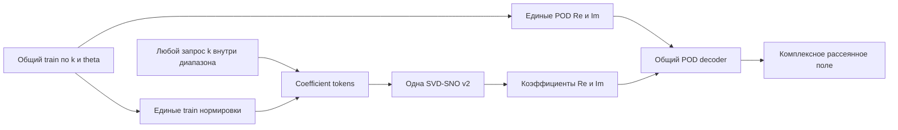

**Одна нейросетевая модель для общего диапазона волновых чисел: SNO, Helmholtz и архитектуры ICML**

Проверено 10 ноября 2026 года. Три субагента с medium effort отдельно разобрали SNO/arXiv, ICML и локальный код; выводы ниже сопоставлены с первичными текстами и авторскими реализациями. Это литературный обзор и проект реализации. Новый FEM-датасет не генерировался, unified-модель не обучалась.

Основной вывод: одну модель на конечном интервале физических волновых чисел построить можно; разделение на low/high не является требованием SNO. Однако в проверенных SNO/PODNO-работах не найден готовый эксперимент, подтверждающий именно широкополосное комплексное Helmholtz scattering. Прямые положительные примеры есть у FNO/HNO. Для текущего проекта рекомендован первый эксперимент с существующей SVD-SNO v2, общими POD-базисами и одним checkpoint; новую архитектуру следует проверять следующим отдельным сравнением.

**Что именно понимается под общим диапазоном**

Целевая постановка:

\[
\mathcal G_\vartheta:(A(x),n(x),k,\theta)\longmapsto
u_s(x;k,\theta),\qquad k\in[k_{\min},k_{\max}].
\]

Параметры сети \(\vartheta\) общие для всех запросов. На инференсе нет выбора low/high-checkpoint или переключения POD-базиса по порогу частоты. Внутренние локальные и глобальные ветви, несколько пространственных масштабов или анализ ошибки по частотным интервалам этому условию не противоречат.

Нужно различать физический параметр \(k\), индекс пространственной Fourier-моды \(m\) и разрешение сетки \(h\). Перенос между разрешениями не доказывает перенос по \(k\); восстановление высоких гармоник поля не доказывает обучение на разных физических частотах. Для сейсмических статей \(f\) измеряется в Гц, \(\omega=2\pi f\), а локальное волновое число зависит и от скорости среды. Их частотные диапазоны нельзя численно приравнивать к нашему \(k\).

Под «общим» здесь выбран конечный интервал. Обещание равномерной точности для всех \(k>0\) потребовало бы отдельного обоснования. Для reference-задачи естественный первый кандидат — объединение прежних полос \([0.1,4]\). Это предложение, а не уже согласованный целевой диапазон пользователя или измеренный результат.

**Какие статьи непосредственно отвечают на вопрос**

| Работа | Что подтверждено | Что брать для проекта |
|---|---|---|
| Huang–Alkhalifah, *Learned frequency-domain scattered wavefield solutions using neural operators*, GJI 2025 | Одна FNO внутри каждого опыта: случайные частоты 3–15 Гц; в другом опыте 3–21 Гц. Вход \((v,U_0)\), выход \(\delta U\). Частота и положение источника содержатся в комплексном фоновом поле \(U_0\). | Самое близкое соответствие scattered target и непрерывно меняющейся частоте. [§2–3, arXiv](https://arxiv.org/html/2405.01272v3), [журнальная версия](https://doi.org/10.1093/gji/ggaf113). |
| Zou et al., *Ambient Noise Full Waveform Inversion with Neural Operators*, JGR 2025 | В §3.2 прямо описана одна 2D HNO для полосы 0.1–0.5 Гц. Частота — пространственно постоянный входной канал. | Подробный пример единой conditional-модели с авторским кодом. [§3.1–3.2](https://arxiv.org/html/2503.15013v2), [репозиторий](https://github.com/caifeng-zou/ANFWI_HNO). |
| Zou et al., *Deep Neural Helmholtz Operators for 3-D Elastic Wave Propagation and Inversion*, GJI 2024 | U-shaped operator принимает скорость, источник и частоту. Препринт использует частотную сетку 1.6–6 Гц с шагом 0.4 Гц. | Полный 3D training workflow, предобученные модели и пример пространственного декодера. Наличие одной сети не заменяет отдельного теста на удержанных непрерывных частотах. [§2–3](https://arxiv.org/html/2311.09608v1), [код](https://github.com/caifeng-zou/HelmholtzNO). |
| Kong et al., *Reducing Frequency Bias of Fourier Neural Operators in 3D Seismic Wavefield Simulations Through Multi-Stage Training*, arXiv 2025 | В Discussion, стр. 18, сопоставлены FNO-1 для всех 11 частот и FNO-11 с отдельной сетью на частоту. Ошибки близки; у FNO-1 верхние частоты несколько хуже. | Прямое исследование компромисса между одной моделью и набором частотных моделей. Основной опубликованный код ориентирован на single-frequency multistage. [Статья, Fig. 10](https://arxiv.org/pdf/2503.02023), [код](https://github.com/qingkaikong/multi-stage_FNO-SeismicSimulations). |

В первой работе backbone — четыре Fourier-блока, width 128, 48 удерживаемых мод, GELU; обучение использует MSE, Adam с lr \(10^{-3}\), 1000 эпох. Авторская ссылка на реализацию в просмотренном тексте не обнаружена. Для нашей падающей плоской волны естественный аналог фонового входа — \(u_i(x)=\exp(ikd\cdot x)\); полезность такого входа именно в нашей SNO ещё предстоит проверить. Приведённые в статье ошибки не дают основания обещать наш целевой процент точности. [Методика и настройки Huang–Alkhalifah](https://arxiv.org/html/2405.01272v3).

Вторая работа использует восемь внутренних FNO-слоёв и U-shaped skip connections, затем GNO для запросов на свободной поверхности. Вход: \(V_P,V_S\), источник, частота; выход комплексный. Обучение — смесь относительных L1/L2 с весами 0.95/0.05. Это упругая сейсмика с иными источниками и границами, поэтому переносится принцип conditioning, а не готовая физическая модель. [Формулы 12 и 15](https://arxiv.org/html/2503.15013v2).

**Насколько подробна доступная реализация HNO**

Авторский код ANFWI_HNO просмотрен на commit `2179584ead4acbed2cf3941955adc5e1554b5f49`. В [UNO2D](https://github.com/caifeng-zou/ANFWI_HNO/blob/2179584ead4acbed2cf3941955adc5e1554b5f49/code/util/HNO.py#L166) заданы размеры внутренних сеток:

\[
256\!\times\!128\to192\!\times\!96\to128\!\times\!64
\to64\!\times\!32\to32\!\times\!16
\to64\!\times\!32\to128\!\times\!64
\to192\!\times\!96\to256\!\times\!128.
\]

Уровни восстанавливаются с concatenation skip connections. Блок содержит spectral convolution, pointwise-путь с изменением разрешения, LayerNorm, GELU и pointwise MLP. Конец этой конкретной реализации интегрирует признаки к поверхности; для полного FEM-поля его потребуется заменить пространственной выходной головой. [Блок и forward](https://github.com/caifeng-zou/ANFWI_HNO/blob/2179584ead4acbed2cf3941955adc5e1554b5f49/code/util/HNO.py#L112).

В [process.py](https://github.com/caifeng-zou/ANFWI_HNO/blob/2179584ead4acbed2cf3941955adc5e1554b5f49/code/util/process.py#L76) временные решения преобразуются в частотные; частота переносится в batch dimension и добавляется пространственно постоянным каналом. Нормировки в этой 2D-версии общие по данным, что удобно для непрерывных запросов. Репозиторий содержит forward/FWI workflows и генерацию данных, но не выделенный полный 2D training notebook. Более подробные training notebooks доступны в [HelmholtzNO](https://github.com/caifeng-zou/HelmholtzNO).

Есть существенная деталь: в 3D [standardizer_wrt_freq](https://github.com/caifeng-zou/HelmholtzNO/blob/cf6b785664c035404f77bd45f220922c76dc3160/code/util/prep_data.py#L27) статистики индексируются по фиксированным частотам. Для произвольного нового \(k\) нужна общая нормировка либо определённая непрерывная интерполяция статистик. Нельзя считать, что скалярный frequency channel автоматически делает весь preprocessing пригодным для любого нового значения. Training notebook 3D — небольшой демонстрационный запуск, а не полный опубликованный датасет.

**Что дают SNO и близкие методы**

| Источник | Архитектура и граница доказательств |
|---|---|
| Fanaskov–Oseledets, *Spectral Neural Operators* | Сеть работает с коэффициентами Chebyshev/Fourier-разложений. В Appendix C.1.3 описаны три слоя, width 20, 100 непериодических либо 51 комплексный периодический коэффициент. В проверенном перечне экспериментов Helmholtz нет. \(k\) в генераторе случайных рядов — индекс гармоники. [§4–5, Appendix C](https://arxiv.org/html/2205.10573v2), [код](https://github.com/VLSF/SNO). |
| Cheng et al., *PODNO* | POD-преобразования заменяют фиксированные спектральные преобразования; внутри слоёв есть возврат в physical space. Проверены Darcy, NLS, KP; общие параметры допустимы, но broadband Helmholtz не исследован. Это отличается от нашей сети целиком над коэффициентами. [§3–4](https://arxiv.org/html/2504.18513v1), [код](https://github.com/Zilan-Cheng/PODNO). |
| Chen et al., *NSNO* | Развёрнутые члены Neumann series, learned resolvents и FNO/UNO. Отдельные cases \(k=20,40,60\) не доказывают общую полосу. [Статья](https://arxiv.org/html/2401.13494v1). В [авторском коде](https://github.com/liuziyang-thu/NSNO/blob/main/forward/models.py) \(k\) хранится как `self.k` конструктора; это не per-sample frequency input. |
| You–Xu–Cai, *MscaleFNO* | Параллельные масштабированные FNO помогают учить осциллирующие поля. В опубликованном 2D Helmholtz-примере \(\lambda=10\) фиксирована; medium/coordinates меняются. Такой результат не подтверждает одну сеть по физическому \(k\). [Авторская журнальная PDF, Example 4.5](https://bpb-us-w2.wpmucdn.com/people.smu.edu/dist/e/573/files/2026/04/MultiscaleFNO_reprint.pdf), [код](https://github.com/yyc-rgb/MscaleFNO). |

Корректная атрибуция нашей модели: «локальная POD/SVD-адаптация coefficient-space идеи SNO». Ни тождество с оригинальным SNO, ни воспроизведение PODNO из такого описания не следуют.

**Что найдено в ICML**

В проверенной подборке и поиске по ICML, включая оглавления [2025](https://proceedings.mlr.press/v267/) и [2026](https://proceedings.mlr.press/v306/), прямой работы об одной SNO для нашего комплекса \((A,n,k,\theta)\) не обнаружено. Это результат ограниченного поиска, а не доказательство отсутствия такой статьи во всех proceedings. Следующие работы дают конкретные архитектурные идеи.

1. **LocalNO, ICML 2024** — глобальные Fourier-операции дополняются локальным интегральным и дифференциальным взаимодействием. Схематически, с объединением авторских ветвей в нашей записи:

   \[
   v_{\ell+1}=\sigma\bigl(W_\ell v_\ell+
   \mathcal F^{-1}(R_\ell\mathcal Fv_\ell)+
   \mathcal I_\ell v_\ell+\mathcal D_\ell v_\ell\bigr).
   \]

   Локальная интегральная окрестность задаётся в физических координатах; дифференциальные kernels масштабируются при изменении шага сетки. Практический интерес для нас — локальные интерфейсные структуры плюс дальнее распространение. Смешанный физический \(k\) в экспериментах не проверен. [PMLR](https://proceedings.mlr.press/v235/liu-schiaffini24a.html), [§3.5 и implementation appendix](https://arxiv.org/html/2402.16845v2), [LocalNO implementation](https://github.com/neuraloperator/neuraloperator/blob/main/neuralop/models/local_no.py).

2. **GNOT, ICML 2023** — отдельные encoders для нескольких функций и глобальных параметров, heterogeneous normalized cross-attention, self-attention, геометрическое soft gating. Это удобная альтернатива, если важно сохранить нерегулярные FEM-узлы: поля \(A,n\) и вектор \((k,\cos\theta,\sin\theta)\) можно кодировать раздельно. Такое назначение входов — наша адаптация. Geometric gating разделяет пространственные структуры, не диапазоны физических частот. [PMLR](https://proceedings.mlr.press/v202/hao23c.html), [§3](https://proceedings.mlr.press/v202/hao23c/hao23c.pdf), [код](https://github.com/thu-ml/GNOT).

3. **IRNO, ICML 2026** — frozen base operator и обучаемый refiner с общими весами на всех шагах:

   \[
   h_0=T_{base}(a),\qquad
   h_{j+1}=h_j+\alpha\Phi_\eta(a,h_j).
   \]

   Progressive spectral loss усиливает внимание к высокочастотной пространственной ошибке. Это вариант дальнейшего исправления ошибок, а не прямое подтверждение переноса по физическому \(k\). Модель содержит два модуля; при желании начать с единой простой сети этот этап можно отложить. Условия contraction из статьи автоматически не переносятся на indefinite Helmholtz. [PMLR](https://proceedings.mlr.press/v306/liu26dm.html), [авторская методика](https://xiaotianliu-dartmouth.github.io/IRNO_ICML_26_Spotlight/), [код](https://github.com/xiaotianliu-dartmouth/Iterative_Refinement_Neural_Operator).

4. **HiNOTE/HNOT, ICML 2024** — hierarchical operator, Galerkin attention, sinc filtering, frequency-aware loss prior для arbitrary-scale super-resolution. Здесь frequency относится к спектру пространственных данных. Работа полезна для представления деталей, но не является основной ссылкой на physical-frequency conditioning. [PMLR](https://proceedings.mlr.press/v235/luo24g.html).

F-FNO относится к [ICLR 2023](https://github.com/alasdairtran/fourierflow), CNO — к [NeurIPS 2023](https://github.com/camlab-ethz/ConvolutionalNeuralOperator), MgNO — к [ICLR 2024](https://proceedings.iclr.cc/paper_files/paper/2024/hash/eb3c8135137c8a60425a0320869ad87e-Abstract-Conference.html). Их нельзя перечислять как результаты ICML. Точное самостоятельное название «Frequency-Aware Neural Operators» в проверенных источниках не идентифицировано; подменять его HNOT не следует.

**Как устроена текущая SVD-SNO v2**

В [SVDSNO](/Users/egoriy/Desktop/multiscale-fem-scattering/neural_operator/sno/model.py:18) нет частотного переключателя. Непрерывный вещественный \(k\) уже входит во входные признаки. Реализация проходит следующие стадии.

1. По train строятся независимые POD-базисы материалов \(\Phi_A,\Phi_n\) и выходов \(\Phi_R,\Phi_I\). Для одной вещественной компоненты:

   \[
   (F-\mathbf1\mu^T)W^{1/2}=U\Sigma V^T,
   \qquad \Phi=W^{-1/2}V_r,
   \qquad c=\Phi^TW(f-\mu).
   \]

   Здесь \(W\) — диагональная lumped mass, а не обучаемая матрица сети. Все средние и нормировки оцениваются по train. [Построение пространств](/Users/egoriy/Desktop/multiscale-fem-scattering/neural_operator/training.py:122).

2. Вход имеет форму \([B,r_A+r_n+3]\):

   \[
   x=[\widetilde c_A,\widetilde c_n,\cos\theta,\sin\theta,\widetilde k],
   \quad\widetilde k=(k-\mu_{k,train})/\sigma_{k,train}.
   \]

   Коэффициенты материалов независимо дополняются нулями до \(R=\max(r_{out},r_A,r_n)\). Получаются tokens \(T\in\mathbb R^{B\times R\times5}\):

   \[
   T_j=[\widetilde c_{A,j},\widetilde c_{n,j},
   \cos\theta,\sin\theta,\widetilde k],\quad
   Z^{(0)}=\operatorname{GELU}(T W_{lift}+b_{lift}).
   \]

   \(Z^{(0)}\) имеет форму \([B,R,H]\). Совпадение индекса \(j\) не означает совпадение пространственных функций разных POD-базисов. [Tokens](/Users/egoriy/Desktop/multiscale-fem-scattering/neural_operator/sno/model.py:49).

3. Каждый из \(L\) блоков вычисляет

   \[
   Z^{(\ell+1)}=Z^{(\ell)}+
   \operatorname{GELU}\left(Z^{(\ell)}W_{loc}^{(\ell)}+b^{(\ell)}+
   B^{(\ell)}Z^{(\ell)}W_{ch}^{(\ell)}\right).
   \]

   \(W_{loc},W_{ch}\in\mathbb R^{H\times H}\) смешивают скрытые каналы, \(B^{(\ell)}\in\mathbb R^{R\times R}\) — модальные позиции. Это полностью coefficient-space модель: внутри блока нет FFT или пространственного дифференцирования. [CoefficientBlock](/Users/egoriy/Desktop/multiscale-fem-scattering/neural_operator/_layers.py:37).

4. Общая линейная голова \(H\to2\) на первых \(r_{out}\) позициях выдаёт нормированные коэффициенты Re/Im. После обратной нормировки:

   \[
   \widehat u_s=\mu_R+\Phi_R\widehat c_R+
   i(\mu_I+\Phi_I\widehat c_I).
   \]

   Модуль вычисляется после восстановления: \(|\widehat u_s|=\sqrt{\widehat u_R^2+\widehat u_I^2}\). Отдельная amplitude-head не требуется.

В reference-моделях \(H=48,L=6\). На фиксированной среде \(r_A=r_n=0\), фактические независимые входы — только \(k,\theta\). Количество обучаемых параметров равно

\[
P=8H+2+L(2H^2+H+R^2)=28322+6R^2.
\]

Хранение POD-таблиц \(N_h\times r\) учитывается отдельно. Рост общего ранга увеличивает и память декодера, и квадратичную по \(R\) стоимость modal mixing.

**Почему результаты сейчас разделены на low/high**

| Сценарий проекта | Диапазоны | Что фактически проверено |
|---|---|---|
| Основной `neural_operator` | low [1,2], high [4,8] | Раздельные datasets/runs; текущая статья посвящена static [1,2]. Между полосами есть промежуток. |
| `reference_sno_gmsfem` | low [0.1,2], high [2,4] | Два обученных checkpoint с независимыми POD-базисами и нормировками; дополнительно extrapolation frozen low на k>2. |

Это разные среды и сетки. В статье static-low — три активных включения и 3221 узел. Reference использует 24 включения, \(A=0.2I,n=10\), и 53 246 узлов. Их метрики объединять в одну таблицу единого опыта нельзя. [Reference model](/Users/egoriy/Desktop/multiscale-fem-scattering/experiments/reference_sno_gmsfem/MODEL.md:33), [текущая статья](/Users/egoriy/Desktop/multiscale-fem-scattering/paper/svd_sno_revision_2026-11-06/main.tex:31).

Раздельные run заданы циклом в [reference runner](/Users/egoriy/Desktop/multiscale-fem-scattering/experiments/reference_sno_gmsfem/run.py:105), а не формулой SNO. Core CLI уже имеет произвольный `--k-range` и отдельный `--dataset`; это позволяет создать общий диапазон в основной static-постановке. Для сохранения физики reference нужна параметризация его собственного генератора, а не замена его генератором другой среды. [Core CLI](/Users/egoriy/Desktop/multiscale-fem-scattering/neural_operator/run.py:55).

По сохранённым reference-артефактам:

| Показатель, рассеянное поле | low [0.1,2] | high [2,4] |
|---|---:|---:|
| POD-ранг Re/Im | 25/25 | 56/56 |
| Test mean consistent complex L2 | 0.7575% | 3.3180% |
| Test p95 | 2.6427% | 9.6640% |
| Mean consistent decoder floor | 0.1120% | 0.0912% |
| Лучшая эпоха / лимит | 497/500 | 498/500 |

Frozen low на \(k>2\) даёт 177.7174% средней ошибки рассеянного поля. Это не результат unified-обучения: модель не видела эту полосу при обучении. High-run остановлен по лимиту эпох и не доказывает предельное качество архитектуры. [Сохранённый отчёт](/Users/egoriy/Desktop/multiscale-fem-scattering/experiments/reference_sno_gmsfem/results/REPORT.md:5).

Главное следствие: в текущем high-опыте ошибка сети намного выше decoder floor. Одно увеличение POD-ранга не объясняет и не устраняет этот разрыв. Но достаточность ранга 56 или cap 96 для объединённого диапазона ещё не установлена.

**Конкретный вариант реализации без low/high**

Первый baseline должен сохранить существующую SVD-SNO v2 и изменить только экспериментальный протокол:

Нужно объединять физические поля и метаданные, затем заново строить базисы по общему train. Коэффициенты существующих low/high-POD относятся к разным координатным системам: простая склейка коэффициентов или усреднение весов некорректны. Если исходные reference-поля переиспользуются, для \(k=2\) нужен один глобальный frequency group; локальные `frequency_id` разных файлов не уникальны глобально. При сохранении прежнего benchmark-test ни один его снимок не должен попасть в новый train.

Для первой настройки можно оставить \(H=48,L=6\), общую нормировку \(k\) и выбрать rank по объединённому validation. Это стартовый контроль с известной реализацией, а не заявление об оптимальности гиперпараметров. Сравнение с обычным MLP над теми же POD-коэффициентами полезно: на фиксированной среде задача имеет лишь два параметра, и преимущество modal mixing нужно продемонстрировать.

Если baseline показывает большой mapping error при малом decoder floor, предлагается отдельная **модификация проекта**, не готовый результат одной из статей: conditioning во всех слоях.

\[
q=[\widetilde k,\widetilde{k^2},\cos\theta,\sin\theta],
\quad e=\mathrm{MLP}(q),
\quad(\gamma_\ell,\beta_\ell)=L_\ell(e)\in\mathbb R^{2H},
\]

\[
S_\ell=ZW_{loc}+b+BZW_{ch},\qquad
Z_{next}=Z+\operatorname{GELU}((1+\gamma_\ell)\odot S_\ell+\beta_\ell).
\]

Модуляция broadcast по \(R\). Выходные линейные слои conditioning можно инициализировать нулями, чтобы стартовать с исходного блока. \(k^2\) нормируется собственными train-статистиками. Это остаётся одной сетью с непрерывными признаками и без выбора полосы. Fourier features по нормированному \(k\) можно добавить отдельной ablation, если видна недообученная осцилляция коэффициентов; произвольный большой набор частот вводить заранее не стоит.

Если общий POD-декодер требует слишком большого ранга, следующий архитектурный кандидат — spatial FNO/LocalNO с входом

\[
[A_{11},A_{12},A_{22},n,\Re u_i,\Im u_i,
\widetilde k,x,y]
\longmapsto[\Re u_s,\Im u_s].
\]

Для скалярного \(A=\alpha I\) достаточно одного канала \(\alpha\). Входной \(u_i\) явно сообщает пространственную фазу и направление; вычислить его можно аналитически. Это наша адаптация идеи фонового поля. Вариант на регулярной сетке требует отдельного учёта FEM↔grid transfer; GNOT можно исследовать как альтернативу для нерегулярных узлов. Все веса обучаются совместно на одной смеси \(k\).

**Как понять, что мешает точности**

У общего POD-декодера есть ограничение представления. Для лучшей проекции \(u_r^*\) в его аффинное пространство в consistent FEM-метрике:

\[
\|u-\widehat u\|_M^2=
\|u-u_r^*\|_M^2+\|u_r^*-\widehat u\|_M^2.
\]

Первое слагаемое — decoder floor, второе — ошибка предсказания допустимых коэффициентов. Равенство относится к оптимальной M-проекции; простое кодирование lumped-POD не обязано давать её, поскольку \(W\ne M\). В отчёте следует сохранять consistent floor отдельно. Увеличение глубины не помогает, если велико первое слагаемое; смена базиса без проверки mapping error также может оказаться лишней.

Физическое разрешение проверяется по наиболее короткой локальной волне. При \(A=\alpha I\) внутри однородного включения:

\[
k_{loc}=k\sqrt{n/\alpha},\qquad
\lambda_{loc}=2\pi/k_{loc}.
\]

Для reference \(\alpha=0.2,n=10\) и \(k=4\): \(k_{loc}\approx28.28\), \(\lambda_{loc}\approx0.222\). Это расчёт из локального уравнения, не результат статьи. Номинальное \(h=0.02\) даёт около 11 шагов на эту длину, но само это число не доказывает FEM convergence: существенны фактическая сетка, интерфейсы, P1-дисперсия и граничная аппроксимация. Нужны выбранные повторные решения на более мелкой сетке, прежде чем трактовать surrogate error как точность непрерывной задачи.

**Минимальный убедительный эксперимент и обратная связь**

1. Зафиксировать задачу: одна среда или разные \(A,n\), конечный диапазон \(k\), требуемые mean/p95 ошибки. Для ближайшего продолжения reference достаточно одной среды и \([0.1,4]\); перенос на материалы — отдельный следующий опыт.
2. Сформировать общий train/val/test по частотным группам; все направления одного \(k\) держать вместе. Для нескольких сред дополнительно разделять среды. На новом тесте использовать и частоты между train-точками, и удержанные направления. Дедупликация проводится по физическим параметрам, а не именам файлов.
3. До обучения измерить decoder floor против \(k\) и rank. Выбирать rank на validation с контролем среднего и хвоста ошибки. Старый rank cap не считать доказанно достаточным.
4. Обучить три сравнимых варианта: shared SVD-SNO v2; shared POD-MLP; shared SVD-SNO с conditioning. Дать несколько seed, согласованный tuning budget и одинаковые данные. Только при необходимости добавить spatial LocalNO как отдельное исследование представления.
5. Для сравнения shared и двух полос использовать общий нетронутый test, одинаковый union train-решений, учитывать сумму параметров/времени двух моделей и дополнительные POD-таблицы. Старые checkpoint полезны как reference, но их прежние test не должны незаметно стать новым train.
6. Основная loss — комплексная consistent FEM L2, уже поддержанная кодом. Отдельно показывать mean, p95, max, ошибку почти нулевых полей, decoder floor и распределение по \(k\). Стратифицированные batches по всему диапазону и равномерное взвешивание запросов помогут проверить, не доминирует ли одна часть спектра; они не требуют нескольких моделей.
7. Экстраполяцию за \([k_{min},k_{max}]\) оформлять отдельным тестом с frozen weights/bases. Аналогично отдельно показывать spatial-resolution transfer и обобщение на новые материалы. Ни один из этих результатов не следует автоматически из остальных.

Содержательная исследовательская гипотеза: **одна SVD-SNO с общим выходным пространством способна аппроксимировать параметрическое семейство Helmholtz-решений на заданном интервале, а layer-wise conditioning уменьшает ошибку отображения при контролируемом decoder floor**. Возможность общего интервала уже поддерживается входным API; качество этой гипотезы пока не измерено.

Главный вклад будущего исследования будет в контролируемом сравнении представления, conditioning и ошибок по всему диапазону. Простое увеличение числа слоёв или замена названия low/high на shared ещё не создаёт такого результата.
