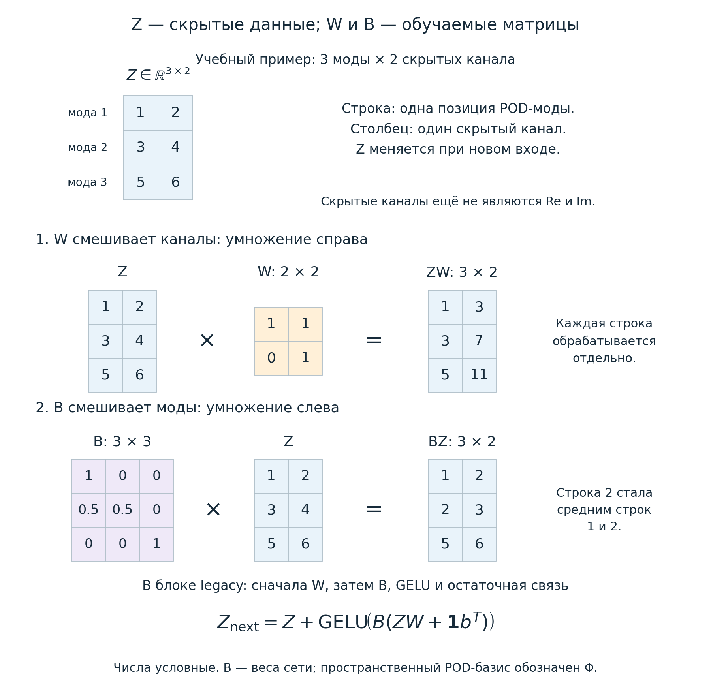
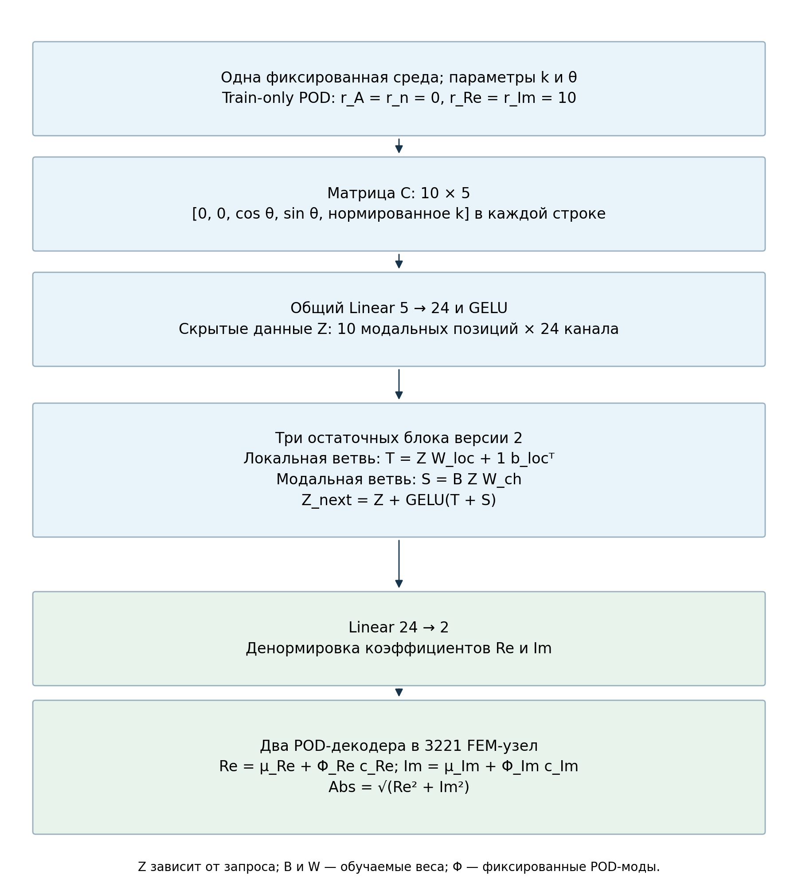
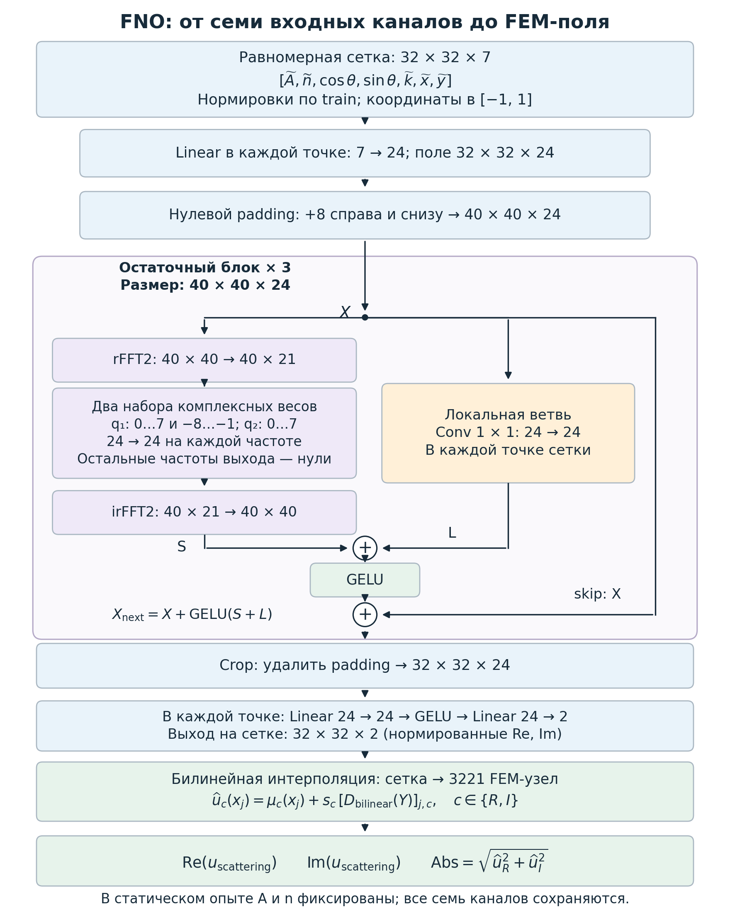

# Методичка: SVD, SNO и комплексное рассеянное поле

Эта методичка объясняет путь от конечно-элементных данных до трёх результатов: **Re(u_scattering), Im(u_scattering), Abs(u_scattering)**. Формулы ниже описывают SVD-SNO v2 и техническую совместимость с форматом v1. Новые измеренные результаты и команды приведены в [отчёте ревизии](operator_revision.md). Текущий эксперимент описан в [статье](../../paper/svd_sno_revision_2026-11-06/main.tex).

## 1. Что должна предсказывать модель

Вход задачи — пространственные коэффициенты среды \(A(x),n(x)\), волновое число \(k\) и направление падающей волны \(\theta\). На выходе требуется комплексное **рассеянное** поле:

\[
u_s(x)=u_{\mathrm{scattering}}(x)=u_R(x)+i u_I(x).
\]

Полное поле равно \(u_{\mathrm{total}}=u_i+u_s\), где \(u_i=\exp(ik(\cos\theta,\sin\theta)\cdot x)\). Модели данного пакета предсказывают именно \(u_s\). Обозначения `u_scat`, `u_s` и `u_scattering` в этом объяснении относятся к одному полю.

| Результат | Формула | Смысл |
| --- | --- | --- |
| Re(u_scattering) | \(u_R\) | Действительная часть со знаком |
| Im(u_scattering) | \(u_I\) | Мнимая часть со знаком |
| Abs(u_scattering) | \(\sqrt{u_R^2+u_I^2}\) | Неотрицательный модуль, или амплитуда комплексного поля |

Например, при \(u_s=3-4i\) три значения равны \(3,-4,5\). Модуль — это не сумма частей и не интенсивность \(|u_s|^2\).

Достаточно предсказывать **два независимых вещественных канала**. Третий результат вычисляется из них после восстановления физического поля. Так всегда выполняется тождество \(|u_s|^2=u_R^2+u_I^2\); отдельная обучаемая голова для модуля могла бы его нарушить. Вычислять модуль нужно после обратной нормировки и декодирования: модуль POD-коэффициентов не является модулем пространственного поля.

Каждый результат выдаётся в FEM-узлах. Между узлами Re и Im задают P1-поле; его точный модуль вычисляется из интерполированных Re и Im. Простая линейная интерполяция уже вычисленных узловых модулей в общем случае даёт другую функцию.

## 2. Зачем нужны SVD и POD

Одно FEM-решение может содержать тысячи узловых значений. Соседние решения при разных параметрах часто имеют общие пространственные структуры. Вместо предсказания всех узлов сразу можно искать несколько характерных пространственных полей и предсказывать только их веса.

**SVD** — алгоритм разложения матрицы. **POD** — представление семейства полей небольшим числом наиболее значимых мод; в этой реализации POD строится с помощью SVD. SVD самостоятельно не предсказывает решение для новых \(A,n,k,\theta\). Эту зависимость обучает нейросеть.

### 2.1. Матрица снимков и центрирование

Пусть имеется \(m\) обучающих снимков одного вещественного поля, по \(N_h\) узлов в каждом. Для Re и Im такие вычисления выполняются раздельно. Сначала вычисляем среднее поле:

\[
\mu=\frac1m\sum_{s=1}^m f^{(s)},\qquad
X_{s,:}=(f^{(s)}-\mu)^T,\qquad X\in\mathbb R^{m\times N_h}.
\]

Среднее хранится отдельно: моды должны описывать изменения относительно него. И среднее, и моды оцениваются по **train**, чтобы отложенные поля не участвовали в построении представления.

### 2.2. Как разложение находит пространственные моды

Вначале рассмотрим обычную евклидову метрику:

\[
X=U\Sigma V^T
=\sum_j\sigma_j U_{:,j}V_{:,j}^T,\qquad
\sigma_1\geq\sigma_2\geq\cdots\geq0.
\]

Каждое слагаемое — матрица ранга один. Столбец \(V_{:,j}\) задаёт пространственную форму, а столбец \(U_{:,j}\sigma_j\) — её коэффициенты во всех обучающих снимках. Числа \(\sigma_j\) показывают значимость этих направлений в матрице данных. Знак отдельной моды произволен: одновременная смена знака моды и её коэффициента сохраняет поле.

Оставляем первые \(r\) мод:

\[
X_r=U_r\Sigma_r V_r^T,\qquad
\|X-X_r\|_F^2=\sum_{j>r}\sigma_j^2.
\]

Среди матриц ранга не выше \(r\) это приближение минимизирует ошибку в норме Фробениуса. Утверждение относится к выбранной метрике и обучающей матрице; оно не обещает такую же точность на любом новом поле.

### 2.3. Почему в текущем коде используются веса

На неравномерной FEM-сетке равный вес каждого узла переоценивает области, где узлов больше. В [PODBasis](../sno/basis.py) используются положительные веса \(w_j\), равные lumped FEM-массам. Обозначим

\[
W_{\mathrm{POD}}=\operatorname{diag}(w_j),\qquad D=\operatorname{diag}(\sqrt{w_j}).
\]

SVD применяется к взвешенной матрице \(Y=XD\), а пространственный базис задаётся как

\[
Y=U\Sigma V^T,\qquad
\Phi_r=D^{-1}V_r,\qquad \Phi_r^T W_{\mathrm{POD}}\Phi_r=I_r.
\]

После этого **encode** переводит поле в коэффициенты, а **decode** возвращает его в узлы:

\[
c=\Phi_r^T W_{\mathrm{POD}}(f-\mu),\qquad f_r=\mu+\Phi_r c.
\]

В NumPy строки соответствуют снимкам, поэтому та же операция записана как `((fields - mean) * weights) @ modes`. Доля сохранённой центрированной train-энергии равна

\[
E_r=\frac{\sum_{j=1}^r\sigma_j^2}{\|Y\|_F^2}.
\]

Знаменатель содержит полную энергию матрицы, даже если вычислена только часть сингулярных чисел. Большая доля энергии — полезная диагностика сжатия, но сама по себе не определяет ошибку сети.

### 2.4. Небольшой численный пример

Пусть строки матрицы снимков без весов равны \((2,0),(-2,0),(0,1),(0,-1)\). Среднее нулевое, а \(X^TX=\operatorname{diag}(8,2)\). Поэтому сингулярные числа равны \(\sqrt8\) и \(\sqrt2\), первая пространственная мода направлена вдоль первой координаты.

Одна мода сохраняет \(8/(8+2)=80\%\) train-энергии. Первые два снимка восстанавливаются точно, последние два восстанавливаются нулями. Так видно, почему хорошая **средняя** характеристика сжатия не гарантирует точность каждого примера.

### 2.5. Полный и рандомизированный SVD

`method="full"` вызывает экономный `numpy.linalg.svd(..., full_matrices=False)`, после чего оставляет нужные моды. «Полный» здесь означает алгоритм разложения исходной матрицы, а не необходимость хранить все моды в модели.

Для `method="randomized"` и достаточно малого запрошенного ранга код выполняет:

1. Создаёт случайную матрицу \(\Omega\) с \(r+10\) столбцами и находит ортонормированный базис \(Q\) для \(Y\Omega\).
2. Дважды уточняет подпространство, чередуя QR-разложения \(Y^TQ\) и произведения \(YZ\), где \(Z\) — полученный правый базис.
3. Вычисляет обычный SVD меньшей матрицы \(Q^TY\).
4. Оставляет правые сингулярные векторы и возвращает физические моды делением на \(\sqrt{w_j}\).

Здесь дополнительные 10 направлений помогают захватить нужное подпространство, а две степенные итерации усиливают вклад ведущих направлений. `seed` фиксирует случайную выборку. Если \(r+10\) уже достигает меньшего размера матрицы, реализация переходит к полному SVD. Почти нулевые сингулярные значения отбрасываются по численному порогу. У постоянного поля ранг после центрирования равен нулю.

Рандомизированный SVD — приближённый алгоритм вычисления базиса. Он не добавляет случайные среды в датасет и не заменяет обучение сети.

## 3. Как устроен текущий SVD-SNO

В [SVDSNO](../sno/model.py) нейросеть работает с коэффициентами, а не с массивом FEM-узлов. Название обозначает локальную адаптацию идеи SNO с POD-базисами. Оно не означает точное воспроизведение всех архитектур, называемых SNO в литературе.

Весь путь можно записать так:

```text
A, n в FEM-узлах ── POD encode ── нормировка ─┐
                                            ├─ вектор признаков q
theta ── cos(theta), sin(theta) ──────────────┤
k ── нормировка ─────────────────────────────┘
       ↓ сборка R × 5 coefficient tokens, общий Linear(5,H) + GELU
R × H скрытых значений
       ↓ depth остаточных блоков смешивания мод и каналов
R × H
       ↓ Linear(H, 2)
r_out × 2 нормированных выходных коэффициентов (первые r_out строк)
       ↓ обратная нормировка + два POD-декодера
Re(u_scattering), Im(u_scattering) в FEM-узлах
       ↓ sqrt(Re² + Im²)
Abs(u_scattering)
```

### 3.1. Четыре независимых базиса и входные признаки

Отдельные POD-базисы строятся для \(A,n,u_R,u_I\). Их ранги могут различаться. Для \(A,n\) берётся по одному снимку на обучающую среду: повторение одного материала для разных направлений не создаёт новую пространственную информацию.

Пусть входные ранги равны \(r_A,r_n\). Тогда сеть получает вектор длины

\[
d=r_A+r_n+3,\qquad
q=\bigl[\widetilde c_A,\widetilde c_n,
\cos\theta,\sin\theta,\widetilde k\bigr].
\]

Коэффициенты и \(k\) нормируются по train-статистикам. Пара \(\cos\theta,\sin\theta\) учитывает периодичность угла без разрыва между \(0\) и \(2\pi\). Постоянные признаки не делятся на почти нулевое стандартное отклонение: код использует единичный масштаб.

У текущего **static**-датасета физическая среда одна. Поэтому \(r_A=r_n=0\), и меняются только три признака волны. Такая сохранённая SVD-SNO-модель не реагирует на новые материалы: при нулевых входных рангах их изменение не передаётся сети.

### 3.2. Что означают Z, W и B

Начнём с ролей этих объектов. **Z — текущие данные внутри сети; W и B — обучаемые правила преобразования этих данных.** Они не обозначают три разных физических поля.

В одном примере \(Z\) — таблица из \(R\) строк и \(H\) столбцов:

| Элемент | Что означает | Меняется от запроса к запросу? | Обучается оптимизатором? |
| --- | --- | --- | --- |
| \(Z\in\mathbb R^{R\times H}\) | Скрытые значения для текущего запроса | Да | Вычисляется из входа; отдельным параметром не является |
| Строка \(Z_{j,:}\) | \(H\) скрытых признаков в позиции моды \(j\) | Да | — |
| Столбец \(Z_{:,h}\) | Один скрытый канал \(h\) во всех модальных позициях | Да | — |
| \(W_\ell\in\mathbb R^{H\times H}\) | Смешивание каналов в каждой строке | После обучения фиксирована | Да |
| \(B_\ell\in\mathbb R^{R\times R}\) | Смешивание модальных строк в каждом канале | После обучения фиксирована | Да |
| \(b_\ell\in\mathbb R^H\) | Обучаемый сдвиг локальной ветви (v2) | После обучения фиксирован | Да |
| \(\Phi\in\mathbb R^{N_h\times r}\) | Пространственные POD-моды в FEM-узлах | Фиксированы после построения базиса | Нет, вычисляются посредством SVD |

Скрытый канал — дополнительный признак, который сеть создаёт для решения задачи. Он не обязан соответствовать Re, Im, координате или физической величине. У двух каналов выходного слоя смысл уже задан: коэффициенты Re и Im. В скрытой таблице отдельное \(Z_{jh}\) ещё не является коэффициентом конечного поля.

**B не является POD-базисом.** Матрица \(B\) имеет размер \(R\times R\) и работает внутри сети. POD-базис \(\Phi\) имеет размер \(N_h\times r\) и восстанавливает значения в пространстве. Также \(W_\ell\) здесь — вес слоя нейросети; диагональная матрица квадратурных весов из раздела 2 обозначена отдельно как \(W_{\mathrm{POD}}\).



На рисунке показаны две операции над разными осями одной таблицы. Умножение \(ZW\) меняет столбцы внутри каждой строки. Умножение \(BZ\) меняет строки внутри каждого столбца.

#### Учебный пример: три модальные позиции и два канала

Возьмём небольшую таблицу скрытых значений. Числа выбраны для объяснения умножения матриц; это не обученные веса и не результат эксперимента:

\[
Z=\begin{pmatrix}1&2\\3&4\\5&6\end{pmatrix},\qquad
W=\begin{pmatrix}1&1\\0&1\end{pmatrix},\qquad
B=\begin{pmatrix}1&0&0\\\tfrac12&\tfrac12&0\\0&0&1\end{pmatrix}.
\]

**1. Только смешивание каналов:**

\[
ZW=\begin{pmatrix}1&3\\3&7\\5&11\end{pmatrix}.
\]

Например, первая строка \([1,2]\) стала \([1,1+2]=[1,3]\). В каждой строке первый канал сохранён, второй заменён суммой двух каналов. Данные других строк здесь не использовались: модальные позиции пока не взаимодействуют.

**2. Только смешивание мод, применённое к исходной Z:**

\[
BZ=\begin{pmatrix}1&2\\2&3\\5&6\end{pmatrix}.
\]

Теперь вторая строка стала средним первой и второй: \(\tfrac12[1,2]+\tfrac12[3,4]=[2,3]\). Первая и третья строки сохранены. Правило одинаково для обоих каналов, и при этой операции один канал не складывается с другим. В настоящем слое веса \(B\) могут быть отрицательными и не обязаны суммироваться в единицу; усреднение выбрано только для простоты примера.

**3. Последовательность legacy PyTorch-блока v1:** сначала \(ZW\), затем сдвиг, затем \(B\). Для \(b=[0,1]^T\) получаем

\[
ZW+\mathbf1b^T=\begin{pmatrix}1&4\\3&8\\5&12\end{pmatrix},\qquad
B(ZW+\mathbf1b^T)=\begin{pmatrix}1&4\\2&6\\5&12\end{pmatrix}.
\]

Вектор \(\mathbf1\) из трёх единиц повторяет один и тот же сдвиг \([0,1]\) в каждой строке. Он позволяет слою выдавать ненулевую поправку даже при нулевых входных значениях. После умножения на \(B\) применяется GELU к каждому элементу, затем прибавляется исходная \(Z\). Получается следующая скрытая таблица, а не готовое поле.

#### Индекс слоя и связь с кодом

Надпись \(Z^{(\ell)}\) означает «таблица после \(\ell\) блоков», а не возведение матрицы в степень. \(Z^{(0)}\) приходит из `lift`, \(Z^{(1)}\) — из первого блока. Индекс \(\ell\) у \(B_\ell,W_\ell,b_\ell\) указывает, что у каждого блока собственные обучаемые параметры. Во время одного прогноза параметры фиксированы, а значения \(Z\) последовательно меняются.

В сохранённом v1 [_ModeBlock](../_layers.py) `channels` соответствует преобразованию \(ZW+\mathbf1b^T\), а `axes[0]` — умножению на \(B\) по модальной оси. В принятой математической записи \(W=\texttt{channels.weight}^T\), \(b=\texttt{channels.bias}\), \(B=\texttt{axes[0].weight}\): `nn.Linear` хранит матрицу каналов в транспонированном относительно \(ZW\) порядке.

### 3.3. Подъём размерности и остаточные блоки

В v2 модальная длина равна \(R=\max(r_A,r_n,r_{out})\), а не просто выходному рангу. По каждому независимому входному базису коэффициенты дополняются нулями до \(R\). В позиции \(j\) формируется пять признаков:

\[
 C_{j,:}=\left[\operatorname{pad}(\widetilde c_A)_j,
 \operatorname{pad}(\widetilde c_n)_j,\cos\theta,\sin\theta,\widetilde k\right],
 \qquad Z^{(0)}=\operatorname{GELU}(CW_{lift}+\mathbf1b_{lift}^{T}).
\]

`Linear(5,H)` обрабатывает все строки с общими весами. Если входной ранг больше выходного, дополнительные входные строки участвуют во всех блоках: только readout обрезает таблицу до \(r_{out}\). Нулевой ранг обоих материалов допустим: тогда все строки получают параметры волны, а обучаемая матрица \(B\) позволяет различать выходные позиции.

Блок [CoefficientBlock](../_layers.py) получает одну таблицу \(Z\) в двух параллельных ветвях:

\[
 Z^{(\ell+1)}=Z^{(\ell)}+
 \operatorname{GELU}\left(
 \underbrace{Z^{(\ell)}W_{loc,\ell}+\mathbf1b_{loc,\ell}^{T}}_{\text{каждая строка отдельно}}
 +\underbrace{B_\ell Z^{(\ell)}W_{ch,\ell}}_{\text{моды и каналы}}
 \right).
\]

Если \(B=0\), локальная ветвь продолжает изменять представление. В старом v1-блоке весь нелинейный путь проходил через \(B\): \(Z+\operatorname{GELU}(B(ZW+\mathbf1b^T))\). V2 сохраняет коэффициентную нелинейность и добавляет независимую локальную обработку. «Локальная» здесь означает отдельную модальную строку, а не физическую окрестность в \(x,y\). Дополнительный channel bias модальной ветви не нужен: после сложения он дублировал бы локальный bias.

Скрытые строки A, n и выхода принадлежат **разным** POD-базисам. Их объединение по номеру — способ организации тензора; этот номер не объявляется общей физической модой. Преобразование между последовательностями учит сеть. Базисы и их знаки фиксированы в checkpoint, их нельзя заново вычислять при inference без согласованного преобразования весов.

Общий `Linear(H,2)` после последнего блока применяется к первым \(r_{out}\) строкам. После обратной нормировки два независимых POD-декодера дают

\[
 \widehat u_R=\mu_R+\Phi_R\widehat c_R,\qquad
 \widehat u_I=\mu_I+\Phi_I\widehat c_I.
\]

Если ранг одной части меньше \(r_{out}\), её отсутствующие моды дополняются нулями **в декодере**. Такие позиции не добавляют пространственных степеней свободы. Модуль получается из восстановленных Re и Im.

Стандартный `TrainConfig` задаёт `width=24`, `depth=3`, верхние ранги `rank=48`, `input_rank=32`, `sno_architecture_version=2`. Сам конструктор `SVDSNO` по умолчанию использует ширину 64 и 4 блока; точные размеры готовой модели следует читать из `predictor.model_kwargs`. Все старые bundles без `architecture_version` загрузчик трактует как v1. Их lift, блоки и предсказания не меняются.

Текущий v2 использует coefficient tokens, GELU после lift и две параллельные ветви. Схема вычислений и hashes актуальных static-low моделей приведены в [отчёте ревизии](operator_revision.md).



### 3.4. Как выбирается выходной ранг

В [_svd_preprocessing](../training.py) базисы сначала строятся только по train с ограничением `rank`. Затем для каждого доступного общего ранга восстанавливаются val-поля и считается средняя комплексная FEM L2 ошибка. Выбирается первый ранг, достигший `target_projection_error` (по умолчанию 0.01).

Если порог не достигнут, остаётся максимально доступный ранг и сохраняется `target_attained=False`. Достигнутый порог относится к **средней ошибке проекции**, а не к каждому образцу и не к будущей ошибке обученной сети.

## 4. Чем FNO отличается от SVD-SNO

[FNO2d](../fno/model.py) переносит входные FEM-поля на регулярную двумерную сетку. Семь входных каналов — нормированные \(A,n,k\), \(\cos\theta,\sin\theta\) и две нормированные координаты. Порядок в коде: \([A,n,\cos\theta,\sin\theta,k,x,y]\).

После линейного подъёма каналов каждый блок текущей реализации выполняет

\[
v_{\ell+1}=v_\ell+\operatorname{GELU}\left(
\mathcal F^{-1}\{\mathcal R_\ell\mathcal Fv_\ell\}
+\mathcal W_\ell v_\ell\right).
\]

FFT переводит скрытое поле в Fourier-коэффициенты; обучаемые комплексные веса перемножают выбранные низкие моды и смешивают каналы. Затем inverse FFT возвращает результат на физическую сетку. Локальная ветвь — свёртка \(1\times1\). Здесь GELU применяется **на пространственной сетке**. Padding дополняет сетку перед блоками; перед проекцией выхода лишняя область обрезается.

FNO выдаёт два канала на tensor-grid. Они билинейно переводятся в FEM-узлы, масштабируются и дополняются сохранённым средним полем. Модуль вычисляется из полученных физических Re и Im.



На схеме `X` — скрытое поле одного блока, `S` — результат спектральной ветви, `L` — локальной. Сначала складываются `S` и `L`, затем применяется GELU, после чего прибавляется исходное `X`. Указаны размеры текущего опыта: сетка 32×32, ширина 24, padding 8 и три блока. Это схема FNO; скрытая таблица `Z` и матрица модального смешивания `B` относятся к описанной выше SVD-SNO.

| Свойство | SVD-SNO этого проекта | FNO этого проекта |
| --- | --- | --- |
| Пространственное представление | POD-моды, извлечённые из train | Fourier-преобразование регулярной сетки |
| Скрытые значения | Моды × каналы | Узлы tensor-grid × каналы |
| Где действует GELU | В пространстве коэффициентов | В физическом пространстве |
| Обучаемое пространственное смешивание | Плотная матрица по POD-модам | Веса выбранных Fourier-мод |
| Восстановление FEM-поля | Фиксированные средние и POD-моды | Билинейный перенос tensor-grid → FEM |
| Выдаваемые компоненты | Re, Im и производный Abs | Re, Im и производный Abs |

В SVD-SNO не требуется FFT по FEM-узлам. В FNO нельзя подавать произвольный порядок неструктурированных FEM-узлов прямо в FFT как пространственную сетку. Перенос FEM → grid → FEM создаёт собственную ошибку, которую следует измерять отдельно от ошибки сети.

## 5. Потери, нормы и разбиение данных

### 5.1. Комплексная FEM L2 ошибка

Основная метрика текущего пути обучения использует согласованную матрицу масс \(M\):

\[
e_M=\frac{\|\widehat u_s-u_s\|_M}{\|u_s\|_M},\qquad
\|u\|_M^2=u^*Mu=u_R^TMu_R+u_I^TMu_I.
\]

Она одновременно контролирует обе части. При обучении берётся среднее относительных ошибок отдельных полей; численный floor защищает деление и квадратный корень около нуля. По одной картинке модуля нельзя оценить фазовую точность: например, \(u\) и \(-u\) имеют одинаковый модуль, но отличаются как комплексные поля.

Нужно различать три нормы: обычную узловую евклидову, диагональную lumped-норму \(W_{\mathrm{POD}}\) при построении POD и consistent FEM-норму \(M\) при обучении и итоговой оценке. Их численные значения могут отличаться.

### 5.2. Почему SNO можно обучать без реконструкции всех узлов в каждом батче

[PODFEMLoss](../losses.py) заранее вычисляет для каждой части Gram-матрицу \(G=\Phi^TM\Phi\), коэффициенты consistent-проекции \(c^*\) и энергию остатка \(\rho\). Затем используется тождество

\[
\|u-\mu-\Phi\widehat c\|_M^2
=(\widehat c-c^*)^TG(\widehat c-c^*)+\|\rho\|_M^2.
\]

Для комплексного поля складываются энергии Re и Im. Перед вычислением выражения к выходным коэффициентам возвращаются физические масштабы. Онлайн-стоимость зависит от ранга; это та же ошибка восстановленного поля в сохранённом пространстве, а не произвольный MSE нормированных коэффициентов.

В отчёте `projection_fem_l2` измеряет обычную lumped-POD-реконструкцию в consistent-норме. `consistent_projection_floor_fem_l2` использует наилучшую consistent-проекцию на то же выходное пространство. Именно второе значение задаёт нижнюю границу для этой нормы и фиксированного декодера. Даже при малом projection floor сеть может плохо предсказывать коэффициенты.

### 5.3. Какие задачи проверяют splits

В статическом датасете все направления одной частоты остаются в одной группе `frequency_id`. По умолчанию доли групп train/val/test равны 0.67/0.17/0.16. Среда одна; оценка проверяет удержанные частоты и направления в заданном протоколе, а не новые материалы.

В датасетах с переменными материалами группировка выполняется по `medium_id`: все направления одной среды должны оставаться вместе. Разбиение отдельных строк могло бы поместить одну физическую среду одновременно в train и test.

Train определяет базисы, нормировку и веса сети. Val выбирает выходной ранг и лучшее состояние сети. Test служит итоговой оценкой. Перенос на другую сетку, выход за диапазон \(k\) и изменение материалов — отдельные проверки.

## 6. Практика: получить Re, Im и Abs

### 6.1. Запуск в окружении проекта

Команды выполняются из корня репозитория. Для генерации эталонных решений нужен комплексный DOLFINx/PETSc и Gmsh. Окружение и notebooks описаны в [README](../README.md).

```bash
docker compose up -d dolfinx-complex
docker compose exec -T dolfinx-complex python3 -m pip install -r neural_operator/requirements.txt

# План генерации: без FEM-расчётов и обучения.
docker compose exec -T dolfinx-complex python3 -m neural_operator.run data --band low --dry-run

# Создать либо загрузить стандартный low-band датасет.
docker compose exec -T dolfinx-complex python3 -m neural_operator.run data --band low

# Отдельно проверить POD и обучить нужные методы.
docker compose exec -T dolfinx-complex python3 -m neural_operator.run svd --pod-method randomized
docker compose exec -T dolfinx-complex python3 -m neural_operator.run train --method svd --pod-method randomized --epochs 200 --sno-architecture-version 2 --output neural_operator/runs/revision_2026-11-08/static_low
docker compose exec -T dolfinx-complex python3 -m neural_operator.run train --method fno --pod-method randomized --epochs 200
```

У FNO параметр `--pod-method` выбирает профиль путей; он не добавляет POD в Fourier-слои. Здесь оба метода сохраняются в одном randomized-профиле. Эти команды запускают обучение, если подходящий завершённый run отсутствует. Совпавший run используется повторно, несовпавшие данные или настройки требуют отдельного `--output` либо явного `--retrain`.

### 6.2. Получение трёх компонент готовой модели

Следующий пример использует сохранённую randomized SVD-SNO-модель и один образец стандартного датасета. Тот же API работает с FNO-checkpoint после его обучения.

```python
import numpy as np
from neural_operator.data import load_dataset
from neural_operator.training import load_predictor

dataset = load_dataset("neural_operator/data/static_low_frequency_1000x8", mmap=True)
predictor = load_predictor(
    "neural_operator/runs/revision_2026-11-08/static_low/svd/model.pt"
)
i = int(np.flatnonzero(dataset.split == 2)[0])  # test sample

parts = predictor.predict_components(
    dataset.A[i], dataset.n[i], dataset.theta[i], dataset.k0[i]
)
u_real = parts["real"]
u_imag = parts["imag"]
u_abs = parts["abs"]

assert u_real.shape == u_imag.shape == u_abs.shape == (len(dataset.coordinates),)
np.testing.assert_allclose(u_abs, np.hypot(u_real, u_imag), rtol=1e-6)
```

Метод `predict_components` выполняет один комплексный прогноз и возвращает словарь с ключами `real`, `imag`, `abs`. Для пакета \(B\) входных полей каждая компонента имеет форму `(B, nodes)`. Для одного поля — `(nodes,)`. Входные \(A,n\) должны использовать сохранённый порядок FEM-узлов.

Существующий `predict` возвращает комплексный массив. Разложить уже полученный результат можно без повторного inference:

```python
from neural_operator.fields import scattering_components

u_scattering = predictor.predict(
    dataset.A[i], dataset.n[i], dataset.theta[i], dataset.k0[i]
)
parts = scattering_components(u_scattering)
# Эквивалентно: u_scattering.real, u_scattering.imag, np.abs(u_scattering).
```

Для датасета предпочтителен метод, проверяющий совпадение геометрии и порядка узлов:

```python
indices = np.flatnonzero(dataset.split == 2)[:4]
parts_batch = predictor.predict_dataset_components(dataset, indices=indices)
```

Для другой сетки используется `predictor.on_mesh(target_coordinates, target_triangles)` и его `predict_components`. Сначала переносятся комплексное поле либо его Re/Im-базисы, затем вычисляется модуль на целевых узлах. Уточнение целевой сетки само по себе не добавляет в обученную модель новую физику.

### 6.3. Как читать рисунки и сохранённые массивы

Общий `plot_prediction(dataset, i, u_scattering)` показывает сетку из девяти карт: строки Re, Im, Abs; столбцы FEM, prediction, абсолютная ошибка соответствующей величины. Для Re и Im используется симметричная цветовая шкала со знаком; для Abs — неотрицательная шкала. В каждой строке FEM и prediction используют общий диапазон цветов.

Ошибка модуля \(\bigl||\widehat u|-|u|\bigr|\) и модуль комплексной ошибки \(|\widehat u-u|\) — разные величины. Первая не обнаруживает некоторые фазовые ошибки.

#### Текущие static-low результаты

На одной фиксированной среде, k∈[1,2], test содержит 1280 полей с удержанными частотами. Метрика — complex consistent FEM L2. Полные configurations, версии, hashes и проверка checkpoint находятся в [отчёте](operator_revision.md) и [JSON provenance](operator_revision.json).

| Модель | Mean | Median | p95 |
| --- | ---: | ---: | ---: |
| SVD-SNO v2 | 0.9475% | 0.8671% | 1.6534% |
| FNO | 1.6599% | 1.6329% | 1.9505% |
| Chebyshev-SNO modes8 | 7.9364% | 7.6838% | 9.8811% |

[Static-predictions notebook](../notebooks/Static-predictions.ipynb) читает именно эти три checkpoints, выводит статистики полного test и строит Re/Im/Abs для одного заранее фиксированного test-примера. Сохранённых execution outputs в notebook нет. Оценка одного поля дополняет общую таблицу, а не заменяет её.

FNO обучена на MPS и повторно проверена на CPU; SNO/Chebyshev обучены на CPU. Различаются число параметров, завершённые эпохи и выходные пространства; время обучения не используется как доказательство превосходства. Для Chebyshev modes8 validation decoder floor уже равен 7.6143%, поэтому ограничение представления требуется измерять до увеличения epochs.

`test_predictions.npz` содержит комплексный `prediction` и может дополнительно содержать `prediction_real`, `prediction_imag`, `prediction_abs`. Три компоненты всегда можно получить через `scattering_components`; добавление такого вывода не меняет число обучаемых выходных каналов.

## 7. Совместимость версий сети

Загрузчик различает архитектуры по `model_kwargs['architecture_version']`. Для текущего SNO используется v2. Поддержка unversioned v1 сохранена для программной совместимости и проверена unit tests: веса другой структуры не подставляются в v2 автоматически.

| Элемент | V1 | V2 |
| --- | --- | --- |
| Lift | Dense d→rH и reshape | R×5 coefficient tokens, shared Linear и GELU |
| Блок | (Z+operatorname{GELU}(B(ZW+b))) | (Z+operatorname{GELU}(ZW_{loc}+b+BZW_{ch})) |
| Длины последовательностей | Выходной r | R=max(r_A,r_n,r_out), readout первых r_out строк |

Здесь «локальная» ветвь означает отдельную модальную строку. Она не задаёт физическую локальность в x,y. Базисы, нормировка и версия сохраняются вместе с весами; их следует брать из одного bundle.

## 8. Вопросы для самопроверки

1. Почему трём отображаемым результатам достаточно двух независимых выходных каналов?
2. Что хранится в пространственных модах, а что — в коэффициентах отдельного поля?
3. Почему SVD обучающих снимков не заменяет сеть, предсказывающую коэффициенты?
4. Почему 99% сохранённой train-энергии не гарантируют 1% ошибки каждого нового поля?
5. Где применяется GELU в SVD-SNO и где — в FNO?
6. Почему модель с нулевыми POD-рангами \(A,n\) не может различать новые материалы?
7. Чем ошибка модуля отличается от комплексной ошибки и почему важен контроль Re и Im?
8. Какая из проекционных метрик задаёт нижнюю границу consistent FEM L2 для фиксированного выходного пространства?
9. Почему \(Z\) меняется при каждом запросе, хотя обученные \(W\) и \(B\) остаются теми же?
10. Какой элемент меняется в примере \(ZW\), какой — в \(BZ\), и почему \(B\) не является POD-базисом \(\Phi\)?

Для подробного математического протокола см. [methods.md](methods.md), для карты кода — [structure.md](structure.md), для источников и границ сопоставления с опубликованными методами — [references.md](references.md). Эта методичка объясняет локальную реализацию; она не утверждает сеточную независимость, перенос на любые материалы или точность относительно непрерывной PDE без отдельных проверок.
